# 2주차 · 국내상품 전략 구현 — 코스피200 선물 일봉 4전략 + 리스크 레이어

**제출일: 2026/10/30(금) 23:59 까지**

> 이 README 하나가 2주차 보고서입니다. 수치는 모두 `results/` 의 원본 파일(JSON·CSV)에서 읽은 값입니다.
> **실행 환경을 섞지 않습니다.** 6-1~6-4 는 **과거 데이터 백테스트**(Python, 계좌 주문 없음, 다음 거래일 시가 + 1틱 체결 가정), 6-5 는 NH FUTURES API 앱의 **앱 시뮬레이션**(실전 시세로 판정, 종이 체결)입니다. **모의계좌 체결은 이번 주에 없습니다.**

| 항목 | 내용 |
| --- | --- |
| 전략 이름 | K200_일봉_4전략_동일비중 (튜닝판) + 리스크 레이어 |
| 대상 종목 | 코스피200 선물 근월물 연결 (조회 기준 `A016C000` = 2026년 12월물, 주간) |
| 앱 실행 전략 | S4 RSI 눌림목 — [strategy.json](strategy.json) |
| 데이터 | NH선물 `국내_차트(일)` 2000-01-04 ~ 2026-10-26, 6,607거래일 |
| 학습 / 검증 구간 | 2001-01-02 ~ 2024-12-30 (숫자 고름) / 2025-01-02 ~ 2026-10-26 (고를 때 안 봄) |
| 작성 | 이건준 — 4전략 백테스트·앱 전략 / 강민영 — 리스크 레이어 |
| 작성일 | 2026-10-29 |

## 폴더 구성

| 경로 | 내용 |
| --- | --- |
| `README.md` | 이 보고서 |
| [strategy.json](strategy.json) | 앱 전략주문 탭에 넣는 S4 설정 (`version`·`draft`) |
| [strategy_check.json](strategy_check.json) | 앱 동작 확인용 5분봉 설정 — 전략 평가 대상 아님 (3-4절) |
| [fetch_minute.py](fetch_minute.py) | `국내_차트(분)` 으로 연결 1분봉 수집 |
| [check_frequency.py](check_frequency.py) | 확인용 설정이 장중에 거래를 낼지 1분봉으로 미리 셈 |
| [fetch_contract_daily.py](fetch_contract_daily.py) | 월물 한 종목(12월물)의 일봉 수집 — 앱 백테스트와 같은 데이터 |
| [compare_app_backtest.py](compare_app_backtest.py) | 앱 백테스트 S4 거래와 Python 거래 맞대기 (6-5절) |
| [nh_client.py](nh_client.py) | NH선물 REST 최소 클라이언트 — 토큰 발급, 시세 조회만 (주문 함수 없음) |
| [fetch_daily.py](fetch_daily.py) | `국내_차트(일)` 로 연결 일봉 수집, 롤오버 수정가 생성 |
| [backtest_daily.py](backtest_daily.py) | 문헌 기본값 4전략 백테스트 |
| [optimize_daily.py](optimize_daily.py) | 학습 구간 격자 튜닝 → 검증, 그래프 ①~⑦ |
| [oos_analysis.py](oos_analysis.py) | 검증 구간 상세(변동성·낙폭·월별·거래), 그래프 ⑧~⑩ |
| [team/](team/) | 리스크 레이어 (강민영) — `risk_layer_run.py` 가 아래 전부를 돌려 `results/risk_layer_*` 저장 |
| [risk_lag_check.py](risk_lag_check.py) | 리스크 레이어 노출을 하루 늦게 적용했을 때의 점검 (7-3절) |
| [results/](results/) | 원본 데이터와 결과 JSON·CSV, `figs/` 그래프 10장, `risk_layer_*` 그래프 4장 |
| [screenshots/](screenshots/) | 앱 화면 캡처 (계좌 식별정보 가림) |

---

## 1. 과제 요약

**과제:** NH선물 Open API 로 국내 선물 상품 하나에 대한 규칙 기반 전략을 구현하고 결과를 분석합니다.

**한 것:**
1. 코스피200 선물 연결 일봉 26년치를 API 로 받아, 롤오버 수정가를 직접 만들었습니다.
2. 문헌에서 가져온 일봉 전략 4개(S1 시계열 모멘텀 · S2 변동성 관리 · S3 일중 레인지 반전 · S4 RSI 눌림목)를 2001–2024 로 튜닝하고, 2025-01 이후 22개월로 검증했습니다.
3. 4개를 동일비중으로 섞은 조합 위에 **리스크 레이어**(변동성 타깃 · ES 한도 · 낙폭 한도)를 얹어, 학습 24년과 검증 22개월 모두에서 전후를 비교했습니다.
4. 그중 앱 규칙으로 옮길 수 있는 **S4 를 NH FUTURES API 앱 전략주문 탭**에 넣어 앱 백테스트와 앱 시뮬레이션을 돌렸습니다.

| 필수 기능 | 이번 주에 한 것 | 근거 |
| --- | --- | --- |
| 시세 수신 | `국내_차트(일)` REST 로 2000년 이후 연결 일봉 6,607일 수집. 앱 시뮬레이션은 앱이 실시간 체결을 WebSocket 으로 수신 | `results/k200_1d_continuous.csv`, 6-5절 |
| 신호 판정 | 일봉 종가로 판정 (S1·S2 월말, S3·S4 매일). 앱에서는 일봉 마감 판정 | 3-4절, [strategy.json](strategy.json) |
| 주문 처리 | 백테스트: 다음 거래일 시가 + 1틱 가정. 앱: 앱 시뮬레이션(종이 체결) — 계좌 주문 없음 | 5절 |
| 위험 관리 | 무레버리지(비중 ≤ 1), 변동성 비례 축소, 추세 필터, 숏 대신 현금 + 조합 단의 리스크 레이어. 앱: 1계약·손절 −20%·하루 손실 한도 | 3-4·3-5절 |
| 실행 기록 | 전략별 일 수익·포지션·비용 JSON/CSV, 앱 실행 기록(JSONL) | `results/` |

**아직 안 한 것:** 모의계좌 주문(접수·체결 응답 확인). 8-3절 계획에 넣었습니다.

## 2. 실행 방법

### 2-1. 준비

```bash
pip install requests pyyaml pandas numpy matplotlib
```

키는 팀 공용 설정 파일 `~/NHFutures/config/config.yaml`(Windows `%USERPROFILE%\NHFutures\config\config.yaml`)에 둡니다. 서식은 [week01/config.example.yaml](../week01/config.example.yaml) 입니다.
일봉 수집은 `real` 의 `domestic` 키를 씁니다(시세 조회만, 주문 없음). 2단계부터는 저장된 CSV 만 읽으므로 키가 없어도 됩니다.

### 2-2. 백테스트 재현

`week02/` 폴더에서 실행합니다.

```bash
python fetch_daily.py      # ① 일봉 수집 → results/k200_1d_continuous.csv (키 필요)
python backtest_daily.py   # ② 문헌 기본값 → results/backtest_daily.json, backtest_daily_equity.csv
python optimize_daily.py   # ③ 튜닝·검증 → results/optimize_daily.json, results/figs ①~⑦
python oos_analysis.py     # ④ 검증 상세 → results/oos_analysis.json, results/figs ⑧~⑩
```

②~④는 저장소의 CSV 로 다시 돌리면 `results/*.json` 이 **바이트 단위로 같게** 나옵니다(2026-10-29 확인).

**리스크 레이어** (`week02/` 폴더에서, 약 2분):

```bash
pip install scipy tabulate
python team/risk_layer_run.py   # → results/risk_layer_daily.csv, risk_layer_strategy_returns.csv, risk_layer_summary.json, risk_layer_*.png
python risk_lag_check.py        # → results/risk_lag_check.json
```

- 입력은 `results/k200_1d_continuous.csv` 하나입니다. 4전략 일수익률은 `team/k200_daily4_replicate.py` 가 `optimize_daily.py` 튜닝 1위 규칙을 다시 구현해 만들고, 6-2절 표와 소수점까지 같습니다.
- 다른 사람이 다시 돌려도 `risk_layer_daily.csv`·`risk_layer_strategy_returns.csv`·`risk_layer_summary.json` 이 바이트 단위로 같게 나왔습니다(2026-10-29, 이건준 확인).
- `team/risk_is_check.py`·`risk_layer.py`·`risk_futures.py` 는 같은 계산을 표로 풀어 `team/*_report.md` 로 씁니다(저장소에는 올리지 않음 — 내용은 이 README 6-4·7-3절에 합침).

### 2-3. 앱 전략 재현 (S4 + 동작 확인용)

[NH FUTURES API](https://github.com/PetterChanHyuk/nh-futures-open-api) 를 설치하고 국내 APP Key·Secret Key 를 앱 설정 화면에 넣습니다.

- **접속 환경은 「실전투자」로 둡니다.** 우리 팀 모의 키에는 [국내 시세조회] 권한이 없어 지난 봉·실시간 시세를 받지 못합니다(8-1절). 「전략 검증」(앱 시뮬레이션)과 「백테스트」는 앱 안의 종이 장부로만 체결하므로 실전 환경이어도 **계좌로 주문이 나가지 않습니다.** 계좌 주문이 나가는 「전략 진행」 탭은 쓰지 않습니다.
- 키를 넣은 뒤에는 **앱을 한 번 껐다 켭니다.** 앱은 켤 때 품목별세부정보(틱 크기·증거금)를 받는데, 키 없이 켠 상태면 백테스트가 「그 종목의 틱 크기를 몰라 셈할 수 없습니다」로 거절됩니다(8-1절).

**방법 1 — 화면에서 입력.** 전략주문 탭 → 새 전략 → 3-4절 S4 값을 넣고 저장 → 「백테스트」 → 「전략 검증」에서 앱 시뮬레이션 실행.

**방법 2 — 저장 API 로 넣기.** 앱이 켜져 있을 때. 데스크톱 앱의 포트는 47100 부터 비어 있는 번호를 씁니다(우리 PC 는 47100). Windows PowerShell 5.1 에서는 `curl` 이 다른 명령의 별칭이라 **`curl.exe`** 로 부릅니다.

```bash
curl.exe -X PUT "http://127.0.0.1:47100/api/strategy/versions/team03-w2-k200-s4-rsi-pullback" \
  -H "Content-Type: application/json" \
  --data-binary @strategy.json
```

확인용 설정도 같은 방법으로 넣습니다.

```bash
curl.exe -X PUT "http://127.0.0.1:47100/api/strategy/versions/team03-w2-k200-check-5m-rsi" \
  -H "Content-Type: application/json" \
  --data-binary @strategy_check.json
```

두 파일 모두 월물 코드 대신 품목(코스피200 선물)만 들고 있고, 종목코드는 앱이 그때의 종목 마스터에서 찾습니다.

확인용 설정이 장중에 거래를 내는지는 `python check_frequency.py` 로 미리 봤습니다(1분봉은 `python fetch_minute.py` 로 받음, 키 필요).

**앱 백테스트 재현.** 화면의 「백테스트」 버튼이 부르는 것과 같은 요청입니다. 요청 본문은 `strategy.json` 의 `version`·`draft` 에 `"code": "A016C000"`, `"session": "국내 주간"`, `"range": "all"`, `"feePerContract": 3081`(명목 약 2.1억원 × 0.00145%), `"slippageTicks": 1` 을 더한 것입니다.

```bash
curl.exe -X POST "http://127.0.0.1:47100/api/strategy/backtest" -H "Content-Type: application/json" --data-binary @요청.json
python fetch_contract_daily.py                                   # 12월물 일봉 → results/k200_202612_1d.csv
python compare_app_backtest.py results/app_backtest_s4_20261029_204420.json   # → results/app_backtest_compare.json
```

## 3. 전략과 매매 계획

### 3-1. 대상 상품

| 항목 | 값 |
| --- | --- |
| 종목 | 코스피200 선물 근월물 연결 (조회 기준 `A016C000`, 2026년 12월물) |
| 호가 단위 | 0.05 포인트 |
| 거래승수 | 250,000원 (1틱 12,500원) |
| 세션 | 주간 일봉만 사용 (야간 제외) |
| 월물 | 백테스트는 분기 만기마다 다음 근월물로 넘김(롤오버, 4-3절). 앱 실행은 2026년 12월물 한 종목 |

수익률은 계약 수가 아니라 **명목금액 대비 %** 로 계산했습니다. 그래서 2017년 거래승수 변경(50만 → 25만원)과 무관합니다.

### 3-2. 전략을 고른 까닭

| | 전략 | 고른 까닭 |
| --- | --- | --- |
| S1 | 시계열 모멘텀 | 추세 추종의 기본형. 위기 때 벌 수 있음(2008 +13%) |
| S2 | 변동성 관리 롱 | 변동성이 커지면 비중을 줄여 급락을 덜 맞음 |
| S3 | 일중 레인지 반전 | 종가가 하루 범위의 어디서 끝났는지로 반전을 노림. 가격만 써서 다른 셋과 직교 |
| S4 | RSI 눌림목 | 상승 추세 안에서 단기 과매도 때만 삼. 시장에 있는 날이 적어 낙폭이 작음 |

**4개를 섞은 까닭.** 학습 구간 일수익률 상관이 −0.07 ~ 0.25 로 낮아(그래프 ④), 섞기만 해도 변동성이 절반 이하로 떨어집니다.

**S4 를 앱에 올린 까닭.** 앱 조건식은 가격·이동평균·RSI·ATR·볼린저·거래량을 받습니다. S4 는 「종가 > SMA, RSI < 값, 종가 > SMA 청산」이라 그대로 옮겨집니다. S1·S2(월말 리밸런싱, 소수 비중)와 S3(순위·감쇠 연산)는 앱 조건식으로 그대로 옮길 수 없습니다.

### 3-3. 숫자를 정한 방법 (2단계)

**1단계 — 문헌 기본값 (이 데이터로 고르지 않음)**

| | 기본값 | 출처 |
| --- | --- | --- |
| S1 | 12개월 수익률 부호, 1개월 보유, 롱/숏 | Moskowitz·Ooi·Pedersen (2012, JFE) |
| S2 | 비중 = c / 직전 22일 실현분산, 월 리밸런싱, 상한 1 | Moreira·Muir (2017, JF) |
| S3 | IntradayRange 알파 식 (delta 10, decay 4, 거래조건 20·60·0.95·−0.01·252·0.8) | WorldQuant IQC 2026 제출 알파 |
| S4 | RSI(2) < 5, SMA200 위, SMA5 위에서 청산 | Connors·Alvarez (2008) |

**2단계 — 2001–2024 격자 튜닝.** 전략별 격자를 모두 돌려 **학습 샤프 1위**를 고릅니다(모두 380개 조합). S4 는 거래 30건 미만 조합을 뺍니다. 검증 구간(2025–)은 고를 때 쓰지 않았습니다.

| | 격자 | 조합 수 |
| --- | --- | --- |
| S1 | 룩백 1~12개월 × {롱/숏, 롱/현금} | 24 |
| S2 | 창 {22, 44, 66, 126}일 × 상한 {1, 1.5, 2} × {분산, 표준편차} | 24 |
| S3 | delta {1, 3, 5, 10, 20} × decay {1, 2, 4, 8} × 거래조건 {켬, 끔} × 방향 {반전, 추종} | 80 |
| S4 | RSI 기간 {2, 3, 4} × 진입 {2, 5, 10, 15, 20, 25, 30} × 추세 SMA {없음, 100, 150, 200} × 청산 SMA {3, 5, 10} | 252 |

### 3-4. 매매 규칙 (튜닝 1위)

| | 판정 | 진입 / 비중 | 청산 | 손절 |
| --- | --- | --- | --- | --- |
| S1 | 월말 종가 | 지난 5개월 수익률 > 0 이면 롱 1 | 5개월 수익률 ≤ 0 이면 현금 | 없음 (월말 신호) |
| S2 | 월말 종가 | 비중 = c / 직전 22일 표준편차, 상한 1 (늘 보유) | – | 없음 (비중 축소가 방어) |
| S3 | 매일 종가 | 하루 범위 위치값의 20일 변화 부호로 롱/숏, 거래조건이 참인 날만 갱신 | 거래조건이 거짓이면 직전 포지션 유지 | 없음 |
| S4 | 매일 종가 | 종가 > SMA100 이고 RSI(3) < 30 이면 롱 1 | 종가 > SMA10 | 백테스트 없음 / 앱 −20% (아래) |
| 조합 | 매일 | 4개 일수익률의 단순 평균 → 리스크 레이어 노출 곱 (3-5절) | – | – |

- **공통**: 판정은 그날 종가, 체결은 다음 거래일 시가입니다. 앱도 「일봉 신호의 주문은 다음 거래 창의 첫 체결에 나간다」로 같습니다.
- **S2 의 c**: 「관리 포트폴리오 표준편차 = 매수보유 표준편차」가 되도록 **그 시점까지의 데이터로만** 맞춥니다. 논문은 전체 표본으로 맞추는데 그러면 미래 정보가 들어갑니다.

**S4 앱 설정 ([strategy.json](strategy.json))**

| 칸 | 값 | 까닭 |
| --- | --- | --- |
| 기준 봉 / 평가 | 일봉 / 마감 | 백테스트와 같은 종가 판정 |
| 매수 진입 | `close > MA(100)` 그리고 `RSI(3) < 30` | 튜닝 1위 |
| 매수 청산 | `close > MA(10)` | 튜닝 1위 |
| 매도 진입·청산 | 끔 | S4 는 롱 전용 |
| 주문 | 시장가 · FAS · 1계약 · 최대 보유 1 | 백테스트의 「비중 1」을 1계약으로 |
| 손절 | 진입가 대비 **−20%** | 앱은 손절 칸이 필수입니다. 2000~2026 백테스트 241거래의 최대 역행이 −19.28% 라, −20% 는 과거에 한 번도 닿지 않는 거리입니다. 규칙을 바꾸지 않는 재해 방어용입니다 |
| 세션 끝 정리 | 끔 | 여러 날 보유하는 전략 |
| 하루 손실 한도 | 5,000,000원 | 1계약 명목(약 2.1억원)의 약 2.4% |

**앱 동작 확인용 설정 ([strategy_check.json](strategy_check.json)) — 전략 평가 대상이 아닙니다**

S4 는 일봉이라 금요일 15:45 마감에 한 번 판정하고, 주문은 다음 거래 창(월요일 09:00)에 나갑니다. 게다가 지금은 추세 조건이 거짓(6-5절)이라 제출 마감 전에는 주문·체결을 볼 수 없습니다. 그래서 **앱의 주문 → 체결 → 청산 흐름**을 보려고 S4 의 RSI 눌림목·MA 청산을 5분봉으로 옮긴 실행을 따로 세웁니다.

| 칸 | 값 | 까닭 |
| --- | --- | --- |
| 기준 봉 / 평가 | 5분봉 / 마감 | 장중에 여러 번 판정 |
| 매수 진입 | `RSI(3) < 30` | S4 와 같은 눌림목 조건. 추세 필터는 뺌 — 넣으면 지금 장에서 진입이 없음 |
| 매수 청산 | `close > MA(10)` | S4 와 같은 청산 조건 |
| 주문 | 시장가 · FAS · 1계약 · 최대 보유 1 · **하루 진입 3번까지** | 기록을 읽을 수 있는 양으로 제한 |
| 손절 | **100틱 (5pt, 1계약 125만원)** | 20틱이면 지수 850 에서 너무 좁아 77% 가 손절로 끝남. 100틱이면 규칙 청산 59% · 손절 41% 로 두 경로가 다 보임 |
| 세션 끝 정리 | 켬, 10분 전 | 하루 안에 끝나는 실행 |
| 하루 손실 한도 | 5,000,000원 | 손절 3번(375만원)보다 큼 |

미리 본 빈도 (`results/check_frequency.json`, 2026-09-01 ~ 10-22 의 1분봉을 5분봉으로 묶어 같은 규칙): 34거래일 모두 거래가 있었고 하루 3번(상한), 청산은 규칙 59% · 손절 41% 였습니다. **수익성은 검증하지 않았고, 이 실행의 손익은 전략 성과로 해석하지 않습니다.**

### 3-5. 리스크 레이어 (강민영)

전략별로 따로 다는 게 아니라, **4전략을 합친 수익을 보고 오늘의 노출(0~1)을 하나 정해 4전략에 똑같이 곱합니다.** 전략의 신호·파라미터·비중은 그대로입니다.

```
S1·S2·S3·S4 (원안 그대로) → 합친 수익 (노출 1)
                              ↓
        ① 변동성 타깃 · ② 낙폭 한도 · ③ ES 한도 → 가장 엄격한 값 = 오늘 노출
                              ↓
        4전략 보유 비중 × 오늘 노출  (예: 노출 0.3 → 모든 전략이 30%만)
```

| 규칙 | 내용 | 근거 |
| --- | --- | --- |
| ① 변동성 타깃 | 노출 = min(1, 10% ÷ 조합의 직전 22일 변동성) | Moreira·Muir (2017), Harvey 외 (2018) |
| ② 낙폭 한도 | 고점 대비 −17.4% 면 노출 ½, −24.4% 면 0, −10.2% 위로 회복 시 원복. 낙폭은 ①+③만 적용한 그림자 자산곡선으로 잼 | 연 10% 변동성·엣지 0 전략이 운만으로 1년간 겪는 최대낙폭의 상위 10%·1%·중앙값 (학습 구간 표준화 잔차 5,404일 부트스트랩 1만 경로) |
| ③ ES 한도 | 꼬리 손실 예상치(FHS-ES97.5)가 하루 1.90% 넘으면 그만큼 노출 축소 | 1.90% = ①의 10% 를 하루로 환산(0.63%) × 학습 구간 꼬리 두께 3.02배. FHS(EWMA λ=0.94, 잔차 250일)는 Barone-Adesi 외 (1999) |

- 셋 중 가장 엄격한 것을 따릅니다. 레버리지는 쓰지 않습니다(노출 최대 1). 노출을 바꿀 때마다 1틱 + 수수료를 물렸습니다.
- ②·③의 숫자는 **학습 구간(2001–2024)에서만 계산**했습니다. 처음 모의 데이터 3년으로 계산했을 때(1.84%, −16.8/−23.5/−9.8%)와 거의 같아, 짧은 데이터로 정한 숫자가 24년에서도 흔들리지 않았습니다.
- 노출은 **전날까지의 정보로만** 정합니다 — 변동성·FHS 의 σ 와 잔차 분위수 모두 `shift(1)`, 낙폭은 오늘 수익을 넣기 전 값으로 판정합니다 (`team/risk_layer.py` `apply_limits`).

### 3-6. 미리 알고 있던 약점

- 380개 조합 중 1위를 골랐으므로, 학습 샤프의 일부는 우연입니다.
- S1·S4 튜닝은 롱 쪽으로 기울어(숏 → 현금, 진입 완화) 우상향 시장에서 유리합니다.
- S2·조합·리스크 레이어는 소수 비중이라, 실제로는 미니선물로 쪼개야 합니다.
- S3 신호는 미국 종목 간 상대 신호를 단일 지수의 시계열 신호로 옮긴 것이라 원래 근거와 다릅니다.

## 4. 사용 API와 프로그램 구조

### 4-1. 구조

```
[NH선물 Open API — REST]
   접근토큰 발급 → 국내_차트(일) (A016C000, 연결, 주간)
        ↓  조회 종료일을 당기며 3000건씩 3번
[fetch_daily.py]  diff_rt 누적 → 보유 월물 기준 수정가, 롤오버 표시
        ↓  results/k200_1d_continuous.csv
[backtest_daily.py]   문헌 기본값 → backtest_daily.json
[optimize_daily.py]   학습 격자 → 1위 → 검증 → optimize_daily.json, figs ①~⑦
[oos_analysis.py]     검증 상세 → oos_analysis.json, figs ⑧~⑩
[리스크 레이어]        조합 수익 → 노출(0~1) → 레이어 후 수익

[NH FUTURES API 앱]   strategy.json(S4) → 백테스트(bar-v1) → 전략 검증(앱 시뮬레이션, paper 종이 체결)
```

### 4-2. 사용 API

| 용도 | API | 방식 | 쓴 곳 | 주요 값 |
| --- | --- | --- | --- | --- |
| 접근 토큰 발급 | `/auth-service/v1/token` | REST | `nh_client.py` | `grant_type=client_credentials` |
| 일봉 | 국내_차트(일) `/trade/v1/domestic/chart-daily` | REST | `fetch_daily.py` | `sym=A016C000`, `cidx_yn=1`, `fut_cidx_exp_mod=0`, `nght_tp=1`, `req_qty=3000` |
| 준비 봉·실시간 체결 | 앱 내부 (국내 차트 조회, WebSocket 체결) | REST·WebSocket | NH FUTURES API 앱 | 앱이 호출 |

우리 코드는 **주문 API 를 호출하지 않습니다.**

### 4-3. 롤오버 수정가를 직접 만든 까닭

- 원시 연결가(`fut_cidx_exp_mod=0`)는 분기 만기 다음 날 월물이 바뀌며 가격이 튑니다.
- 응답의 `diff_rt` 는 **같은 월물** 기준 전일 대비입니다. 그래서 「원시 종가 차이 − diff_rt」 가 0이 아닌 날이 롤오버 날이고, 그 차이가 롤오버 갭입니다.
- 2000~2026 에서 이런 날이 107번이었고 전부 3·6·9·12월이었습니다. 수정가 연속성 오차는 0(1.8e−13)입니다.
- NH 의 만기수정 연결(`=1`)은 쓰지 않았습니다 (8-1절).

## 5. 실행 환경

| 항목 | 백테스트 (6-1~6-4) | 앱 시뮬레이션 (6-5) |
| --- | --- | --- |
| 환경 | 과거 데이터 백테스트 — Python, 로컬 | NH FUTURES API 앱 「전략 검증」 |
| 계좌 주문 | **없음** | **없음** — 종이 체결, 모의계좌 체결 아님 |
| 시세 | 저장한 일봉 CSV | 실전 시세 — 앱 접속 환경 「실전투자」(모의 키에 시세조회 권한 없음), 주문은 앱 종이 장부만 |
| 체결 | 그날 종가로 판정 → 다음 거래일 시가 | 앱 종이 체결 모형 |
| 슬리피지 | 한쪽 1틱 (0.05pt) | 앱 모형 |
| 수수료 | 0.00145% — NH선물 Open API 코스피선물 「기존」 수수료 (헤럴드경제 2025-08) | 앱 설정 |
| 롤오버 비용 | 보유 중이면 만기일에 2번 체결 비용 | 해당 없음 (12월물 한 종목) |
| 구간 | 2000-01-04 ~ 2026-10-26 | 2026-10-30 국내 주간 (실행 시각은 6-5절) |

## 6. 실행 결과

### 6-1. 근거 파일 (`results/`)

| 파일 | 내용 |
| --- | --- |
| `k200_1d_continuous.csv` | 연결 일봉 6,607일 (원시 OHLC, 거래량, 미결제, diff, adj_offset, roll) |
| `backtest_daily.json` · `backtest_daily_equity.csv` | 문헌 기본값: 전체·연도별·구간·상관·민감도, 전략별 누적 곡선 |
| `optimize_daily.json` | 전략별 조합 수, 학습 샤프 분포, 기본값·상위 3의 학습/검증 지표, 조합 지표 |
| `oos_analysis.json` | 검증 구간 변동성·최대 하락·월별 수익·상관·거래 목록 |
| `k200_1m_continuous.csv` · `check_frequency.json` | 연결 1분봉 (2025-10-10 ~ 2026-10-22), 확인용 설정의 거래 빈도 |
| `app_backtest_s4_20261029_204420.json` · `app_backtest_check_20261029_204420.json` | 앱 백테스트 답 전체 (가정·신호·체결·거래) |
| `k200_202612_1d.csv` · `app_backtest_compare.json` | 12월물 한 종목 일봉 (2023-12-15 ~ 2026-10-29), 앱 거래와 Python 거래 맞대기 |
| `risk_layer_summary.json` | 리스크 레이어: 한도 숫자, 학습·검증 성과, 위험 측정, 사후검증, 결정 규칙 비율, 전략별, 위기 구간, 연도별, 증거금, 갭, 슬리피지, 정수 계약, 민감도 36 |
| `risk_layer_daily.csv` | 날마다 원안 수익, ①②③ 노출, 최종 노출, 결정 규칙, 레이어 후 수익, 그림자 낙폭 |
| `risk_layer_strategy_returns.csv` | 리스크 레이어 입력 — 4전략 일수익률 (튜닝 1위) |
| `risk_lag_check.json` | 노출을 하루 늦게 적용한 점검 |
| `figs/` | 그래프 ①~⑩ |

### 6-2. 결과 먼저 — 튜닝 4개 동일비중

| | 구간 | 누적 | CAGR | 변동성 | 샤프 | 최대 낙폭 |
| --- | --- | --- | --- | --- | --- | --- |
| **튜닝 4개 동일비중** | 학습 2001–2024 | +405.0% | 7.13% | 11.9% | **0.64** | **−26.2%** |
| 매수보유 (비교) | 학습 2001–2024 | +405.4% | 7.13% | 23.1% | 0.41 | −54.3% |
| **튜닝 4개 동일비중** | **검증 2025-01 ~ 2026-10** | **+115.0%** | **55.0%** | **26.0%** | **1.82** | **−12.9%** |
| 매수보유 (비교) | 검증 2025-01 ~ 2026-10 | +164.3% | 74.5% | 46.6% | 1.43 | −42.8% |
| 문헌 기본값 4개 동일비중 | 검증 2025-01 ~ 2026-10 | – | 37.0% | – | 1.53 | −17.9% |

- **학습 구간**: 매수보유와 같은 CAGR(7.13%)을 변동성 절반, 최대 낙폭 절반 이하로 냈습니다.
- **검증 구간**: 수익률은 매수보유보다 낮지만, 샤프는 1.43 → 1.82 로 높고 최대 낙폭은 −42.8% → −12.9% 로 3분의 1 이하입니다.
- 샤프 = 일수익률 평균 ÷ 표준편차 × √252. 코스피200 을 24년 그냥 들고 있으면 0.41 이었습니다.
- 검증 구간 22개월 동안 코스피200 이 크게 올라 연환산 CAGR 이 크게 나옵니다. 앞으로 이 정도를 기대하라는 뜻이 아닙니다.

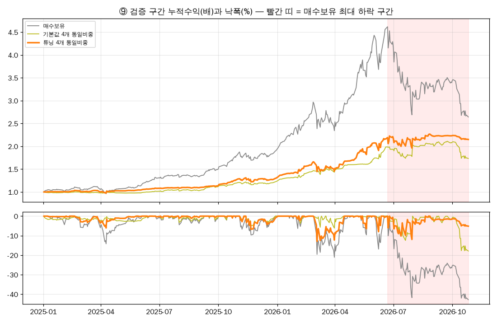

**검증 구간은 「쉬운 강세장」이 아니었습니다.**

| 항목 | 2001–2024 | 2025-01 ~ 2026-10 |
| --- | --- | --- |
| 연환산 실현변동성 | 23.1% (평균) | **46.6%** |
| 하루 ±3% 넘게 움직인 날 | 연평균 11.8일 | **92일** (22개월) |
| 연도별 변동성 순위 (26개 해 중) | 2008년 40.7% (2위) | **2026년 64.6% (1위)**, 2025년 23.3% (11위) |

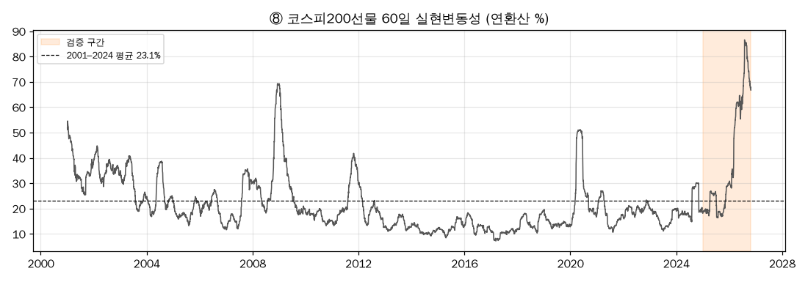

2026-06-22 → 2026-10-26 매수보유 **−42.8%** 하락 구간의 수익률: 튜닝 동일비중 **−1.9%**, 기본값 동일비중 −12.7%, S1 −42.8%, S2 −20.5%, **S3 +84.4%**, S4 −1.9%.

### 6-3. 전략별 결과

**검증 구간 2025-01-02 ~ 2026-10-26 (튜닝 1위)**

| | 누적 | CAGR | 변동성 | 샤프 | 최대 낙폭 | 보유 비율 | 거래 / 승률 | 비용 합(%p) |
| --- | --- | --- | --- | --- | --- | --- | --- | --- |
| S1 시계열 모멘텀 | +147.4% | 68.0% | 45.5% | 1.37 | −42.8% | 81.8% | 1건 (보유 중) | 0.1 |
| S2 변동성 관리 | +157.9% | 72.0% | 25.1% | **2.29** | −20.5% | 100% | – | 0.1 |
| S3 일중 레인지 반전 | +71.0% | 36.0% | 46.5% | 0.89 | −44.0% | 100% | – | 2.6 |
| S4 RSI 눌림목 | +53.3% | 27.7% | 25.9% | 1.07 | −20.9% | 17.5% | 19 / 84.2% | 0.4 |
| **4개 동일비중** | **+115.0%** | **55.0%** | **26.0%** | **1.82** | **−12.9%** | – | – | – |
| 매수보유 | +164.3% | 74.5% | 46.6% | 1.43 | −42.8% | 100% | – | – |

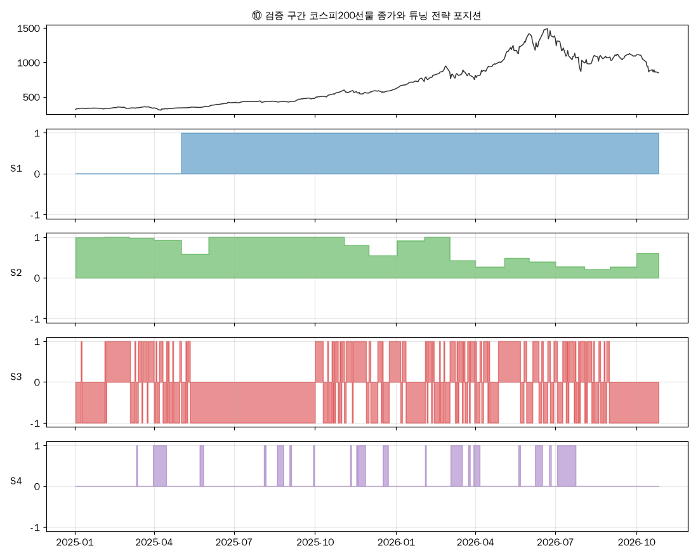

검증 구간 일수익률 상관: S1–S2 0.82, S1–S4 0.54, S2–S4 0.48, S3 와 나머지 0.12~0.22. 학습 구간보다 S1·S2·S4 끼리의 상관이 높아졌고(모두 롱 위주), 낮게 남은 건 S3 뿐입니다.

**학습 구간 2001–2024 (기본값 → 튜닝)**

| 전략 | 기본값 샤프 | 튜닝 숫자 | 튜닝 CAGR | 튜닝 변동성 | 튜닝 샤프 | 튜닝 최대 낙폭 | 거래 / 승률 | 비용 합(%p) |
| --- | --- | --- | --- | --- | --- | --- | --- | --- |
| S1 | 0.24 | 5개월, 롱/현금 | 6.76% | 15.7% | 0.50 | −33.1% | 28 / 53.6% | 4.7 |
| S2 | 0.40 | 22일, 상한 1, 표준편차 | 6.78% | 21.1% | 0.42 | −46.9% | – | 5.5 |
| S3 | 0.13 | delta 20, decay 1, 조건 켬 | 5.05% | 23.6% | 0.33 | −67.9% | 1,484 / 54.7% | **87.0** |
| S4 | 0.34 | RSI3 < 30, SMA100, 청산 SMA10 | 5.70% | 10.3% | 0.59 | −20.6% | 221 / 75.1% | 13.6 |
| **4개 동일비중** | 0.44 | – | 7.13% | 11.9% | **0.64** | −26.2% | – | – |

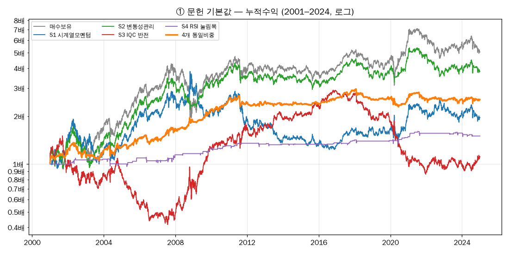
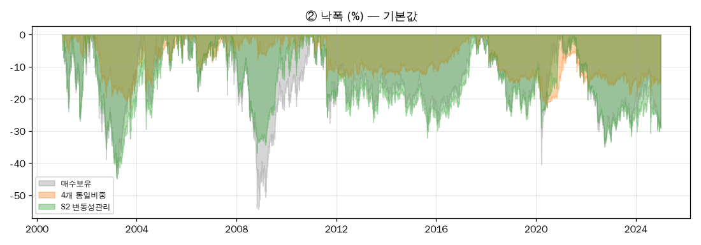
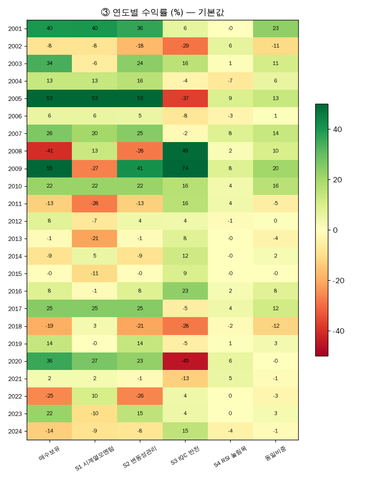
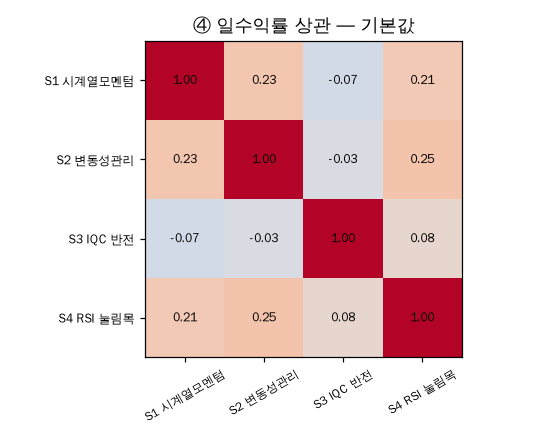
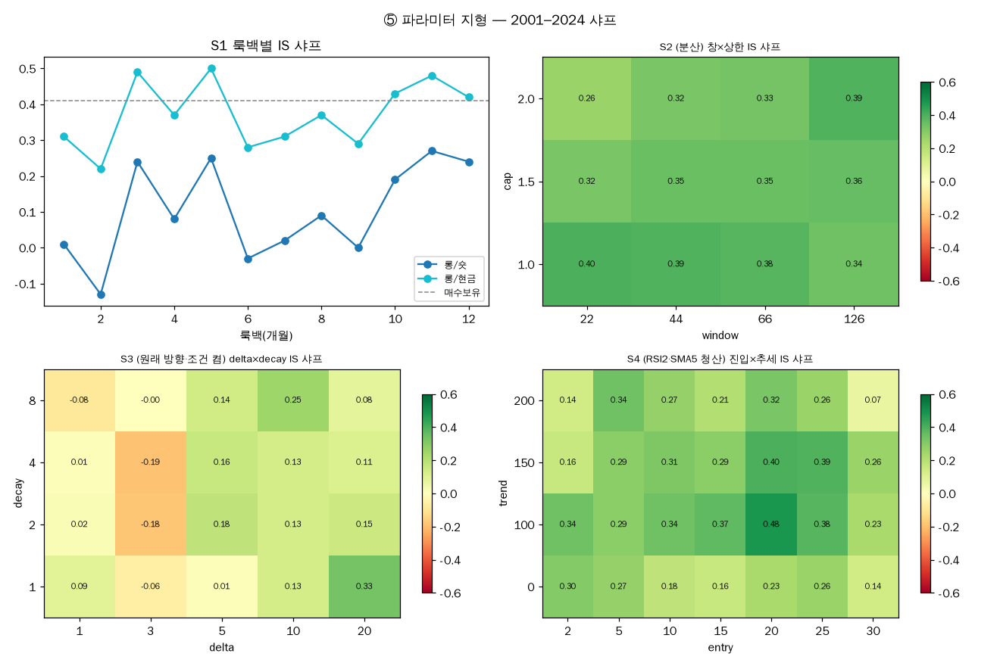
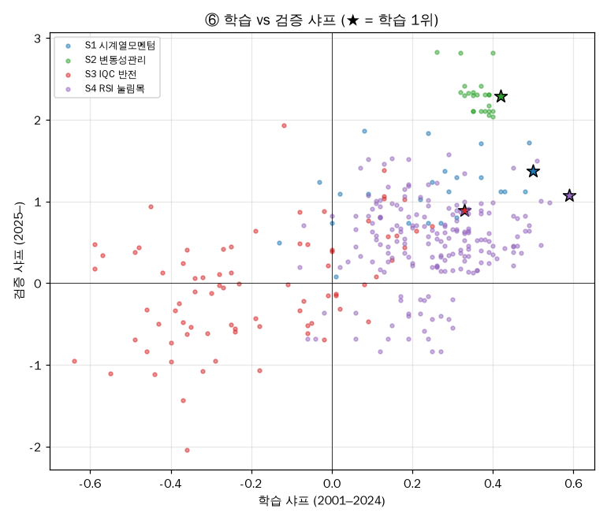
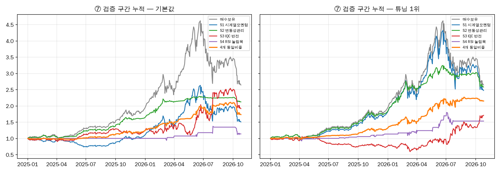

<details>
<summary><b>S4 검증 구간 거래 19건</b> — 승 16 / 패 3, 승률 84.2% (다음 거래일 시가 기준)</summary>

| # | 진입일 | 청산일 | 수익률 |
| --- | --- | --- | --- |
| 1 | 2025-03-12 | 2025-03-13 | +1.89% |
| 2 | 2025-03-31 | 2025-04-15 | −3.63% |
| 3 | 2025-05-23 | 2025-05-27 | +1.79% |
| 4 | 2025-08-04 | 2025-08-06 | +2.69% |
| 5 | 2025-08-19 | 2025-08-26 | +0.72% |
| 6 | 2025-09-02 | 2025-09-04 | +1.24% |
| 7 | 2025-09-29 | 2025-09-30 | +1.26% |
| 8 | 2025-11-10 | 2025-11-11 | +2.67% |
| 9 | 2025-11-17 | 2025-11-18 | +0.49% |
| 10 | 2025-11-19 | 2025-11-27 | +0.53% |
| 11 | 2025-12-17 | 2025-12-23 | +2.95% |
| 12 | 2026-02-03 | 2026-02-04 | +3.80% |
| 13 | 2026-03-04 | 2026-03-17 | +0.55% |
| 14 | 2026-03-24 | 2026-03-26 | −0.47% |
| 15 | 2026-03-30 | 2026-04-06 | +4.27% |
| 16 | 2026-05-20 | 2026-05-22 | +7.26% |
| 17 | 2026-06-08 | 2026-06-16 | +14.36% |
| 18 | 2026-06-24 | 2026-06-26 | +8.79% |
| 19 | 2026-07-03 | 2026-07-24 | −8.40% |

2026-07-24 이후로는 종가가 SMA100 아래라 진입하지 않았습니다.

</details>

### 6-4. 리스크 레이어 전후 (강민영)

> 근거 파일: `results/risk_layer_summary.json`(표 전부), `risk_layer_daily.csv`(날마다 ①②③ 노출·결정 규칙·전후 수익), `risk_lag_check.json`.
> 환경은 6-2절과 같은 과거 데이터 백테스트이고, 노출 변경마다 1틱 + 수수료를 뺐습니다. 「원안」은 6-2절 튜닝 4개 동일비중과 같은 수익률입니다.

**성과 — 학습 24년과 검증 22개월**

| 구성 | 학습 누적 | 학습 변동성 | 학습 샤프 | 학습 낙폭 | 검증 누적 | 검증 변동성 | 검증 샤프 | 검증 낙폭 |
| --- | --- | --- | --- | --- | --- | --- | --- | --- |
| 원안 (노출 1) | +405% | 11.9% | **0.64** | −26.2% | +115.0% | 26.0% | 1.82 | −12.9% |
| ① 변동성 타깃만 | +213% | 8.8% | 0.60 | −19.1% | +54.1% | 10.3% | 2.45 | −5.8% |
| ② 낙폭 한도만 | +301% | 11.2% | 0.58 | −21.7% | +115.0% | 26.0% | 1.82 | −12.9% |
| ③ ES 한도만 | +171% | 8.5% | 0.54 | −19.0% | +45.3% | 9.1% | 2.39 | −5.4% |
| **①+②+③** | +168% | 8.2% | 0.55 | **−18.4%** | +45.6% | 9.0% | **2.43** | **−5.4%** |
| 매수보유 | +405% | 23.1% | 0.41 | −54.3% | +164.3% | 46.6% | 1.43 | −42.8% |

**핵심: 24년 내내 손실은 줄였지만 샤프는 올리지 않았습니다.** 학습 구간 샤프는 0.64 → 0.55 로 내려갔고, 검증 구간 샤프 상승(1.82 → 2.43)은 그 구간이 유난히 거칠었기 때문입니다(7-3절).

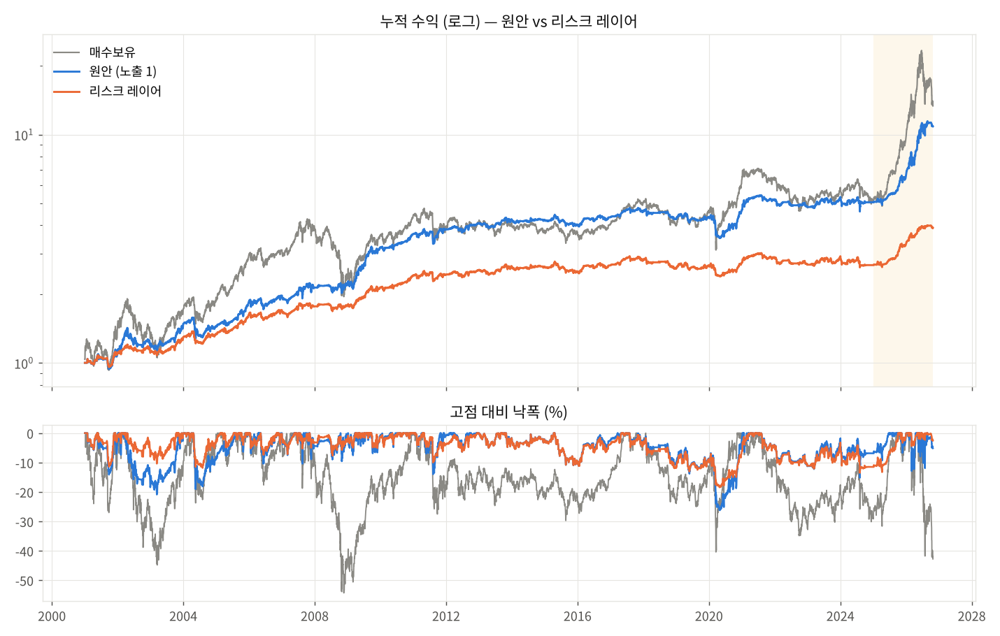

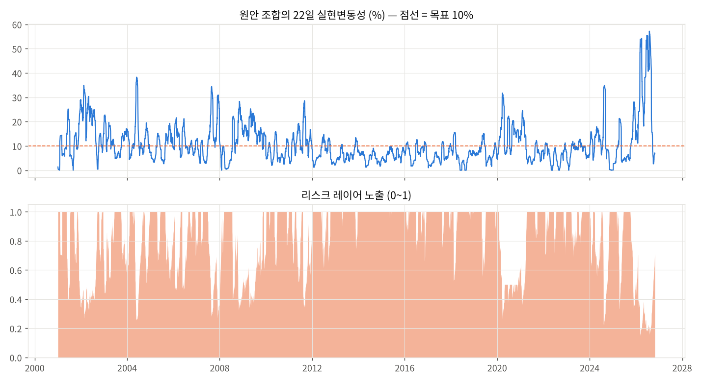

**어느 브레이크가 노출을 정했나**

| | ③ ES 한도 | ① 변동성 타깃 | ② 낙폭 한도 | 브레이크 없음 (노출 1) | 평균 노출 |
| --- | --- | --- | --- | --- | --- |
| 학습 (5,926일) | 29% | 19% | 1% | 51% | 0.84 |
| 검증 (440일) | 58% | 16% | 0% | 26% | 0.59 |

- ② 낙폭 한도가 24년 중 실제로 작동한 건 **2020년 한 번**입니다. 그림자 곡선이 2020-04-29 에 −18.4% 까지 빠져 ½선 아래 37일 동안 노출을 반으로 줄였다가 회복 후 풀었습니다.
- 연평균 노출은 조용한 2013–2017 에 0.95~1.0, 거친 2026년에 0.32 였습니다.

**위기 구간 — 여기서 브레이크가 일합니다**

| 구간 | 매수보유 | 원안 수익 / 낙폭 | 레이어 수익 / 낙폭 | 평균 노출 |
| --- | --- | --- | --- | --- |
| 2002-04 ~ 2003-03 IT 버블 후 | −39.8% | −12.0% / −20.9% | **−5.4% / −10.4%** | 0.63 |
| 2008 금융위기 | −40.6% | +2.5% / −9.6% | +0.3% / −7.1% | 0.73 |
| 2011 하반기 유럽위기 | −13.1% | +4.4% / −11.8% | −0.6% / −8.8% | 0.67 |
| 2020-02 ~ 04 코로나 | −8.9% | −17.0% / −20.2% | **−8.2% / −11.0%** | 0.51 |
| 2026-06 ~ 10 검증 급락 | −42.2% | −0.4% / −11.9% | −1.2% / **−2.6%** | 0.32 |

- 원안이 잃은 위기(2002, 2020)에서는 손실을 절반으로 줄였습니다.
- 원안이 버틴 위기(2008, 2011)에서는 수익을 2~5%p 깎았습니다. 그래도 낙폭은 줄었습니다.
- 다섯 번 모두 낙폭은 줄었습니다.

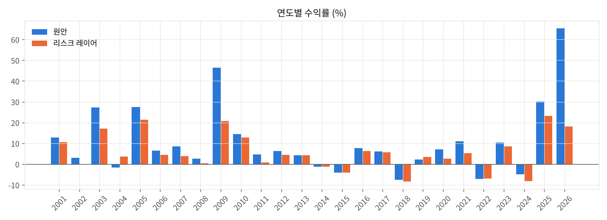

**위험 측정과 VaR 사후검증** (VaR95 사후검증 = 굴러가는 250일 VaR 로 다음 날을 예측해 초과 횟수가 5% 에 맞는지, Kupiec 검정)

| | 원안 | 레이어 후 |
| --- | --- | --- |
| VaR95 (하루, 검증) | 1.97% | 0.76% |
| ES97.5 (최악 2.5% 날 평균 손실, 검증) | 5.02% | 1.62% |
| 초과첨도 (검증) | 9.8 | 6.2 |
| 최악 하루 (검증) | −8.67% | −2.69% |
| 사후검증 — 과거분포 VaR, 학습 (기대 284회) | 323회, p=0.02 **실패** | 315회, p=0.06 통과 |
| 사후검증 — 과거분포 VaR, 검증 (기대 10회) | 20회, p=0.00 **실패** | 8회, p=0.61 통과 |
| 사후검증 — FHS VaR, 학습 | 301회, p=0.28 통과 | 303회, p=0.23 통과 |
| 사후검증 — FHS VaR, 검증 | 7회, p=0.39 통과 | 10회, p=0.86 통과 |

과거분포 VaR 은 원안의 위험을 24년과 검증 구간 모두에서 과소평가했고, FHS 는 통과했습니다. ③ ES 한도에 FHS 를 쓴 근거입니다.

**전략별 효과 — 검증 구간** (그날의 공통 노출을 각 전략에 곱해 따로 계산)

| 전략 | 샤프 원안 → 후 | 최대낙폭 원안 → 후 | 학습 샤프 원안 → 후 |
| --- | --- | --- | --- |
| S1 시계열 모멘텀 | 1.37 → 2.09 | −42.8% → −17.8% | 0.50 → 0.40 |
| S2 변동성 관리 | 2.29 → 2.39 | −20.5% → −10.8% | 0.42 → 0.35 |
| S4 RSI 눌림목 | 1.07 → 1.20 | −20.9% → −7.2% | 0.59 → 0.53 |
| S3 일중 레인지 반전 | 0.89 → **0.27** | −44.0% → −29.8% | 0.33 → 0.24 |

**선물 고유 위험 — 검증 구간** (가정: 위탁증거금률 21% KRX 2026-08-03 조정, 유지증거금률 14% 가정, 승수 25만원)

| | 원안 | 레이어 후 |
| --- | --- | --- |
| 자본 7,973만원(1계약 명목)일 때 최악 하루 | −1,094만원 | −290만원 |
| 같은 자본에서 자본 ÷ 위탁증거금 최저 | 2.73배 | 3.94배 |
| 자본 2,392만원(명목 30%)일 때 위 비율 최저 | **0.82배** — 증거금보다 자본이 적은 날 발생 | 1.18배 |
| 밤사이 갭 ES97.5 | 3.59% | 1.05% |
| 급변일(73일) 슬리피지 5틱 가정 시 샤프 | 1.81 | 2.41 |

**민감도.** 변동성 목표 4 × ES 한도 3 × 낙폭선 3 = 36가지로 바꿔 돌려도 36가지 모두 정상 계산됐고(영구 정지 0), 검증 샤프 2.12~2.59, 검증 낙폭 −3.5~−7.0% 였습니다. 결과가 특정 숫자에 기대지 않습니다.

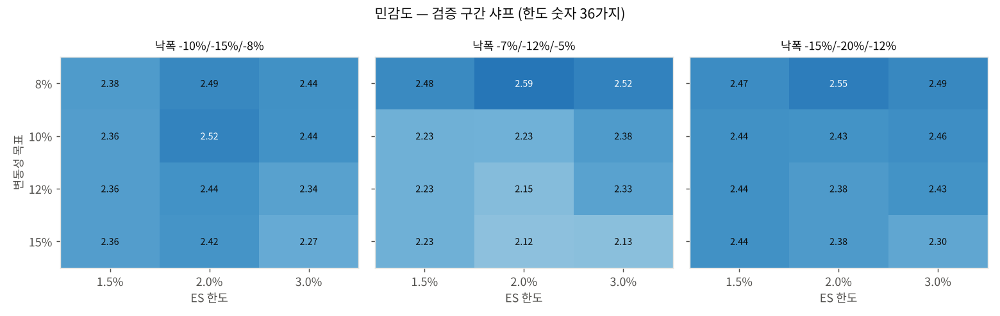

### 6-5. 앱 백테스트와 앱 시뮬레이션

> 실행 환경: **앱 백테스트(`bar-v1`) + 앱 시뮬레이션(종이 체결)**. 계좌 주문 없음, 모의계좌 체결 아님.
> 앱 백테스트: 2026-10-29 20:44 실행. 앱 시뮬레이션: 2026-10-30 (국내 주간) — 캡처·기록 추가 후 채웁니다.

| 실행 | 설정 | 목적 | 실행 전 예상 |
| --- | --- | --- | --- |
| ① S4 | [strategy.json](strategy.json) | 앱이 같은 규칙을 같은 봉에서 판정하는지 | 15:45 마감 판정 1번, **주문 0건** |
| ② 동작 확인용 | [strategy_check.json](strategy_check.json) | 주문 → 체결 → 청산(규칙·손절·세션 끝) 흐름 | 장중 진입 최대 3번 |

**① S4 가 주문 0건일 까닭.** 2026-10-26 종가 850.00 이 SMA(100) 1,123.93 보다 한참 아래라 진입 조건 「종가 > MA(100)」이 거짓입니다(RSI(3) 28.21 은 조건 충족). 추세 기준을 SMA150(1,081)·SMA200(1,004)으로 바꿔도 거짓이라, 숫자를 바꿔 주문을 만들지 않았습니다. 또 일봉 신호의 주문은 다음 거래 창에 나가므로, 금요일 신호가 있었더라도 체결은 월요일입니다.

**앱 백테스트 결과** (`bar-v1`: 신호 다음 세션 첫 체결, 슬리피지 1틱, 계약당 수수료 3,081원, 1계약)

| | ① S4 (일봉) | ② 동작 확인용 (5분봉) |
| --- | --- | --- |
| 봉 | 12월물 일봉 496개 (2024-10-15 ~ 2026-10-28, 준비 200) | 5분봉 562개, 7세션 (2026-10-21 ~ 10-29) |
| 거래 | 17건 (승 13 · 패 4) | 21건 (승 14 · 패 7) — 하루 정확히 3건, 상한 작동 |
| 청산 사유 | 규칙 17 | 규칙 14 · 손절 7 |
| 손익 (1계약, 수수료 뒤) | +82,945,246원 | +8,158,098원 |
| 최대 낙폭 | 23,756,162원 | 1,755,986원 |

②의 손익은 **전략 성과가 아닙니다**(3-4절) — 하루 상한·손절·청산 경로가 앱에서 그대로 작동하는지만 봅니다.

**앱 S4 거래가 우리 규칙과 같은가** (`results/app_backtest_compare.json`)

| 맞댄 Python 백테스트 | Python 거래 | 진입일 같음 | 진입·청산일 모두 같음 |
| --- | --- | --- | --- |
| 같은 데이터 — 12월물 한 종목 일봉 | 18 | **17 / 17** | **16 / 17** |
| 다른 데이터 — 연결 수정가 (6-3절) | 19 | 8 / 17 | 2 / 17 |

- **같은 데이터로는 앱과 우리 규칙이 사실상 같습니다.** 다른 1건(2025-05-21 진입)은 앱이 **진입한 봉에서는 청산을 판정하지 않기** 때문입니다. Python 은 진입 당일 종가에 청산 조건이 맞아 다음 날(05-22) 나갔다가 05-26 에 다시 들어갔고, 앱은 05-28 까지 들고 있었습니다.
- **연결 수정가와 어긋난 건 데이터 차이입니다.** 12월물은 2026-09 만기 전까지 근월물이 아니라 거래가 적고 베이시스가 달라, MA(10)·RSI(3) 가 넘는 날이 하루 이틀씩 다릅니다. 실전에서 쓰려면 앱이 쓰는 「그 월물의 일봉」 기준으로 다시 검증해야 합니다(8-3절).

**앱 화면 (2026-10-29 20:51, 실행 전 설정과 백테스트).** 상단 「실전 · 시세 연결됨」, 연결 계좌 없음. 화면의 백테스트는 계약당 수수료 0원이라 위 표(3,081원)보다 손익이 체결 수 × 3,081원만큼 큽니다 — S4 +83,050,000원(체결 34), 확인용 +8,287,500원(체결 42).

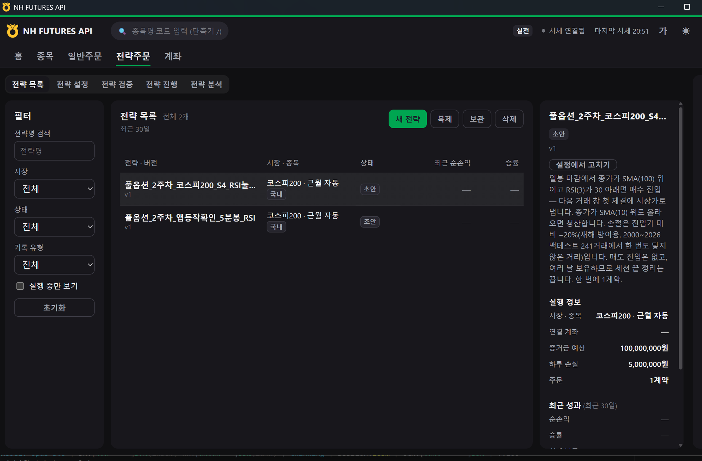

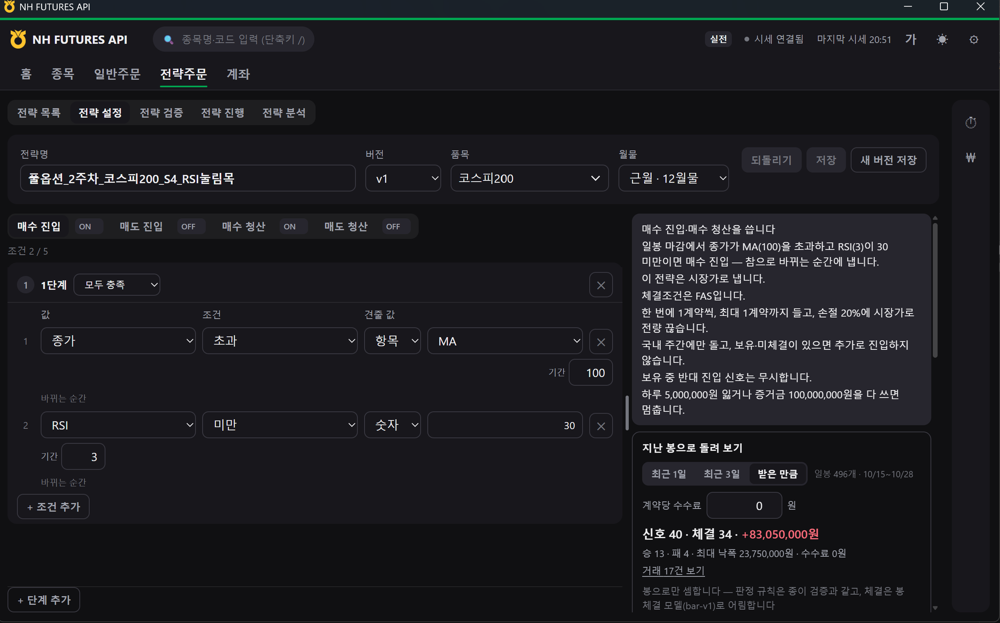

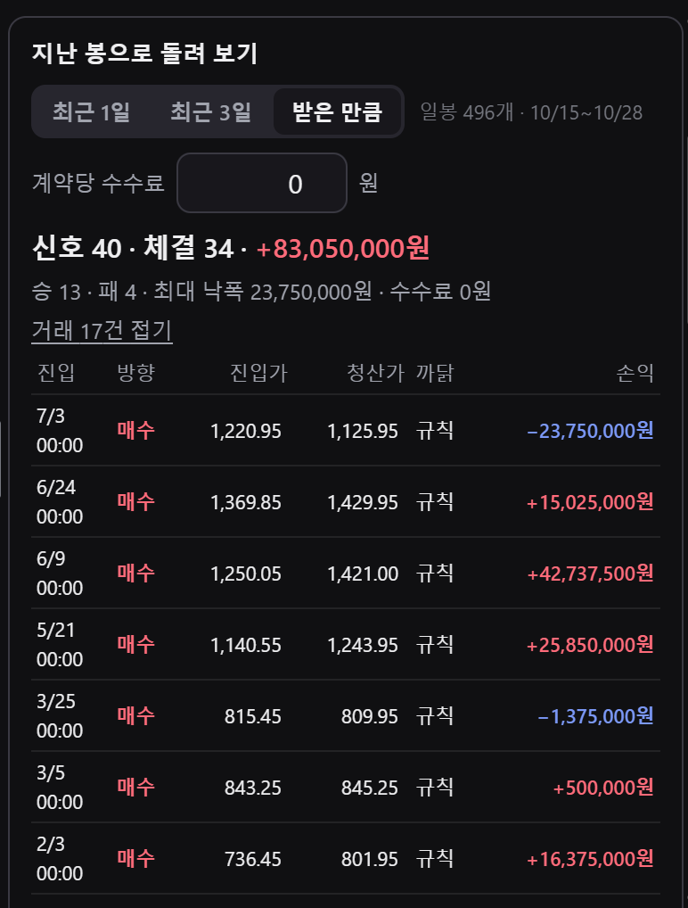

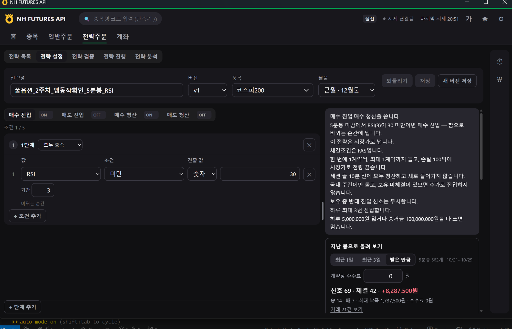

| 캡처 | 내용 |
| --- | --- |
| [04](screenshots/04-S4-매수청산.png) | S4 매수 청산 `종가 > MA(10)` |
| [05a](screenshots/05a-S4-조건평가-주문방식.png) · [05b](screenshots/05b-S4-청산수량.png) · [05c](screenshots/05c-S4-실행필터.png) · [05d](screenshots/05d-S4-위험한도.png) | S4 보조 설정 — 일봉·마감, 시장가·FAS, 손절 20%, 세션 끝 정리 꺼짐, 국내 주간, 하루 손실 500만원 |
| [10b](screenshots/10b-S4-백테스트-거래목록.png) · [10c](screenshots/10c-S4-백테스트-거래목록-가정.png) | S4 백테스트 거래 17건 나머지, bar-v1 가정 |
| [07](screenshots/07-확인용-매수청산-백테스트가정.png) | 확인용 매수 청산, 백테스트 가정 |
| [08a](screenshots/08a-확인용-조건평가-주문방식.png) · [08b](screenshots/08b-확인용-청산수량.png) · [08c](screenshots/08c-확인용-실행필터.png) · [08d](screenshots/08d-확인용-위험한도.png) | 확인용 보조 설정 — 5분봉·마감, 손절 100틱, 세션 끝 10분 전, 하루 최대 진입 3번 |

| 확인할 것 (앱 시뮬레이션) | 근거 파일 / 캡처 |
| --- | --- |
| ① 15:45 일봉 마감 판정과 그때의 MA(100)·RSI(3) 값, 진입 안 한 까닭 | `results/journal_*.jsonl`, `screenshots/` |
| ② 진입·체결 가격, 청산 사유(규칙·손절·세션 끝), 하루 3번 상한 작동 | `results/journal_*.jsonl`, `screenshots/` |

## 7. 해석과 한계

### 7-1. 4전략 조합이 의미 있다고 보는 근거

1. **극단적 변동성 국면에서 확인했습니다.** 검증 구간 변동성(46.6%)은 학습 평균의 2배이고, 2026년(64.6%)은 26년 중 1위입니다. 이 구간에서 샤프 1.82, 최대 낙폭 −12.9% 였습니다.
2. **급락 세 번을 버텼습니다.** 매수보유가 −20% 넘게 빠진 2026-03·07·10 에 각각 −12.0%·−1.9%·−3.6% 였습니다.
3. **학습 구간에서도 같은 성질이었습니다.** 매수보유와 같은 CAGR 을 변동성·낙폭 절반으로 냈습니다.
4. **기본값 조합도 방향이 같았습니다** (검증 샤프 1.53, 최대 낙폭 −17.9%). 튜닝이 아니라 「섞는 것」 자체가 효과의 큰 몫입니다.

### 7-2. 4전략 조합의 한계

1. **급락 방어는 대부분 S3 덕분입니다.** 06-22 → 10-26 구간에서 S3 가 +84.4% 였고 나머지 셋은 −1.9% ~ −42.8% 였습니다. S3 는 학습 샤프 0.33 에 비용 87%p 로 근거가 가장 약했습니다.
2. **S1 튜닝은 검증 구간에서 사실상 매수보유였습니다.** 2025-05-02 진입 후 한 번도 나가지 않았고 최대 낙폭도 −42.8% 로 같습니다.
3. **S2 는 튜닝이 오히려 나빴습니다.** 문헌 기본값(분산)의 검증 샤프가 2.82 로 튜닝 1위(2.29)보다 높고 낙폭도 절반입니다.
4. **학습 순위와 검증 순위의 상관**은 S1 0.47, S3 0.45, S4 0.05, S2 −0.49 입니다. 튜닝 순위가 검증에서도 이어진 건 S1·S3 정도입니다.
5. **다중검정과 표본 크기**: 380개 조합 중 1위를 골랐고, 검증 구간은 22개월, S4 검증 거래는 19건뿐입니다.
6. **검증 결과를 보고 숫자를 다시 고르지 않았습니다.** 다시 고르면 그때부터 이 구간도 학습 구간이 됩니다.

### 7-3. 리스크 레이어 해석과 한계

1. **「더 버는 장치」가 아니라 「덜 잃는 장치」입니다.** 24년 학습 구간에서 최대낙폭 −26.2% → −18.4%, 위기 다섯 번 모두 낙폭이 줄었지만, 샤프는 0.64 → 0.55 로 내려갔습니다. 검증 구간 샤프 상승(1.82 → 2.43)은 26년 중 가장 거친 구간이라 생긴 것이고 24년에서는 재현되지 않습니다.
2. **샤프가 내려간 곳은 조용한 횡보기입니다.** 2001–2010 은 원안 0.99 → 레이어 1.02 로 비슷했지만, 2011–2024 는 원안도 거의 못 번 구간(+38%)에서 노출을 줄였다 늘렸다 하며 반등을 놓쳐 0.29 → 0.14 가 됐습니다.
3. **변동성이 준 것 자체는 기계적입니다.** 노출을 곱하면 손익과 변동성이 같은 비율로 줄어듭니다(검증 평균 노출 0.59). 위험 지표가 좋아진 걸 「전략이 좋아졌다」로 읽으면 안 됩니다.
4. **원안의 위험 숫자는 틀려 있었습니다.** 과거분포 VaR95 가 학습(323 대 기대 284)과 검증(20 대 기대 10) 모두 사후검증에 실패했습니다. FHS 는 둘 다 통과했습니다. 선물은 증거금 거래라 위험 숫자가 틀리면 그대로 추가증거금·강제 청산으로 이어집니다.
5. **실행 시점 점검.** 코드는 전날 종가까지의 정보로 정한 노출을 오늘 수익 **전체**(밤사이 갭 포함)에 곱합니다. 실제로는 다음 날 시가에 바꾸므로 노출을 하루 늦게 곱해 봤습니다 (`risk_lag_check.py`):

   | 검증 구간 | 샤프 | 최대낙폭 | 최악 하루 |
   | --- | --- | --- | --- |
   | 레이어 (그날 적용) | 2.43 | −5.4% | −2.69% |
   | 레이어 (하루 늦게) | 2.41 | −5.2% | **−3.39%** |

   샤프·낙폭은 그대로라 결론은 실행 시점 가정에 기대지 않습니다. 다만 **최악 하루와 밤사이 갭 감소는 일부 과대평가**입니다 — 급락 첫날의 갭은 줄이기 전 노출로 맞습니다. 학습 구간도 최악 하루가 −3.92% → −5.48% 로 같은 방향입니다.
6. **22일 창이라 급락 첫날은 못 막습니다.** 브레이크는 거칠어진 **뒤에** 걸립니다.
7. **S3 와는 맞지 않지만, S3 만 빼는 안은 기각했습니다.** 검증 구간에서 S3 는 샤프 0.89 → 0.27 로 크게 손해를 봤습니다(거친 장 되돌림에서 버는데 그때 브레이크가 줄임). 그래서 「S3 는 브레이크에서 빼자」를 검토했지만, 24년에서는 학습 샤프 같음(0.55), 학습 낙폭 더 깊음(−23.5%), 검증 샤프 더 낮음(1.75)이었습니다. 검증 구간만 보고 낸 아이디어가 학습 구간에서 맞지 않았습니다.
8. **v1 의 영구 정지 결함이 실제로 일어났습니다.** 판단값(낙폭 −15% 에서 정지, 실제 계좌로 측정)으로 돌리면 2020-03-17 코로나 급락 때 멈춘 뒤 2026-10-26 까지 1,620일 동안 다시 켜지지 않아 검증 수익이 0% 입니다. v2(그림자 곡선)로 고쳤습니다(8-2절).

**팀 판단.** 최대 수익·샤프가 목표면 레이어를 쓰지 않는 게 낫고, 큰 손실 회피·증거금 안전·위험 숫자의 정확성이 목표면 씁니다. 선물은 큰 손실이 곧 강제 청산이라 **쓰는 쪽**을 제안하되, 「샤프가 오른다」가 아니라 「손실을 줄인다」로 설명합니다.

### 7-4. 백테스트 가정의 한계

- **체결**: 다음 날 시가 + 1틱 고정입니다. 2026년처럼 갭이 큰 날에는 실제 체결이 더 나쁠 수 있습니다.
- **소수 비중**: S2·조합·리스크 레이어는 소수 비중입니다. 코스피200 선물 1계약(명목 약 2.1억원)으로는 불가능하고 미니선물로 쪼개야 합니다. 리스크 레이어를 미니선물 정수 계약으로 반올림하면(검증 구간) 자본 7,973만원에서 평균 0.6계약·노출 0인 날 249일, 자본 2,392만원에서는 평균 0.1계약·노출 0인 날 387일이라 사실상 레이어가 「켜고 끄기」가 됩니다 (`risk_layer_summary.json` `정수계약`).
- **수수료**: KRX 유관기관 비용이 NH 수수료에 포함되는지 확인하지 못했습니다. 비용의 대부분은 슬리피지입니다.
- **S4 체결**: Connors 원 규칙은 당일 종가 체결이고, 여기서는 다음 날 시가로 체결했습니다.
- **앱 vs 백테스트 데이터**: 백테스트는 롤오버 수정 연결가로 지표를 계산하고, 앱은 12월물 한 종목의 일봉으로 계산합니다. 근월물이 되기 전의 12월물 가격은 거래가 적고 베이시스가 달라, 실제로 앱 S4 거래 17건 중 연결 수정가 백테스트와 같은 날 진입한 건 8건뿐이었습니다(같은 12월물 데이터로는 17건 모두 같은 날 진입, 6-5절).
- **룩어헤드 점검**: 일부러 내일 수익률 부호를 쓰게 하면 샤프가 7.0 으로 튑니다. 파이프라인이 미래 정보에 민감하게 반응한다는 뜻이고, 실제 전략은 그 정보를 쓰지 않습니다.

## 8. 오류 제보·개선·향후 계획

### 8-1. 오류 제보 (API 사용 중 실제로 겪은 것)

| 관찰 | 재현 | 결과 | 대응 |
| --- | --- | --- | --- |
| 만기수정 연결(`fut_cidx_exp_mod=1`)이 분기 롤오버를 대부분 반영하지 않음 | `국내_차트(일)` `A016C000`, `cidx_yn=1`, 2014-07 ~ 2026-10 | 「수정가 − 원시가」 차이가 12년 동안 4번만 바뀜 (2021-01-04, 2022-03-11, 06-10, 09-13). 분기 롤오버는 49번 | `diff_rt` 로 직접 수정가 생성 (4-3절). **운영진 확인 요청** |
| `nxt_key` 로 이어받으면 같은 구간이 다시 옴 | 응답의 `nxt_key=20140731` 을 그대로 넣어 재요청 | 같은 3000건 반복 | 조회 종료일을 당겨 가며 받음 |
| 모의 키로 국내 차트 조회 불가 | 모의 서버(`apidemo`)에 모의 키로 `국내_차트(일)`·`국내_차트(분)` `A016C000` | HTTP 403 「호출 권한이 없는 API입니다. 필요한 권한은 [국내 시세조회] 중 하나가 있어야 합니다」 (2026-10-29 20:44). 같은 요청을 실전 키로는 정상 | 앱 접속 환경을 실전투자로 두고 앱 시뮬레이션만 사용. 모의 키 권한 추가는 HTS [6128] 에서 신청 예정 |
| 앱을 키 없이 켜면 백테스트 불가 | 키 입력 전 켠 앱에서 백테스트 | HTTP 400 「그 종목의 틱 크기를 몰라 셈할 수 없습니다」 — 세션 표 출처가 `table`(내장) | 앱 재시작 후 출처 `api:real`, 백테스트 정상. 운영진 안내에 「키 입력 후 재시작」 추가 제안 |
| 조회 종료일 당일이 응답에 포함되지 않음 | `inq_ed_dt=20140731` | 마지막 행 20140730 | 구간을 이을 때 겹침 없이 이어 붙임 |

### 8-2. 개발 중 고친 것

| 문제 | 원인 | 수정 |
| --- | --- | --- |
| S3 가 원식과 다르게 동작 | `trade_when` 조건이 거짓일 때 0으로 청산하게 짬. 원식은 직전 값 유지 | 직전 포지션 유지로 수정 (학습 샤프 0.00 → 0.13) |
| S3 튜닝에서 80개 중 56개 조합이 빠짐 | 「거래 30건 미만 제외」가 늘 보유하는 조합을 거래 0건으로 셈 | 조건을 S4 에만 적용 |
| 롤오버 감지가 12년 4번 | NH 만기수정 연결에 의존 | `diff_rt` 방식으로 교체, 107번 감지 |
| 리스크 레이어 v1 이 2020-03-17 에 멈춘 뒤 1,620일 동안 안 켜짐 | 낙폭을 실제 계좌로 재서, 노출 0 이면 계좌가 회복할 수 없어 낙폭이 영영 안 줄어듦 | v2: ①+③만 적용한 그림자 자산곡선으로 낙폭을 잼. 한도 숫자도 판단값 → 학습 구간 계산값으로 |
| 앱 저장 시 손절 칸이 비면 저장 불가 | 앱 검증 규칙상 손절 거리는 필수 | 과거 최대 역행(−19.28%) 밖인 −20% 로 둠 (3-4절) |

### 8-3. 개선 방향과 향후 계획

| 확인한 문제 | 다음에 할 것 |
| --- | --- |
| 급락 방어가 S3 하나에 쏠림 | 전략별 위험 기여 균등화(역변동성 비중), S3 없는 3개 조합과 비교 |
| S1 이 급락 중에도 롱 유지 | 5개월 신호에 S2 식 변동성 비중 곱하기 |
| 리스크 레이어가 횡보기(2011–2024)에 샤프를 깎음 | 노출 변경에 문턱(예: 0.1 이상 바뀔 때만)을 둬 잦은 줄였다 늘렸다를 줄이고, 학습 구간에서 비교 |
| 리스크 레이어의 최악 하루 감소가 실행 시점에 기댐 | 노출 변경을 다음 날 시가 체결로 바꿔 다시 계산 (`risk_lag_check.py` 를 본 계산에 반영) |
| 튜닝 숫자의 안정성 | 5년 학습 → 1년 검증을 굴리는 워크포워드 |
| 앱은 월물 한 종목 일봉, 백테스트는 연결 수정가 — 같은 S4 가 17건 중 8건만 같은 날 진입 | 연결 수정가로 고른 숫자를 월물 일봉으로도 학습 구간에서 확인하거나, 앱 실행 전 지표 값을 연결 수정가로 계산해 넣는 방식 검토 |
| 소수 비중 | 미니코스피200 선물 계약 수로 반올림해 다시 계산 |
| 모의계좌 주문 없음 | 미니선물 계약 수로 바꿔 모의계좌 주문 접수·체결을 실제 응답으로 확인 (6주차 주문·위험관리와 연결) |

인증정보와 계좌 식별정보는 이 문서와 결과 파일 어디에도 담지 않았습니다.

## 출처

- Moreira, A. & Muir, T. (2017). Volatility-Managed Portfolios. *Journal of Finance* — [PDF](https://amoreira2.github.io/alan-moreira.github.io/VolPortfolios_published.pdf)
- Moskowitz, T., Ooi, Y. H. & Pedersen, L. H. (2012). Time Series Momentum. *JFE* — [RePEc](https://econpapers.repec.org/RePEc:eee:jfinec:v:104:y:2012:i:2:p:228-250)
- Connors, L. & Alvarez, C. (2008). *Short Term Trading Strategies That Work*
- Harvey, C. R. 외 (2018). The Impact of Volatility Targeting. *Journal of Portfolio Management*
- Barone-Adesi, G., Giannopoulos, K. & Vosper, L. (1999). VaR without Correlations for Portfolios of Derivative Securities. *Journal of Futures Markets*
- 헤럴드경제 — [NH선물 OPEN API 이벤트 (기존 수수료 0.00145%)](https://www.heraldk.com/article/2025080517071996470)
- NH선물 — [Rest-Api-SDK](https://github.com/NHFutures/Rest-Api-SDK), [NH FUTURES API 앱](https://github.com/PetterChanHyuk/nh-futures-open-api), [제출 예시 2주차](https://github.com/PetterChanHyuk/pioneer-1st-submission-example/blob/main/week02/README.md)
