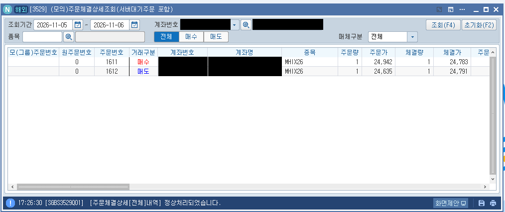

# 3주차 · 해외상품 전략 — 항셍 CBBC 「벽 돌파 되돌리기」

**제출일: 2026/11/06(금) 23:59 까지**

> 이 README 하나가 3주차 보고서입니다.
> **실행 환경을 섞지 않습니다.** 6-1·6-2 는 **과거 데이터 백테스트**(Python, 계좌 주문 없음), 6-3 은 **NH 모의계좌 주문**(11/06 장중) 입니다.
> 수익률은 평가 기준이 아니므로, 이 보고서는 **「왜 이 규칙인가」의 근거와 검증 과정**에 무게를 둡니다. 결과가 마이너스여도 그대로 씁니다.

| 항목 | 내용 |
| --- | --- |
| 전략 이름 | CBBC_벽돌파_되돌리기 (MHI 1계약) |
| 대상 | 신호 = 항셍지수(HSI) 현물, 매매 = 미니 항셍 선물 `MHIX26` (HKEX) |
| 데이터 | HKEX 공개 CBBC 목록·일일거래보고(2020-01 ~), HSI 지수·MHI 선물 1분봉 2020-01 ~ 2026-11 |
| 탐색 / 확인 구간 | 2020-01 ~ 2023-12 / 2024-01 ~ 2026-11 |
| 작성 | 이건준 — CBBC 데이터 수집·가설·백테스트 / 강민영 — 11/06 모의계좌 실행·결과 정리 |
| 작성일 | 2026-11-05 |

## 폴더 구성

| 경로 | 내용 |
| --- | --- |
| `README.md` | 이 보고서 |
| [cbbc_fade.py](cbbc_fade.py) | **장중 실행기** — 아침 CBBC 지도 → 장중 돌파 감지 → 모의계좌 MHI 주문 → `results/<날짜>/` 기록 |
| [backtest_fade.py](backtest_fade.py) | 같은 규칙의 6년 1분봉 백테스트 (입력 데이터는 저장소 밖, 2-3절) |
| [nh_hk_check.py](nh_hk_check.py) | NH 해외 실전 키 항셍 시세 확인 (조회만) |
| [limit_test.py](limit_test.py) | MHI 모의 **지정가** 체결 시험 (11/05) — 시장가 거부 뒤 지정가로 체결되는지 확인, 기록은 `limit_test_log.jsonl` |
| [results/](results/) | 백테스트 집계(`backtest_summary.csv`·`backtest_by_year.csv`), 장중 실행 기록(`<날짜>/`) |
| [screenshots/](screenshots/) | 모의계좌 주문·체결 화면 (계좌 식별정보 가림) |

---

## 1. 과제 요약

**질문:** 홍콩 CBBC(불·베어 증권)는 지수가 **콜 레벨**에 닿으면 즉시 소멸하고, 그 순간 발행사가 헤지로 들고 있던 선물을 정리합니다. 콜 레벨과 물량은 **매일 공개**됩니다. 그렇다면 「CBBC 물량이 몰린 가격대를 뚫는 돌파」는 「아무것도 없는 가격대를 뚫는 돌파」와 다르게 움직일까?

**답 (6년 1분봉):** 다르게 움직입니다. 다만 돈이 될 만큼은 아닙니다.
- CBBC 가 **없는** 가격대를 뚫으면 돌파가 이어집니다 → 되돌리기 매매는 **−7.6pt/거래 (t −4.1)** 로 확실히 잃습니다.
- CBBC 가 **두껍게(300계약↑)** 깔린 가격대를 뚫으면 돌파가 이어지지 않습니다 → 같은 매매가 **+0.5pt/거래 (t 0.2)** 로 본전 근처입니다.
- 두 그룹 차이 약 **8pt** 는 「물량을 다 소화하면 돌파의 연료가 없다」는 가설과 맞는 방향입니다. 하지만 비용(3pt)을 넘는 우위는 확인 구간에서도 유의하지 않습니다.

**이번 주 실행:** 이 규칙을 11/06 HKEX 장중에 **NH 모의계좌**로 실제 주문해, 신호·주문·체결이 끝까지 돌아가는지와 백테스트 가정(진입가·지연)이 실제와 얼마나 다른지 봅니다.

## 2. 실행 방법

### 2-1. 준비 (처음 한 번)

```bash
git clone https://github.com/PetterChanHyuk/nh-futures-open-api     # NH선물 Open API 앱 (API 호출 모듈)
cd nh-futures-open-api
# 앱 README 대로 가상환경·패키지 설치 후
pip install pandas numpy yfinance
```

설정 파일 `%USERPROFILE%\NHFutures\config\config.yaml` (mac/Linux `~/NHFutures/config/config.yaml`):

```yaml
default_environment: paper
paper:
  overseas:
    app_key: (모의 해외 APP Key)        # 주문용 — 필수
    app_secret: (모의 해외 Secret)
real:
  overseas:
    app_key: (실전 해외 APP Key)        # 시세용 — --price nh 쓸 때만
    app_secret: (실전 해외 Secret)
```

> 키·`tokens.json`·`config.yaml` 은 이 저장소에 절대 올리지 않습니다.

### 2-2. 11/06(금) 장중 실행 — 강민영

| KST | 할 일 | 명령 |
| --- | --- | --- |
| 10:00 | 저장소 받기 → `week03` 브랜치 → `week03/` 폴더 | `git fetch && git checkout week03 && git pull` |
| (11/05 완료) | **MHI 모의 체결 시험** — 시장가는 거부, 지정가는 체결 확인 (6-3절). 11/06 엔 생략 가능 | `python limit_test.py --app-dir <앱 폴더>` → `YES` |
| **10:20 전** | **실행기 시작** (지도는 09:20 HKT = 10:20 KST 전에 받아야 정확, 7-3절) | `python cbbc_fade.py --paper-order --app-dir <앱 폴더>` |
| 10:30 ~ 17:00 | 그대로 둠. 30초마다 가격 확인, 신호 나면 자동 주문·30분 뒤 자동 청산 | |
| 17:05 | 자동 종료. `results/20261106/` 확인 | |
| 17:30 | HTS 체결내역 캡처(계좌번호 가림) → `screenshots/`, 6-3절 표 채우기 | |
| ~23:59 | 커밋·푸시 | |

- 노트북이 잠들면 멈춥니다 → 전원 연결, 절전 끄기.
- 중간에 꺼졌으면 **같은 명령으로 다시 켜면 됩니다.** 이미 지난 이벤트는 「늦게 앎」으로 건너뛰고, 열린 포지션은 HTS 에서 직접 청산하세요(실행기는 재시작 전 포지션을 모릅니다).
- 실전 해외 키 시세가 열렸으면(`python nh_hk_check.py` 가 `[성공] HSIX26 현재가`) `--price nh` 를 붙입니다 → 15분 지연이 없어집니다.

### 2-3. 백테스트 재현

```bash
python backtest_fade.py --events <events_grid.csv>
```
`events_grid.csv`(이벤트 12,193건)는 Futu 개인 계정 1분봉에서 만든 파생 데이터라 **공개 저장소에 올리지 않습니다.** 팀 내부 zip 으로 공유합니다. 생성 코드는 이건준 strategy-lab `cbbc/explore.py build`.

### 2-4. 실행기가 하는 일 / 결과 파일

```
[아침] HKEX cbbcFullList.csv  →  HSI CBBC 2,800여 종목  →  50pt 구간별 물량 지도 (map.csv)
[장중 30초마다] HSI 1분봉 (Yahoo ^HSI, 약 15분 지연 / 또는 NH 실전 HSIX26)
   → 09:30 시가 기준 50pt 경계를 그날 처음 뚫었나?           → log.jsonl 「이벤트」
   → 뚫은 구간 물량 ≥ 300 ?  아니면 기록만
   → 포지션 없음 · 25분 안에 알았음 · 청산 16:00 전 ?        → 「모의주문」 MHIX26 지정가 1계약 (반대 방향, 기준가 ±150pt)
   → 이벤트 시각 + 30분                                      → 「청산」 반대 주문
   → 주문 뒤 체결내역 조회                                   → 「체결조회」
```

| 파일 | 내용 |
| --- | --- |
| `results/<날짜>/fulllist_raw.csv` | 그날 받은 HKEX 원본 목록 (재현용) |
| `results/<날짜>/map.csv` | 구간별 물량 (side, bucket, qty) |
| `results/<날짜>/log.jsonl` | 시작·지도·이벤트·주문·체결·청산 한 줄씩 |
| `results/<날짜>/trades.csv` | 거래 요약 — 진입·청산 시각, 지수 기준 가상 손익(비용 3pt 뺌) |

**주문 방식 — 시장가가 아니라 「유리한 지정가」 (11/05 체결 시험 결과).** NH 는 HKEX 상품의 시장가 주문을 받지 않습니다(`7032`, 8-1절). 그래서 실행기는 매수는 기준가 **+150pt**, 매도는 기준가 **−150pt** 지정가로 냅니다. 모의 서버는 API 로는 HKEX 시세를 주지 않지만 **내부 시세로 그 시점 가격에 체결**해 주므로(지정가 24,942 매수 → 24,783 체결), 이 지정가는 사실상 시장가처럼 작동합니다. 150pt 는 Yahoo 지연(약 15분)과 지수·선물 차이를 덮을 만큼의 여유입니다. 기준가를 못 받은 순간에는 주문을 내지 않고 「주문보류」 로 기록합니다.

## 3. 전략과 매매 계획

### 3-1. 대상 상품

| 항목 | 값 |
| --- | --- |
| 매매 종목 | 미니 항셍 지수 선물 `MHIX26` (HKEX, 11월물 — 11/27 만기) |
| 호가 단위 / 승수 | 1pt / HK$10 |
| 거래시간 (KST) | 주간 10:15~13:00, 14:00~17:30 / 야간 18:15~04:00 |
| 신호 기준 | 항셍지수(HSI) 현물, 연속매매 09:30~16:00 HKT = **10:30~17:00 KST** (점심 12:00~13:00 HKT 휴장) |
| NH 모의 주문가능 | MHIX26 37계약 / HSIX26 7계약 (11/05 주문가능수량 조회) |

### 3-2. CBBC 가 무엇이고 왜 가격에 영향을 줄 수 있나

CBBC 는 홍콩 발행사가 상장하는 레버리지 상품입니다. 불은 지수 상승, 베어는 하락에 베팅하고, 지수가 **콜 레벨**에 닿으면 그 즉시 소멸합니다(강제 콜). 판정은 현물 지수 기준입니다.

```
투자자: 베어 CBBC 매수 (하락 베팅)
발행사: 반대편 = 지수 롱 위험 → 헤지로 선물 매도
지수가 콜 레벨까지 상승 → 녹아웃 → 헤지 필요 없음 → 발행사가 선물을 되삼
```

- 콜 레벨·교환비율·미결제 비율은 HKEX 가 **매일 무료 공개** → 「어느 가격에 얼마의 헤지가 풀릴지」를 미리 압니다.
- HSI CBBC 전체 물량 ≈ HSI 선물 17,700계약 상당(11/3), 현재가 ±100~1,200pt 에 촘촘히 깔림.
- 선행연구: Cheung 외(2010, *Pacific-Basin Finance Journal*) 가 2006~08 HSI CBBC 콜 정보로 매매 전략을 세워 양의 수익을 보고.

### 3-3. 이 규칙에 이르기까지 (기각된 것 포함)

| 단계 | 한 일 | 결과 |
| --- | --- | --- |
| ① 관찰 | 11/2~3 녹아웃 8건의 1분 반응 | 녹아웃 1분은 일반 돌파보다 3~4배 큼, 5분쯤 되돌림 (표본 작음) |
| ② 탐색 | 「벽 닿음 → 따라가기(R1) / 되돌리기(R2)」 57개 조합, 232거래일 | R2-베어 +16.7pt, t 2.6 이 가장 유망 |
| ③ 사전등록 1 | R2-베어를 git 커밋으로 고정 → 탐색에 안 쓴 499거래에서 판정 | **기각** (−4.2pt, 대조 −4.3pt 와 같음). 같은 날짜도 6년 데이터로 지도를 다시 만들자 +16.7 → −5.8 — 처음 결과는 잡음 |
| ④ 탐색 2 | 모든 50pt 돌파 12,193건에서 「무엇이 이후 30분 움직임과 연관 있나」 (2020~23만) | 뚫은 구간 물량이 클수록 돌파가 덜 이어짐 |
| ⑤ 사전등록 2 | H-A(물량 큰 돌파는 덜 간다)·H-B·H-C 고정 → 2024~26 에서 한 번만 판정 | H-A **보류**(방향 맞음, −4.8pt, t −0.78), H-B 보류, H-C(모델 매매) 기각 |
| ⑥ 이번 규칙 | H-A 를 가장 단순한 매매로 옮김: 물량 ≥ 300 구간 돌파를 되돌리기 | 6-1절 |

**이 규칙을 고른 근거:** 수익이 가장 좋은 조합이 아니라, **두 번의 사전등록을 거치며 방향이 바뀌지 않은 유일한 관계**(H-A)를 그대로 매매로 옮긴 것입니다. 숫자(300계약, 30분)는 H-A 정의 그대로이고 결과를 보고 고르지 않았습니다.

### 3-4. 매매 규칙

| 칸 | 값 |
| --- | --- |
| 지도 | 장 시작 전 HKEX CBBC 전체 목록(HSI 기초). 물량 = 발행수량 × 미결제% ÷ 교환비율 ÷ 50 (HSI 선물 계약 상당), 콜 레벨을 50pt 구간으로 묶음 |
| 이벤트 | 09:30~16:00 HKT, HSI 1분봉이 **09:30 시가 너머 50pt 경계를 그날 처음** 뚫은 분 |
| 볼 물량 | 위로 경계 e → 구간 [e, e+50) 의 **베어**, 아래로 경계 e → 구간 [e−50, e) 의 **불** |
| 신호 | 그 물량 ≥ **300** |
| 진입 | **돌파 반대 방향** MHI 1계약 (위로 뚫으면 매도, 아래로 뚫으면 매수). 주문은 기준가 ±150pt 지정가 — HKEX 는 시장가 미지원 (2-4절) |
| 청산 | 이벤트 분 + **30분** 에 반대 주문 |
| 제한 | 한 번에 한 포지션. 이벤트를 25분 넘게 늦게 알면 안 함. 청산이 16:00 HKT 를 넘으면 안 함 |
| 비용 가정 | 왕복 3pt = 스프레드 1틱 + 슬리피지 1틱 + 수수료 약 1틱 (HK$30) |

### 3-5. 미리 알고 있던 약점
- **확인 구간에서도 유의하지 않음** (t 0.5). 비용 후 기대값이 0 근처입니다.
- **지연:** 무료 HSI 시세(Yahoo)는 약 15분 늦습니다. 지연판(15분 늦게 진입, 15분 보유)은 백테스트에서 −2.7pt/거래 입니다 (6-1절). 지연 없는 시세는 NH 실전 해외 키 + 거래소 시세 신청이 필요한데, 11/05 현재 API 에 반영되지 않았습니다 (8-1절).
- **현물 신호, 선물 체결:** 베이시스 변동만큼 어긋납니다.
- **하루 거래가 적음:** 백테스트 기준 벽 이벤트는 하루 평균 약 1.5번 → 11/06 하루는 0~3거래 정도일 것입니다. 하루 결과는 성과가 아니라 **실행 확인**입니다.

## 4. 사용 API와 프로그램 구조

### 4-1. 데이터 출처

| 데이터 | 출처 | 쓰는 곳 |
| --- | --- | --- |
| CBBC 전체 목록 (콜·교환비율·발행량·미결제%) | HKEX `cbbc/search/cbbcFullList.csv` (무료, UTF-16) | 실행기 지도 |
| 종목별 매일 미결제 (2020~) | HKEXnews 「Daily Trading Report - CBBC」 | 백테스트 지도 |
| 콜 레벨 (상장공시) | HKEXnews 「Supplemental Listing Document - CBBC」 PDF | 백테스트 지도 |
| HSI 지수·MHI 선물 1분봉 2020~2026 | Futu OpenAPI (개인 계정, 비공개) | 백테스트 |
| HSI 장중 1분봉 | Yahoo `^HSI` (yfinance, 약 15분 지연) | 실행기 신호 (기본) |

### 4-2. 사용 NH API

| API | 함수 (앱 `overseas_futureoption_functions`) | 용도 | 환경 |
| --- | --- | --- | --- |
| 해외 주문 | `order(qt_div_cd=1, glb_ord_tp_cd=2 지정가, ord_pric=기준가±150, ord_qty=1)` | 진입·청산 | **모의만** (코드에 `ORDER_ENV = "paper"` 고정). 시장가(`1`)는 HKEX 에서 거부 |
| 해외 주문내역 | `order_history(inq_div=2 체결, prd_cd=MHI)` | 체결 확인 | 모의 |
| 해외 주문가능수량 | `orderable_quantity` | 사전 점검 | 모의 |
| 해외 차트(분) | `chart_minute(HSIX26, FHKEX)` | 지연 없는 신호 (`--price nh`) | 실전 (조회만) |
| 해외 현재가·호가 | `price`·`bid_price` | 시세 권한 확인 (`nh_hk_check.py`) | 실전 (조회만) |
| 품목별세부정보 | `product_detail` | HKEX 상품 존재·틱 확인 | 모의 |

## 5. 실행 환경

| 항목 | 백테스트 (6-1·6-2) | 모의 실행 (6-3) |
| --- | --- | --- |
| 실행 | 이건준 로컬 Python | 강민영 노트북 Python + NH 모의계좌 |
| 체결 | 1분봉 종가, 비용 3pt 가정 | **모의 서버 실제 체결** (유리한 지정가 → 그 시점 가격에 체결) |
| 가격 | Futu HSI·MHI 1분봉 | Yahoo ^HSI (15분 지연) 또는 NH 실전 HSIX26 |
| 주문 | 없음 | 모의계좌 MHIX26 1계약 |

## 6. 실행 결과

### 6-1. 백테스트 — 6년 1분봉 (`results/backtest_summary.csv`)

비용 왕복 3pt 뺀 값, t 는 날짜 단위 블록 부트스트랩.

| 그룹 | 규칙 | 기간 | 거래 | 승률 | 평균 | 비용 전 | t | 누적 (1계약) |
| --- | --- | --- | --- | --- | --- | --- | --- | --- |
| **벽 (물량 ≥ 300)** | 즉시판 | 탐색 2020~23 | 734 | 49.6% | −0.6pt | +2.4pt | −0.16 | −HK$4,180 |
| | | **확인 2024~26** | **551** | 48.6% | **+2.0pt** | +5.0pt | **0.53** | +HK$10,980 |
| | | 전체 | 1,285 | 49.2% | +0.5pt | +3.5pt | 0.20 | +HK$6,800 |
| | 15분 지연판 | 확인 2024~26 | 632 | 46.7% | −2.4pt | +0.6pt | −1.06 | −HK$15,110 |
| | | 전체 | 1,450 | 46.6% | −2.7pt | +0.3pt | −1.73 | −HK$38,830 |
| **대조 (물량 0)** | 즉시판 | 확인 2024~26 | 1,256 | 47.4% | −6.1pt | −3.1pt | −2.27 | −HK$77,160 |
| | | 전체 | 2,858 | 47.5% | **−7.6pt** | −4.6pt | **−4.08** | −HK$217,390 |
| | 15분 지연판 | 전체 | 3,380 | 46.3% | −5.3pt | −2.3pt | −4.62 | −HK$179,380 |

**읽는 법**
- 같은 「돌파 되돌리기」인데 **CBBC 없는 돌파에서는 크게, 유의하게 잃고**(t −4.1), **CBBC 두꺼운 돌파에서는 본전**입니다. 차이(즉시판 전체 +0.5 vs −7.6, 약 8pt)가 CBBC 정보의 크기입니다.
- 즉, CBBC 물량은 「돌파가 이어질지」를 가르는 **조건 정보**로는 의미가 있지만, 벽 돌파 되돌리기 **단독 매매로는 비용을 겨우 넘거나 못 넘습니다**.
- 15분 지연판은 벽 그룹도 마이너스 → **무료 지연 시세로는 이 정보를 못 씁니다.** 실시간 시세가 전제 조건입니다.

### 6-2. 연도별 — 벽, 즉시판 (`results/backtest_by_year.csv`)

| 연도 | 거래 | 평균 | t |
| --- | --- | --- | --- |
| 2020 | 151 | −0.2pt | −0.02 |
| 2021 | 192 | −5.8pt | −0.67 |
| 2022 | 222 | +3.7pt | 0.63 |
| 2023 | 169 | −0.6pt | −0.10 |
| 2024 | 213 | +0.3pt | 0.04 |
| 2025 | 177 | +3.7pt | 0.62 |
| 2026 | 161 | +2.4pt | 0.31 |

최근 3년은 모두 플러스지만 어느 해도 유의하지 않습니다.

### 6-3. 모의계좌 실행 — 2026-11-06 (강민영 작성)

> 실행 후 `results/20261106/trades.csv`·`log.jsonl` 과 HTS 체결내역으로 채웁니다. **주문 접수 ≠ 체결** — 체결내역에 있는 것만 체결로 씁니다.

**체결 시험 (11/05, 실행 전날)** — 모의계좌 `MHIX26` 1계약, 응답 원문은 `limit_test_log.jsonl`

| 시각 (KST) | 주문 | 응답 (주문번호 / 오류) | 체결 여부·가격 |
| --- | --- | --- | --- |
| 16:28 | 시장가 매수 1 (`cbbc_fade.py --test-order`) | **거부** `7032` 「[HKEX] 거래소는 [시장가] 주문을 지원하지 않습니다」 | – |
| 16:40 | 지정가 매수 1 @ 24,942 (기준가 24,792 + 150, Yahoo 지연) | 접수 `0000001611` | **체결 24,783** |
| 16:41 | 지정가 매도 1 @ 24,635 (기준가 − 150) | 접수 `0000001612` | **체결 24,791** |

- 시장가는 HKEX 에서 받지 않습니다 → 실행기를 **유리한 지정가(±150pt)** 로 바꿨습니다.
- 지정가는 즉시 체결됐고, 체결가는 지정가가 아니라 **그 시점 가격**이었습니다. 모의 서버가 API 로는 HKEX 시세를 주지 않아도 내부 시세로 체결한다는 뜻입니다.
- 기준가(Yahoo 15분 지연 지수)와 체결가 차이는 10pt 안쪽 — 150pt 여유면 충분합니다.

**장중 이벤트·거래**

| 이벤트 시각 (HKT) | 방향 | 경계 | 구간 물량 | 신호 | 늦게 안 시간 | 진입 (KST, 체결가) | 청산 (KST, 체결가) | 손익 pt (체결 기준) | 가상 손익 (지수 기준) |
| --- | --- | --- | --- | --- | --- | --- | --- | --- | --- |
| 09:30 | 하락 | 24,350 | 0 | 없음 (벽 아님) | 16.4분 | – | – | – | – |
| 09:30 | 하락 | 24,400 | 0 | 없음 (벽 아님) | 16.4분 | – | – | – | – |
| 09:30 | 상승 | 24,450 | 0 | 없음 (벽 아님) | 16.4분 | – | – | – | – |
| 09:37 | 상승 | 24,500 | 0 | 없음 (벽 아님) | 16.5분 | – | – | – | – |
| 09:49 | 상승 | 24,550 | 0 | 없음 (벽 아님) | 16.1분 | – | – | – | – |
| 09:51 | 상승 | 24,600 | 0 | 없음 (벽 아님) | 16.1분 | – | – | – | – |
| 09:52 | 상승 | 24,650 | 0 | 없음 (벽 아님) | 16.1분 | – | – | – | – |
| 09:55 | 상승 | 24,700 | 0 | 없음 (벽 아님) | 16.1분 | – | – | – | – |

**요약:** 이벤트 **8건** 중 벽 **0건** → 거래 **0건** (주문 없음). 실행기는 08:42 HKT(장 전) 지도를 받고 16:05 HKT 자동 종료까지 정상으로 돌았습니다 (`results/20261106/log.jsonl` 「종료 거래수=0」).

**왜 주문이 없었나**
- 11/06 항셍은 **24,349 ~ 24,740** 좁은 범위에서만 움직였고, 09:55 HKT 이후로는 새 50pt 경계를 넘지 않았습니다.
- 그 범위의 물량이 **0** 이었습니다. 11/05 장중 지수가 이 구간을 지나 24,850 위까지 오르면서 24,350 ~ 24,850 의 베어 CBBC 가 녹아웃돼, 11/06 아침 목록에서 빠진 것으로 보입니다 (11/05 오후에 받은 지도에서는 같은 구간이 73~224계약).
- 11/06 아침 지도의 벽 15개는 모두 이 범위 밖이었습니다 — 가장 가까운 위쪽 벽 **베어 24,900 (577계약)**, 아래쪽 벽 **불 22,800 (679계약)**. 고가 24,740 은 위쪽 벽까지 160pt 모자랐습니다.
- 즉 하루 결과는 「신호가 없는 날」 이고, 3-5절에서 예상한 「하루 0~3거래」 범위 안입니다. 주문·체결 경로는 11/05 체결 시험(지정가 매수·매도 체결)으로 확인했습니다.
- 백테스트 가정과 실제 체결가 차이는 이번엔 거래가 없어 비교하지 못했습니다. 11/05 시험에서는 기준가(Yahoo 지연 지수)와 체결가 차이가 10pt 안쪽이었습니다.

**HTS 해외 모의 체결내역 (11/05 ~ 11/06, [3529] 주문체결상세조회, 계좌 식별정보 가림)** — 11/05 체결 시험 2건(주문번호 1611·1612)이 API 응답(`limit_test_log.jsonl`)과 주문가·체결가까지 일치하고, 11/06 주문은 없습니다. 실행기 종료 기록은 `results/20261106/log.jsonl` 마지막 줄(「종료 거래수=0」).



## 7. 해석과 한계

### 7-1. 결론
- CBBC 물량은 HSI 돌파 뒤 움직임을 가르는 **약하지만 방향이 일관된 정보**입니다 (사전등록 2회, 대조군 대비 약 8pt).
- 그러나 「벽 돌파 되돌리기」 단독으로는 확인 구간에서도 비용 후 유의한 우위가 없고(t 0.5), 15분 지연 시세로는 마이너스입니다.
- 이번 주 모의 실행의 목적은 수익이 아니라 **공개 데이터 → 지도 → 신호 → 주문 → 체결 기록이 실제로 끝까지 돌아가는지**의 확인입니다.

### 7-2. 이번에 배운 것
1. **처음 찾은 효과(t 2.6)는 잡음이었다.** 57개 조합에서 고른 데다, 같은 날짜도 지도 계산이 바뀌자 +16.7 → −5.8pt 로 뒤집혔습니다. 사전등록이 없었다면 그 전략을 실행했을 것입니다.
2. **좋은 대조군이 결과를 해석하게 해준다.** 벽 그룹만 보면 「본전」이지만, 물량 0 그룹(−7.6pt)과 나란히 놓아야 CBBC 정보가 있다는 게 보입니다.
3. **데이터 지연이 전략을 바꾼다.** 같은 규칙이 15분 지연만으로 +0.5 → −2.7pt 가 됩니다.

### 7-3. 데이터·실행의 한계
- **과거 지도는 근사치:** 2026-11-03 이전 녹아웃된 종목의 콜 레벨은 가격으로 역산(오차 중앙값 70pt).
- **장중 목록에서 녹아웃 종목이 지워짐:** HKEX 전체 목록은 장중 갱신 때 소멸한 CBBC 를 뺍니다 → 실행기는 **09:20 HKT(10:20 KST) 전**에 지도를 받아야 그날 아침 상태 그대로입니다.
- **모의 서버에 HKEX 시세 없음:** API 로는 시세가 안 나오지만 지정가 주문은 내부 시세로 체결됩니다. 그 내부 시세가 실제 거래소 체결가와 얼마나 같은지는 확인할 수 없습니다 (11/05 시험 체결가는 Yahoo 지수와 10pt 안쪽).
- **수수료 미확인:** NH 해외선물 MHI 수수료를 1틱으로 가정.

## 8. 오류 제보·개선·향후 계획

### 8-1. 오류·제약 (실제로 겪은 것)

| 관찰 | 재현 | 결과 | 대응 |
| --- | --- | --- | --- |
| 모의 해외 서버에 HKEX 시세 없음 | 모의 `overseas_price`·`bid-price`·`chart-minute`, `FHKEX` `HSIX26`/`MHIX26` (11/03·11/05) | 현재가 빈 값, 호가·분봉 「종목을 찾을 수 없습니다」. 품목 목록(`product_detail`)엔 HSI·MHI 있음, 주문가능수량도 나옴 | 신호는 Yahoo/실전 키, 주문만 모의 |
| 국내 실전 키로 해외 시세 | 실전 `overseas_price` | **EGW016** 「필요한 권한은 [해외 시세조회]」 | 해외 실전 키 따로 발급 |
| 모의 해외 키를 실전 서버에 | 실전 토큰 발급 | **EAU024** 「appKey 발급 서비스와 토큰 발급 요청 서비스가 일치하지 않습니다」 | 실전·모의 키 구분 |
| 해외 실전 키, 거래소 시세 미신청 | 실전 HSIX26·MHIX26·SFCX26 현재가·호가·분봉 (11/05 12:40~) | **ETR010** 「시세사용신청 후 조회 가능 (HTS 9726)」 | HTS [9726] 에서 HKEX·SGX 신청(0원) + [시세반영] → **API 엔 3시간 넘게 반영 안 됨** — 운영진 문의 |
| 해외 모의 서버 종목 마스터 전체 미로딩 | 11/05 09:12~10:50 KST, 모든 거래소 | **ETR029** 「종목정보를 찾을 수 없습니다」 | 재시도로 복구 확인 |
| **HKEX 시장가 주문 거부** | 모의 `해외_주문` `FHKEX` `MHIX26` 시장가(`glb_ord_tp_cd=1`) 매수 1계약 (11/05 16:28 KST, `cbbc_fade.py --test-order`) | **7032** 「[HKEX] 거래소는 [시장가] 주문을 지원하지 않습니다」 | 실행기 주문을 **기준가 ±150pt 지정가**로 변경 |
| 모의 서버 HKEX 지정가 체결 방식 | 모의 지정가 매수 24,942 → 매도 24,635 (11/05 16:40~41 KST, `limit_test.py`) | 둘 다 즉시 체결, 체결가는 지정가가 아니라 **그 시점 가격** (24,783 / 24,791). API 시세는 없어도 서버 내부 시세로 체결 | 유리한 지정가를 시장가 대용으로 사용. 응답 원문 `limit_test_log.jsonl` |
| 장 시작 직후 Yahoo 시세 없음 | 11/06 09:30~09:46 HKT, `yfinance` `^HSI` 1분봉 `period=1d` | 「possibly delisted; no price data found」 가 약 15분 반복 — 장이 열리면 Yahoo 가 당일 봉으로 바꾸는데 15분 지연 때문에 첫 봉이 아직 없음 | 실행기는 빈 데이터면 대기 후 재시도 → 09:46 HKT 부터 정상. 지연 없는 시세는 `--price nh` (실전 시세 API 반영 필요) |
| 장 전 실행 시 Yahoo 가 전날 봉을 줌 | 11/06 08:41 HKT 실행 | 11/05 이벤트 12건이 「늦게앎 1,300분대」 로 찍힘 (주문은 25분 제한으로 안 나감) | 아래 8-2 의 날짜 구분 수정 |
| 콘솔 창 드래그 시 일시정지 | Windows 명령 프롬프트에서 출력을 마우스로 선택 | 선택 중엔 프로그램이 멈춤 (제목 「선택」) | 출력 확인은 캡처로. 11/06 실행 중엔 발생하지 않음 |

### 8-2. 개발 중 고친 것

| 문제 | 원인 | 수정 |
| --- | --- | --- |
| 녹아웃 이벤트 반응이 과장됨 | 콜 레벨을 녹아웃일 지수 범위로 잘라 위치를 정함 → 미래 정보 | 위약 대조군 추가, 자르기 제거 |
| 상장공시 파싱이 일부 발행사에서 틀림 | 표 머리글 변형(`Stock Code(s)`) | 변형 허용 → 공식 목록과 100% 일치 |
| 6년 백테스트 중단 (KeyError) | 카테고리 N CBBC(`#HSI NC/NP`) 를 몰랐음 | 이름 패턴 `[RN][CP]` |
| 장중 지도에서 아침에 터진 종목이 빠짐 | HKEX 목록이 소멸 종목을 지움 | 실행기는 장 전에 지도 받기 + 원본 저장 |
| 장 전에 켜면 전날 이벤트 때문에 오늘 같은 가격 돌파를 놓칠 수 있음 (11/06 09:41 KST 발견) | 「이미 본 경계」 를 (방향, 경계) 로만 기억 → 장 전엔 Yahoo 가 전날 봉을 줘서 전날 경계가 먼저 기억됨 | 기억 키에 **날짜** 추가 `(날짜, 방향, 경계)` 후 재시작(08:42 HKT, 지도도 장 전 상태로 다시 받음). 11/06 24,350~24,700 이벤트가 정상으로 잡힘 |

### 8-3. 개선 방향

| 확인한 문제 | 다음에 할 것 |
| --- | --- |
| 15분 지연 | NH 실전 해외 시세가 API 에 열리면 `--price nh` 로 지연 없이 |
| 단독 매매로는 우위 없음 | CBBC 물량을 **필터**로 — 「물량 0 돌파는 따라가고, 두꺼운 돌파는 피함」 (대조군 −7.6pt 의 반대편) 을 새로 사전등록 |
| 1분봉 해상도 | MHI 틱 녹화로 녹아웃 직후 수 초 반응 확인 |
| 근사 지도 | 11/03 부터 쌓이는 정확 지도로 같은 규칙 재검증 (약 2주 뒤) |

인증정보와 계좌 식별정보는 이 문서와 결과 파일 어디에도 담지 않습니다.

## 출처
- HKEX — [Callable Bull/Bear Contracts](https://www.hkex.com.hk/Listing/Structured-Products/Products-Information/Product-Terms/Callable-Bull-Bear-Contracts?sc_lang=en), [CBBC 전체 목록](https://www.hkex.com.hk/eng/cbbc/search/cbbcFullList.csv), [MCE today](https://www.hkex.com.hk/eng/cbbc/mce/mcetoday.htm)
- HKEXnews — [제목 검색](https://www1.hkexnews.hk/search/titlesearch.xhtml) (Daily Trading Report - CBBC, Supplemental Listing Document - CBBC)
- Cheung, S., Cheung, Y.-W., He, A. & Wan, A. (2010). A trading strategy based on Callable Bull/Bear Contracts. *Pacific-Basin Finance Journal* 18(2)
- NH선물 Open API 앱 — https://github.com/PetterChanHyuk/nh-futures-open-api
