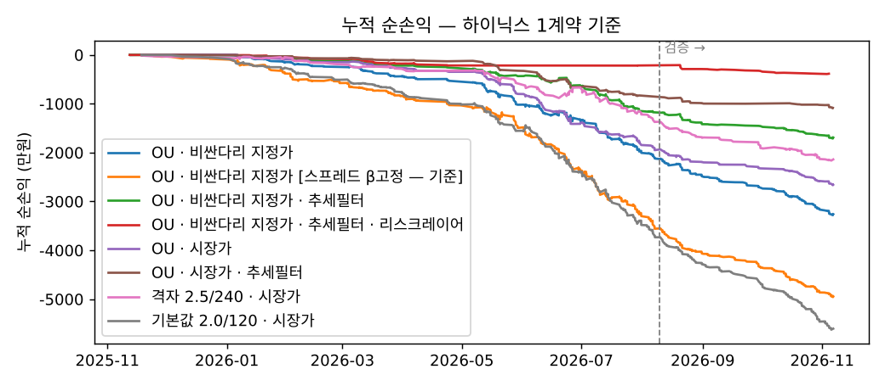
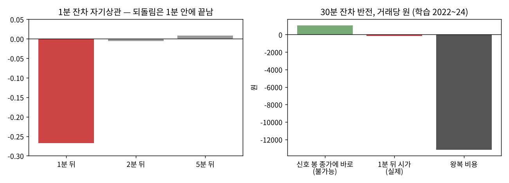
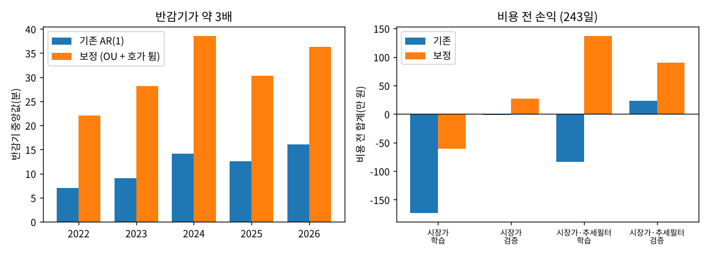
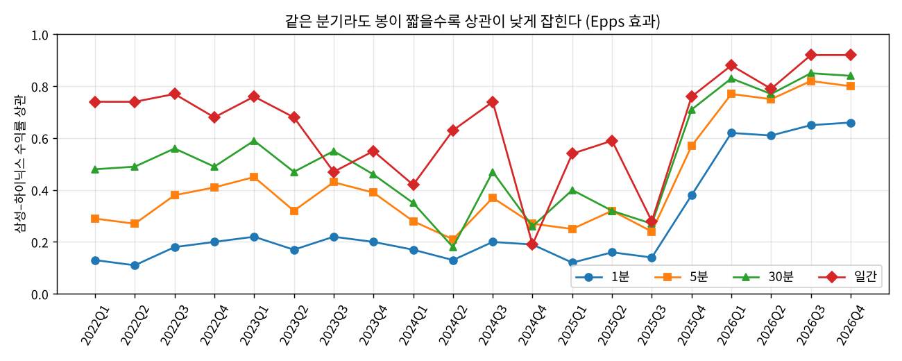

# 4주차 · 복수상품·스프레드 전략 — 삼성전자–SK하이닉스 주식선물 페어

**제출: 2026/11/13(금) 23:59** · 팀 풀옵션(Team-03)

> 이 README 가 4주차 보고서입니다. 시험한 17가지 가운데 의미 있는 5가지만 본문(6절)에 싣고, 나머지는 [부록 A](#부록-a-그-밖의-시험)에 한 줄씩 남겼습니다. 시험한 순서 그대로의 전체 기록은 [실험기록.md](실험기록.md)에 있습니다.
> **실행 환경을 섞지 않습니다.** 6-1~6-5 는 **과거 1분봉 백테스트**(Python, 주문 없음), 6-6 은 **NH 국내 모의계좌 주문**(시세는 실전 키)입니다. 결과가 마이너스여도 그대로 쓰고, 아직 실행 전인 칸은 비워 둡니다.

| 항목 | 내용 |
| --- | --- |
| 전략 | 삼성전자–SK하이닉스 주식선물 스프레드 평균회귀 — 진입·청산선을 **OU 확률미분방정식**에서 도출 |
| 대상 | 삼성전자 주식선물 · SK하이닉스 주식선물 (KRX, 2026년 12월물) |
| 무엇을 사고파나 | 스프레드 s = ln(삼성) − β·ln(하이닉스) 의 괴리. 벌어지면 비싼 쪽 매도·싼 쪽 매수, 좁혀지면 두 다리 함께 청산 |
| 데이터 | NH `국내_차트(분)` 연결선물 1분봉, 2022-01-10 ~ 2026-11-06 (1,173일, 약 41만 분) |
| 검증 방식 | 숫자 고르는 규칙을 데이터 받기 전에 고정(3-5) → 학습 구간에서만 고르고 검증 구간은 한 번만 계산 |
| 실행 | 주문은 모의(paper) 키, 시세는 실전(real) 키 (모의 키에 국내 시세 권한 없음) |
| 작성 | 강민영 |

## 한눈에

**비용까지 넣으면 이 페어로 돈이 되는 규칙은 없었습니다.** 대신 왜 안 되는지를 데이터로 좁혔고, 그중 하나는 직접 고쳤습니다.

1. **기본 전략(6-1)** — OU 진입선 + 두 다리 주문. 사전등록한 판정에서 검증 순손익 −514만 원 → 「비용 앞에서 불성립」
2. **리스크 레이어 + 켈리(6-2)** — 최대 낙폭 1/5 (−1,177만 → −217만 원). 켈리는 비용 뒤 「걸지 마라」
3. **진단: 1분 되돌림 = 호가 튐(6-3)** — 1분 잔차 자기상관 −0.27, 2분 뒤 0. 1분만 늦게 들어가도 사라짐
4. **OU 보정(6-4)** — 호가 튐을 분리해 다시 추정 → 반감기 11 → 31분, 비용 전 손익이 플러스로. 남은 벽은 1틱 비용
5. **짝의 조건(6-5)** — 상관이 높아도 안전하지 않고(분산식), 상관 높은 짝(삼성–미니코스피200)은 계약 크기가 안 맞음

## 폴더 구성

| 경로 | 내용 |
| --- | --- |
| [pair_core.py](pair_core.py) | 핵심 규칙 — 스프레드·β·z, OU 추정·진입선, 신호, 계약 수, 비용, **두 다리 주문 처리(`PairExecutor`)**. 실행기와 백테스트가 같이 씀 |
| [risk_layer.py](risk_layer.py) | 리스크 레이어 — 꼬리(VaR·ES), 단위 수(ES 예산·σ 국면·낙폭·증거금), Kupiec |
| [nh_pair.py](nh_pair.py) | NH 앱 연결 — 월물 찾기, 1분봉·현재가, 모의 주문 브로커 |
| [pair_spread.py](pair_spread.py) | **장중 실행기** — 20초마다 신호 → 두 다리 모의 주문 → 체결 확인·레그 실패 처리 → `results/<날짜>/` |
| [fetch_pair.py](fetch_pair.py) | 연결 1분봉 수집 (이어받기·토큰 만료 재시도) |
| [backtest_pair.py](backtest_pair.py) | 6-1·6-2 백테스트 (격자·스프레드 정의·OU·지정가·추세필터·리스크 레이어) |
| [ou_noise.py](ou_noise.py) · [backtest_ou_noise.py](backtest_ou_noise.py) | 6-4 OU 보정 추정·백테스트 |
| [signal_scan.py](signal_scan.py) · [signal_trade.py](signal_trade.py) | 6-3·6-5 분기별 상관, 신호 스캔·매매 |
| [backtest_k200.py](backtest_k200.py) · [probe_calendar.py](probe_calendar.py) · [theory_apply.py](theory_apply.py) | 6-5 짝 바꾸기 · 캘린더 확인 · 분산식·호크스·켈리 (6-2 켈리 포함) |
| [make_summary_figs.py](make_summary_figs.py) | 이 README 의 그림 6~8 |
| [merge_full.py](merge_full.py) | 2022년치와 최근 1년치 1분봉 합치기 |
| [test_pair.py](test_pair.py) | 시험 60개 (키·네트워크 불필요) |
| `results/` | 결과 CSV·JSON, `figs/` 그림. **1분봉 원본(`pair_1m*.csv`, 약 90MB)은 용량 때문에 올리지 않음** → 2-2 순서대로 다시 받음 |
| [실험기록.md](실험기록.md) | 시험한 순서대로의 전체 기록 (6-1~6-14) |
| 부록 스크립트 | `backtest_30m.py` · `backtest_mm.py` · `tsl_on_spread.py` |

---

## 1. 과제 요약

**질문:** 삼성전자와 SK하이닉스는 같은 메모리 업황을 따라 움직입니다. 둘의 가격 비율이 평소보다 벌어지면 다시 좁혀질까? 좁혀진다면 **두 다리 비용(호가·수수료)을 내고도 남을까?**

이번 주 과제의 두 요건을 이렇게 다뤘습니다.
1. **스프레드를 대상으로** — 한 종목의 방향이 아니라 「삼성 − β × 하이닉스」의 괴리를 매매합니다.
2. **두 다리 주문을 함께** — 한쪽만 체결되면 페어가 아니라 한 종목 베팅이 됩니다. 「둘 다 체결 / 하나만 / 둘 다 실패」를 모두 규칙으로 정했습니다(3-4).

## 2. 실행 방법

### 2-1. 준비

```bash
git clone https://github.com/PetterChanHyuk/nh-futures-open-api     # NH선물 Open API 앱
# 앱 README 대로 가상환경·패키지 설치 후
pip install pandas numpy matplotlib
```

`~/NHFutures/config/config.yaml` 에 **국내 실전 키(시세)** 와 **국내 모의 키(주문)** 가 둘 다 있어야 합니다. 서식은 [week01/config.example.yaml](../week01/config.example.yaml). 키는 저장소에 올리지 않습니다.

### 2-2. 재현 순서 (`week04/` 에서)

| 순서 | 할 일 | 명령 |
| --- | --- | --- |
| 1 | 시험 | `python test_pair.py` → 「모두 통과 (60개)」 |
| 2 | 최근 1년 1분봉 받기 (실전 키, 조회만) | `python fetch_pair.py --app-dir <앱 폴더>` → `results/pair_1m.csv` |
| 3 | 2022년부터 받기 (이어받기 됨, 수십 분) → 합치기 | `python fetch_pair.py --app-dir <앱 폴더> --last 20251107 --days 1000 --max-empty 10 --out pair_1m_older.csv` → `python merge_full.py` → `results/pair_1m_full.csv` |
| 4 | 6-1·6-2 백테스트 | `python backtest_pair.py` |
| 5 | 6-3 신호 스캔·매매 | `python signal_scan.py` → `python signal_trade.py` |
| 6 | 6-4 OU 보정 | `python ou_noise.py` · `python backtest_ou_noise.py orig` · `python backtest_ou_noise.py noise` · `python backtest_ou_noise.py` |
| 7 | 6-2 켈리 · 6-5 분산식 | `python theory_apply.py` |
| 8 | 6-5 짝 바꾸기 · 캘린더 | `python backtest_k200.py` · `python probe_calendar.py --app-dir <앱 폴더>` |
| 9 | 그림 | `python make_summary_figs.py` |
| 장중 | 모의 실행 (6-6) | `python pair_spread.py --app-dir <앱 폴더> --paper-order` → 15:30 자동 종료, `results/<날짜>/` |

- 모의 주문이 막히면 `--paper-order` 대신 `--sim`(실전 호가로 종이 체결). 그날 6-6 표에 「시뮬레이션」 표시.
- 중간에 꺼지면 같은 명령으로 다시 켜면 `state.json` 으로 포지션을 이어 받고 계좌 잔고와 대조합니다.

## 3. 전략

### 3-1. 대상

| 항목 | 삼성전자 선물 | SK하이닉스 선물 |
| --- | --- | --- |
| 거래소·승수 | KRX 개별주식선물 · 10주 | 〃 |
| 호가단위 | 기초주식과 같음 — 20만 원 이상 500원, 미만 100원 | 50만 원 이상 1,000원 |
| 거래시간 | 09:00~15:45 (15:35~ 종가 단일가) | 〃 |
| 월물 | 매월 만기. 실행기는 만기 5일 넘게 남은 가장 가까운 월물(지금 12월물) | 〃 |

### 3-2. 스프레드와 매매 규칙

```
s = ln(삼성) − β·ln(하이닉스)     β: 전날까지 5일 1분 수익률 회귀, 장중 고정 (가격비 β=1·칼만 β 와 비교해 학습 구간 1위를 씀 → 가격비)
z = (s − 직전 W분 평균) / σ_eq
```

| 칸 | 규칙 |
| --- | --- |
| 진입 | z ≥ +a → 삼성 매도·하이닉스 매수 / z ≤ −a → 반대 |
| 청산 | 수렴(z 가 m 안으로) · 손절 a+1.5 · 보유 반감기×3 · 15:15 장마감 · 상관 붕괴 |
| 진입 금지 | 09:15 전 · 14:50 뒤 · 청산 뒤 10분 · 하루 손실 한도 · 레그 실패·잔고 불일치 뒤 |
| 1단위 | 하이닉스 1계약 + 삼성 = 하이닉스 가격 ÷ (β × 삼성 가격) 반올림 (보통 7~10계약) |
| 비용 가정 | 다리마다 체결 한 번에 1틱 + 수수료 편도 0.003% (**NH 실제 수수료율은 모름 — 가정**) |

### 3-3. 진입·청산선을 OU 과정에서 도출

관행값(z = 2) 대신, 스프레드를 평균으로 끌려 돌아오는 확률과정으로 보고 숫자를 계산합니다.

```
dX = κ(μ − X)dt + σ dW         반감기 = ln2 / κ
분당 기대이익 = κ (a − m − c) / (T₁ + T₂)  를 최대로 하는 진입 a, 청산 m     [Bertram 2010]
   T₁, T₂ = 평균 첫 도달 시간 (m → ±a, a → m),  c = 왕복 비용 ÷ (삼성 다리 금액 × σ_eq)
```

- 매일 장 전, 전날까지 2일 1분 스프레드로 κ·σ_eq 를 추정 → 그날의 a, m, 창(반감기×5), 최대 보유(반감기×3)
- 비용이 크면 진입선이 저절로 멀어지고, 남는 게 없으면 「오늘은 거래하지 말라」가 답이 됩니다
- 추가: 추세 필터(스프레드가 한쪽으로 미는 날·시간엔 반대 진입 금지), 비싼 다리(계약 수 × 1틱이 큰 쪽) 지정가 먼저 — 둘 다 학습 구간 성과로만 채택 여부를 정함

### 3-4. 두 다리 주문 처리 (`pair_core.PairExecutor`)

```
[진입]  하이닉스 시장가 → 바로 삼성 시장가
          ↓ 6초 동안 1초마다 주문내역으로 체결 확인
        둘 다 전량 ──→ 포지션 시작 (다리별 체결가·슬리피지 기록)
        모자란 다리 ─→ 잔량 취소 → 남은 수량만 한 번 더 시장가
          ↓ 그래도 모자람
        체결된 만큼 반대 주문으로 되돌림 → 「레그실패」 기록 → 신규 중지
[청산]  같은 순서·확인. 단 모자라도 되돌리지 않음(되돌리면 포지션을 다시 여는 셈)
        → 덜 된 다리만 state.json 에 기억 → 다음 루프마다 그 다리만 재시도
[대조]  5분마다 잔고내역과 실행기 포지션 대조 → 다르면 신규 중지
```

포지션은 「주문 접수」가 아니라 **주문내역의 체결수량**으로만 잡습니다.

### 3-5. 숫자 고르는 규칙 — 데이터 받기 전에 고정 (2026-11-07)

| 단계 | 규칙 |
| --- | --- |
| 스프레드 정의 | β 하루 고정 / 가격비 / 칼만 β 중 학습 구간 샤프 1위 |
| 추세 필터 | 학습 구간 샤프가 오르면 채택 |
| 판정 | 채택된 설정의 **검증 순손익 > 0** 이고 기본값보다 샤프가 높으면 모의 실행에 사용. 아니면 「비용 앞에서 불성립」 |
| 리스크 레이어 | 고르지 않음 — 안전장치라 항상 켬 |

### 3-6. 리스크 레이어 (`risk_layer.py`)

신호는 건드리지 않고 「얼마나 걸지」만, 넷 중 가장 엄격한 값으로 정합니다. 기본 최대 1단위.

| 규칙 | 내용 |
| --- | --- |
| ① ES 예산 | 단위당 꼬리 손실 = max(지난 5일 보유시간 스프레드 변화 ES97.5, 손절선까지 손실) + 비용 ≤ 거래당 30만 원 |
| ② 변동성 국면 | 오늘 σ_eq 가 20일 중앙값의 1.5배 넘으면 절반 |
| ③ 낙폭 한도 | 고점 대비 −150만 원 절반, −250만 원 그날 중단, −100만 원 위로 회복하면 원래대로 |
| ④ 증거금 | `주문가능수량` API 로 두 다리가 다 들어가는 단위만 |
| 사후검증 | 거래마다 예측한 VaR99 를 남기고 Kupiec 검정 |

## 4. 사용 API와 프로그램 구조

| API | 함수 | 용도 | 환경 |
| --- | --- | --- | --- |
| 국내 차트(분) | `chart_minute` / 연결선물 `cidx_yn=1` | 신호·백테스트 데이터 | 실전 (조회만) |
| 국내 현재가 | `price` | 계약 수·호가 | 실전 (조회만) |
| 국내 신규주문 | `order` 시장가(`ord_tp_cd=2`) / 지정가(`1`) | 두 다리 진입·청산 | **모의만** (`ORDER_ENV = "paper"` 고정) |
| 국내 주문내역 | `order_history` | 체결수량·평균가 확인 | 모의 |
| 국내 취소주문 | `cancel` | 미체결 잔량 취소 | 모의 |
| 국내 잔고내역 | `open_interest` | 5분마다 계좌 대조 | 모의 |
| 국내 주문가능수량 | `orderable_quantity` | 리스크 레이어 ④ | 모의 |
| 종목 마스터 | `master_download` / `master_store` | 월물 코드·승수·월물 스프레드 종목 | 공개 파일 |

```
pair_spread.py (실행기)                 backtest_pair.py (백테스트)
   │ 1분봉·현재가 (nh_pair)                │ results/pair_1m.csv (fetch_pair)
   ▼                                      ▼
pair_core ── β·스프레드·z · OU 계획 · 신호 ──┘   ← 같은 함수
   ▼
pair_core.PairExecutor ── 두 다리 주문·확인·재주문·되돌림
   │ nh_pair.NHPaperBroker (모의) / pair_core.PaperFillBroker (--sim)
   ▼
results/<날짜>/ log.jsonl · signals.csv · trades.csv · state.json
```

## 5. 실행 환경

| 항목 | 백테스트 (6-1~6-5) | 모의 실행 (6-6) |
| --- | --- | --- |
| 실행 | 로컬 Python (pandas·numpy·matplotlib) | 로컬 Python + **NH 국내 모의계좌** |
| 시세 | NH 연결 1분봉 (실전 키) | NH 1분봉·현재가 (실전 키) |
| 체결 | 다음 분 시가 + 1틱 + 수수료 가정 | 모의 서버 실제 체결 (주문내역) |
| 주문 | 없음 | 모의계좌 시장가 |

---

## 6. 결과 — 의미 있는 다섯 가지

### 6-1. 기본 전략: 사전등록한 판정 → 비용 앞에서 불성립

데이터 2025-11-10 ~ 2026-11-06 (243일), 학습 183일 / 검증 60일. 가격비 스프레드.

| 설정 | 구간 | 거래 | 거래당 비용(원) | 비용 전 합계(원) | 순손익(원) | 일간 샤프 |
| --- | --- | --- | --- | --- | --- | --- |
| ① 기본값 z 2.0 / 120분 · 시장가 | 검증 | 184 | 115,027 | +2,456,000 | −18,709,016 | −23.19 |
| ③ OU · 시장가 | 검증 | 87 | 81,317 | −14,000 | −7,088,572 | −11.74 |
| ④ OU · 비싼 다리 지정가 | 검증 | 173 | 45,619 | −3,492,000 | −11,384,140 | −14.56 |
| ⑤ OU · 시장가 · 추세필터 | 검증 | 32 | 80,015 | +230,000 | −2,330,495 | −4.88 |
| **⑥ OU · 지정가 · 추세필터 (채택)** | 검증 | 81 | 44,270 | −1,553,000 | **−5,138,901** | −9.55 |

- 모든 설정에서 **순손익 ≈ −비용** — 비용 전 손익이 거의 0입니다.
- 지정가는 비용을 절반(6.8만 → 3.4만 원)으로 줄였지만, **불리할 때만 체결되는 역선택**으로 비용 전 손익이 나빠졌습니다(학습 −152만 → −610만 원).
- 추세 필터는 손실을 반 넘게 줄였지만 거래를 덜 해서(173 → 81) 줄인 것입니다.
- **판정(3-5):** ⑥ 검증 순손익 −514만 원 < 0 → **「비용 앞에서 이 페어는 성립하지 않음」**. 모의 실행은 기본값으로 실행 확인만 합니다(6-6).
- 기간을 2022년까지 늘려도(1,173일 중 930일은 규칙을 안 본 데이터) 평균회귀 쪽은 다섯 해 모두 손실이었습니다(부록 A).



### 6-2. 리스크 레이어와 켈리 — 「얼마나 걸지」 쪽에서도 같은 답

**리스크 레이어** (⑥ 위에 얹음, 학습→검증 이어서)

| | 최대 낙폭(원) | 순손익(원) | VaR99 초과 / 기대 | Kupiec p |
| --- | --- | --- | --- | --- |
| ⑥ 그대로 (학습) | −11,766,765 | −11,762,911 | — | — |
| ⑥ + 리스크 레이어 (학습) | −2,170,363 | −2,166,509 | 5 / 0.89 | **0.002** |
| ⑥ + 리스크 레이어 (검증) | −1,743,650 | −1,685,313 | 2 / 0.23 | **0.022** |

- **최대 낙폭을 1/5 로** 줄였습니다 — 17가지 중 숫자로 「효과 있음」이 나온 유일한 장치입니다.
- 동시에 **VaR 는 틀렸습니다.** 99% VaR 를 넘은 거래가 기대보다 5배 넘게 많아 두 구간 모두 Kupiec 기각. 5일 창의 꼬리가 실제보다 얇았습니다(두 종목이 몇 달 새 2~4배 움직인 해).

**켈리** (`theory_apply.py`, `results/theory_kelly.json`) — 거래 손익 ÷ 1단위 증거금(명목의 15% 가정) = 거래당 수익률 r, f* = E[r]/Var[r]

| 6-4 보정 OU · 시장가 · 추세필터 | 학습 (137건) | 검증 (40건) |
| --- | --- | --- |
| 비용 뒤 f* | −17.1 → **0 (걸지 않음)** | −31.7 → **0** |
| 비용 전 f* (하프켈리) | 4.7 (2.4) | 12.4 (6.2) |
| 비용 전 보수 켈리 (E[r] 95% 하한) | **0** | **0** |

- 비용 뒤엔 모든 설정에서 f* < 0 — 백테스트 판정과 같은 답이 사이징에서도 나옵니다.
- 비용 전엔 f* 가 크지만(증거금 기준 자본의 4.7~12배), 거래당 평균이 표준편차의 1/5~1/8 이라 **95% 하한으로 잡으면 0** 입니다. 과베팅의 실제 예 — 추정 오차를 넣으면 하프켈리도 과합니다.
- **반영 방향:** 리스크 레이어의 「최대 1단위」 를 **min(ES 예산, 보수 켈리)** 로 바꾸면 엣지가 통계적으로 확인되기 전엔 자동으로 0단위가 됩니다. 증거금률 15% 는 가정입니다.

### 6-3. 진단: 1분 되돌림은 「호가 튐」

1분 잔차 수익률(rA − β·rB) 자기상관은 **1분 뒤 −0.27, 2분 뒤 0** 이고, 2022~2026 다섯 해 내내 −0.27 ~ −0.34 로 같습니다. 마지막 체결가가 매수호가와 매도호가 사이를 오가는 것이지, 잡을 수 있는 평균회귀가 아닙니다.

| 확인 | 결과 |
| --- | --- |
| 체결 지연을 0 으로 (신호 분 종가에 바로 — 불가능) | 거래당 비용 전 **+1,313원** — 시장가 왕복 비용의 1/50 |
| 30분 잔차 → 다음 30분 반전 (신호 스캔에서 학습 t −7.29, 검증 −2.92) | 신호 봉 종가에 바로 들어가면 +1,038원(t 3.0), **1분 뒤 시가에서는 −160원(t −0.47)** |



통계적으로 아주 강해 보이는 신호도 실행 가능한 가격에서 다시 재면 사라집니다. 신호 12개 스캔(1일·5일 반전, 모멘텀, 하이닉스 선도, 갭, 상관 이탈, 오전→오후 등)에서 학습·검증을 둘 다 통과한 것은 이 30분 반전 하나였고, 그것도 이 이유로 탈락했습니다.

### 6-4. OU 보정 — 호가 튐을 떼어내고 다시 추정

6-3 때문에 3-3 의 OU 는 호가 튐까지 「빨리 돌아오는 힘」으로 읽어 반감기를 짧게, 기대이익을 크게 잡았습니다. 관측 스프레드를 **진짜 OU + 매 분 독립인 잡음**으로 놓고 분리했습니다.

```
x_t = φ·x_{t−1} + η_t   (진짜 스프레드, φ = e^{−κ})
y_t = x_t + ε_t         (관측 = 진짜 + 호가 튐)
→ 자기공분산 γ_0 = V + s²,  γ_k = V·φ^k (k ≥ 1)      lag 1~5 로 φ·V 추정, s² = γ_0 − V
```

나머지(Bertram 진입·청산선, 창, 보유, 비용, 체결 지연)는 하나도 바꾸지 않았습니다.

| | 2022 | 2023 | 2024 | 2025 | 2026 | 전체 |
| --- | --- | --- | --- | --- | --- | --- |
| 반감기 중앙(분) 기존 → 보정 | 7 → 22 | 9 → 28 | 14 → 39 | 13 → 30 | 16 → 36 | **11 → 31** |
| 모형의 하루 기대이익 중앙(원) | 1.2만 → 0.3만 | 1.7만 → 0.5만 | 6.1만 → 2.4만 | 12.1만 → 4.8만 | 31.7만 → 16.8만 | **5.8만 → 1.9만** |

같은 243일 설정에 넣어 매매 (같은 틀에서 두 OU 를 비교):

| 설정 | 구간 | 비용 전 합계 기존 → 보정 | 순손익 기존 → 보정 |
| --- | --- | --- | --- |
| OU 시장가 | 학습 | −173만 → **−61만** | −2,054만 → −2,102만 |
| | 검증 | −1만 → **+27만** | −709만 → −959만 |
| OU 시장가 · 추세필터 | 학습 | −84만 → **+137만** | −891만 → −685만 |
| | 검증 | +23만 → **+90만** | −233만 → −243만 |



- 반감기가 약 3배가 되자 더 오래 들고 가서(평균 37 → 50분) **진짜 되돌림을 더 잡았고, 추세필터판은 학습·검증 모두 비용 전 플러스**가 됐습니다.
- 분산비 검정으로도 확인: 잡음만 있는 무작위 걸음이면 120분 분산비가 0.59(2022)·0.76(2026)에서 멈춰야 하는데 실제는 0.38·0.55 → **잡음을 빼고도 30분~2시간 규모의 진짜 되돌림은 있습니다.**
- 그래도 거래당 비용 전 +1만~2.3만 원 vs 비용 6만~8만 원(비용의 약 1/4). **남은 차이는 모형이 아니라 1틱 비용 자체**입니다.
- 지정가판은 역선택이 그대로라 보정 효과가 거의 없었습니다.

### 6-5. 짝의 조건 — 상관과 계약 크기

**① 「상관이 높으면 안전」 은 틀렸다 — 분산식** (`results/theory_var.csv`, 일간)

σ_s² = σ_삼성² + β²σ_하닉² − 2βρσ_삼성σ_하닉 — 식으로 계산한 값이 실제 잔차 표준편차와 분기마다 0.1%p 안에서 맞습니다.

| 분기 | ρ | σ삼성 | σ하닉 | σ스프레드 | ρ 가 0.9 였다면 |
| --- | --- | --- | --- | --- | --- |
| 2024Q4 | **0.19** | 2.08% | 2.81% | 2.10% | 1.35% |
| 2025Q3 | 0.28 | 1.95% | 2.88% | 1.89% | 1.66% |
| 2026Q2 | 0.79 | 5.38% | 6.10% | **3.29%** | 2.36% |
| 2026Q3 | **0.92** | 5.95% | 7.26% | 2.41% | 2.61% |

- ρ 가 낮은 분기엔 스프레드가 1.1~1.7배 더 흔들립니다.
- 그런데 **2026년은 상관이 가장 높은데 스프레드 변동도 가장 큽니다** — 두 종목 변동성이 3배가 돼 상관이 지워 주는 몫보다 커졌습니다. 그래서 페어를 멈출 조건은 ρ 가 아니라 **σ_s 자체**(리스크 레이어 ②)여야 합니다.
- 정정: 처음엔 「1분 상관이 2022~25년 0.2, 2026년 0.63 → 2026년만 짝이 맞았다」고 봤지만, **봉이 짧을수록 상관이 낮게 잡히는 착시(Epps 효과)** 였습니다. 같은 분기에도 1분 0.13 / 5분 0.29 / 30분 0.48 / 일간 0.74(2022Q1). 일간 상관은 2022년부터 대부분 0.7 안팎이었습니다.



**② 상관 높은 짝은 계약 크기가 안 맞는다** (`backtest_k200.py`, 같은 규칙, 253일)

삼성 × 미니코스피200(30분 상관 0.94)은 **시장가 네 설정 모두 학습·검증에서 비용 전 플러스** — 이번 주에 비용 전 이익이 꾸준했던 유일한 짝입니다(검증 OU 거래당 +5만~8만 원). 그러나 미니 1계약(2,500만~7,600만 원)에 맞추려면 삼성 11~30계약이 필요해 **거래당 비용이 11만~21만 원**으로 2배가 됐고, 순손익은 손실이었습니다.

**③ 크기가 같은 짝(같은 종목 월물끼리)은 움직임이 너무 작다** (`probe_calendar.py`)

캘린더 스프레드(11월물 × 12월물)는 1:1 로 맞고 마스터에 한 번에 주문하는 월물 스프레드 종목도 있습니다. 그러나 두 월물 차이가 삼성은 **0~1틱 사이**(중앙 +500원, 1틱 500원), 하이닉스는 하루 안 흔들림이 약 1틱이라 비용을 넘을 공간이 없었습니다.

**→ 다음 짝의 조건:** 상관이 해마다 높고, **1계약 금액이 비슷**하고, 스프레드가 틱보다 충분히 크게 움직일 것.

### 6-6. 모의계좌 실행 — 11/12

> 6-1 판정에 따라 **기본값(2.0/120, 시장가)으로 실행 확인만** 합니다 — 목적은 두 다리 주문·체결 확인·레그 실패 처리·잔고 대조가 실제 모의 서버에서 끝까지 도는지입니다. 명령: `python pair_spread.py --app-dir <앱 폴더> --paper-order`. **체결내역에 있는 것만 체결로 씁니다.**

| 날짜 | 환경 | 진입 신호 | 거래 | 레그 실패 | 청산 재시도 | 순손익(원) | 비고 |
| --- | --- | --- | --- | --- | --- | --- | --- |
| 11/12 | | | | | | | |

| 거래 | 진입 소요(초) | 삼성 슬리피지(원) | 하이닉스 슬리피지(원) | 실제 수수료(원) | 백테스트 가정 비용(원) |
| --- | --- | --- | --- | --- | --- |
| | | | | | |

## 7. 결론과 한계

**결론.** 삼성–하이닉스 주식선물 스프레드에는 잡음을 빼도 30분~2시간 규모의 되돌림이 있지만, 거래당 크기가 두 다리 1틱 비용의 약 1/4 이라 비용을 넘지 못합니다. 1분봉 OU 가 기대이익을 부풀린 원인(호가 튐)은 찾아서 고쳤고, 고친 뒤에도 같은 결론입니다. 리스크 레이어는 이익을 만들진 못했지만 낙폭을 1/5 로 줄였고, 켈리는 「걸지 마라」 로 같은 답을 냈습니다.

**한계.**
- 체결은 1분봉 가정(다음 분 시가 + 1틱). 지정가 체결·삼성 7~10계약 동시 체결은 낙관적일 수 있습니다.
- 수수료율 0.003%·증거금률 15% 는 모르는 값입니다. 다만 비용의 대부분은 틱이라 결론은 같습니다.
- 연결선물이라 월물 교체일에 스프레드가 튈 수 있습니다.
- 17가지를 시험했으므로 하나쯤 우연히 좋아 보일 수 있었습니다. 그래서 판정 규칙을 먼저 정했고, 학습·검증을 둘 다 통과한 것만 의미 있다고 봤습니다.

## 8. 오류·개선

| 관찰 | 대응 |
| --- | --- |
| 모의 키 국내 시세 권한 없음 (HTTP 403) | 시세는 실전 키, 주문만 모의 |
| 긴 수집 중 토큰 만료 (EGW023) | 토큰을 버리고 재시도 + 20일마다 중간 저장·이어받기 |
| 빠른 연속 조회 시 속도 제한 (EGW036) | 재시도 대기 |
| 잔고 불일치로 멈춰도 날이 바뀌면 풀림 | 레그 실패·잔고 불일치는 `blocked` 로 따로 — 날이 바뀌어도 유지 |
| 청산 실패 시 되돌림이 포지션을 다시 엶 | 청산은 `unwind=False` — 남은 다리만 재시도 |

| 다음에 할 것 | 이유 |
| --- | --- |
| 실행기에 보정 OU(`--ou-noise`)·보수 켈리(`--kelly`) 옵션 | 분석에서 찾은 것을 실행 코드에 반영 |
| 실시간 체결 녹화 → 호크스 추정 | 거래가 몰렸다 식는 시간(1분봉 근사로 7~13분)과 지정가 역선택을 체결 단위로 재기 |
| VaR 꼬리 추정을 EWMA·FHS 로 | Kupiec 기각 |
| 조건에 맞는 새 짝 찾기 | 6-5 |

## 9. 시험 (`test_pair.py`, 60개 통과)

| 묶음 | 내용 |
| --- | --- |
| 손계산 | 계약 수 9 · 다리 편도 비용 9,270 / 10,165원 · 왕복 38,870원 · 비용 하한 z 4.32 |
| 신호 | β 추정 · z 진입·수렴·손절·장마감 · 상관 낮으면/09:15 전 진입 안 함 |
| 두 다리 | 정상 · 하이닉스 거부 → 삼성 되돌림 · 절반 체결 → 재주문 · 청산 한 다리 거부 → 되돌리지 않음 |
| 실행기 | 진입→청산 기록 · 레그 실패 → 신규 중지 · 청산 재시도 · 재시작 복구 · 잔고 불일치 |
| OU | 첫 도달 시간 공식 = a²/2 극한·몬테카를로 10% 안 · 비용↑ → 진입선↑, 너무 크면 쉼 |
| 지정가·추세필터·스프레드 정의 | 체결 → 헤지, 미체결 → 노출 없음 · 막을 방향만 막음 · 칼만 β 미래정보 없음 |
| 리스크 레이어 | VaR99 ≈ 2.326×4σ · Kupiec 손계산 · ES 예산 손계산 · 낙폭 3→1→0→1→3 |

인증정보와 계좌 식별정보는 이 문서와 결과 파일 어디에도 담지 않습니다.

---

## 부록 A. 그 밖의 시험

결과가 위 다섯 가지의 반복이거나, 1분봉으로는 판정이 안 된 것들입니다. 자세한 표는 [실험기록.md](실험기록.md).

| 시험 | 결과 한 줄 | 기록 |
| --- | --- | --- |
| 진입선·창 격자 12개 | 전부 손실, 비용 전 ≈ 0 | 6-1 |
| 스프레드 정의 3가지 | 가격비가 가장 덜 잃음 — β 정교화는 도움 안 됨 | 6-3 |
| 30분봉 네 방향 (OU·볼린저·변동성 돌파·트레이더 설계) | 전부 손실. 볼린저만 학습 비용 전 플러스 → 검증에서 뒤집힘 | 6-6 |
| 기간 확장 2022~2026 | 평균회귀 다섯 해 모두 손실, 추세 쪽은 2024년 한 해만 이익 | 6-7 |
| 마켓메이킹 1분봉 근사 | 역선택만 셀 수 있음 (체결 뒤 5분 삼성 −1,041원/계약) | 6-9 |
| 하루 단위 방향 (장중 모멘텀·하락일 매수·매수 보유) | 비용을 못 넘음, 하이닉스 매수 보유도 2022~25년 매년 손실 | 6-7 |
| 신호 스캔 나머지 11개 | 학습 기준 탈락 또는 검증에서 사라짐 | 6-10 |
| 개인 지표 도구 6종 72조합 | 통과 0 | 6-11 |
| 호크스 (1분봉 근사) | 거래가 몰렸다 7~13분에 식음, 2026년 분기비 0.65~0.85. 매매 효과는 판정 불가 | 6-14 |
| 지정가 · 추세 필터 (단독) | 6-1 표 안에 포함 | 6-4 |

## 출처
- Bertram, W. K. (2010). Analytic solutions for optimal statistical arbitrage trading. *Physica A* 389(11) — OU 최적 진입·청산
- Avellaneda, M. & Lee, J.-H. (2010). Statistical arbitrage in the US equities market. *Quantitative Finance* 10(7) — 잔차를 쌓아 OU 로 보는 방식
- Gatev, E., Goetzmann, W. & Rouwenhorst, K. G. (2006). Pairs Trading. *Review of Financial Studies* 19(3)
- Epps, T. W. (1979). Comovements in stock prices in the very short run. *JASA* 74(366) — 짧은 간격에서 상관이 낮게 잡히는 현상
- Kupiec, P. (1995). Techniques for Verifying the Accuracy of Risk Measurement Models. *Journal of Derivatives* 3(2)
- Kelly, J. L. (1956). A New Interpretation of Information Rate. *Bell System Technical Journal* 35(4)
- Hawkes, A. G. (1971). Spectra of some self-exciting and mutually exciting point processes. *Biometrika* 58(1)
- NH선물 Open API 앱 — https://github.com/PetterChanHyuk/nh-futures-open-api
