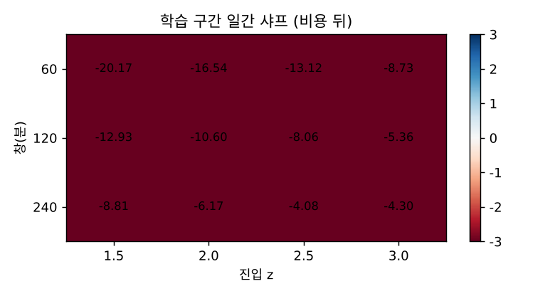
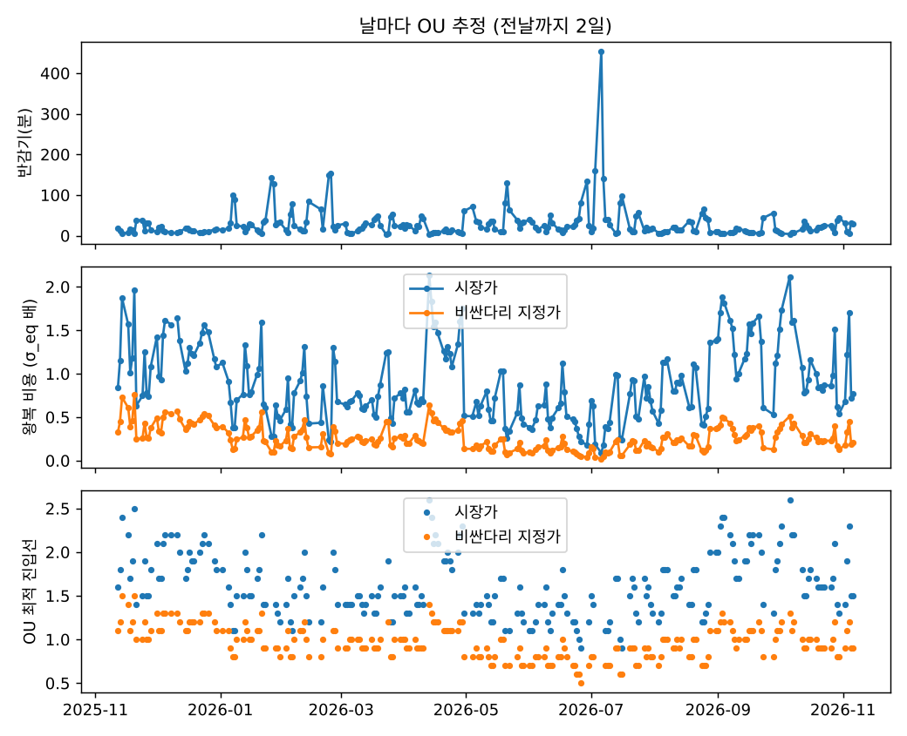
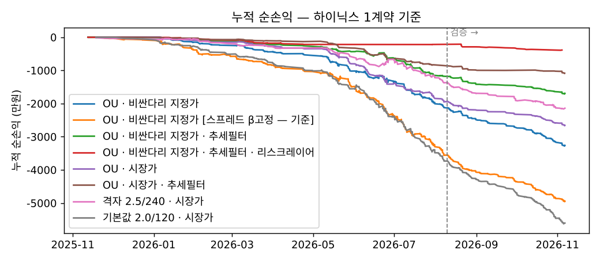
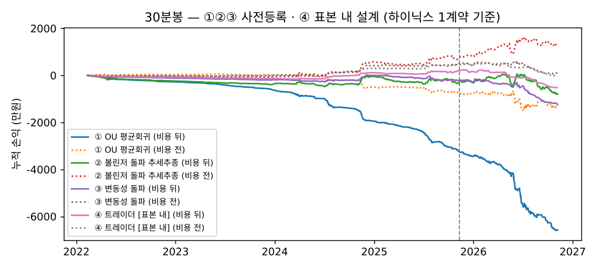

# 4주차 실험 기록 (전체) — 삼성전자–SK하이닉스 주식선물 페어

> 요약 보고서는 [README.md](README.md). 이 파일은 시험한 순서대로 남긴 전체 기록입니다(6-1~6-14).

**제출일: 2026/11/13(금) 23:59 까지** (중간발표 당일 · 발표 자료는 11/12 23:59)

> 이 README 하나가 4주차 보고서입니다.
> **실행 환경을 섞지 않습니다.** 6-1~6-4 는 **과거 1분봉 백테스트**(Python, 계좌 주문 없음), 6-5 는 **NH 국내 모의계좌 주문**(시세는 실전 키)입니다. 모의계좌를 못 쓴 날은 `--sim`(실전 시세 호가로 종이 체결)으로 돌리고 그날 표에 **시뮬레이션**이라고 적습니다.
> 결과가 마이너스여도 그대로 씁니다. **아직 실행 전인 칸은 비워 둡니다 — 수치를 만들어 넣지 않습니다.**

| 항목 | 내용 |
| --- | --- |
| 전략 이름 | 삼성전자_SK하이닉스_페어_평균회귀 |
| 대상 | 삼성전자 주식선물 · SK하이닉스 주식선물 (KRX, 2026년 12월물 — 11월물은 11/12 만기라 건너뜀) |
| 무엇을 사고파나 | 두 종목 가격 비율의 **괴리(스프레드)**. 벌어지면 비싼 쪽 매도·싼 쪽 매수, 좁혀지면 두 다리 함께 청산 |
| 데이터 | NH `국내_차트(분)` 연결선물 1분봉 (실전 키, `fetch_pair.py`) |
| 학습 / 검증 | 마지막 60영업일 = 검증, 그 앞 = 학습 (숫자 고르는 규칙은 3-5절, 데이터 받기 전에 고정) |
| 실행 환경 | **모의계좌 주문** — 주문은 모의(paper) 키, 시세는 실전(real) 키 (모의 키에 [국내 시세조회] 권한 없음, 2주차 8-1절) |
| 작성 | 강민영 — 전략·실행기·백테스트 / 이건준 — 검토 |
| 특색 | **진입·청산선을 관행값(z = 2)이 아니라 OU 확률미분방정식 추정으로 도출** (3-7절) + **비싼 다리(하이닉스)는 지정가로 먼저** (3-8절) + **스프레드 추세 반대 진입 막기** (3-9절) + **리스크 레이어** — 꼬리 손실 예산·변동성 국면·낙폭·증거금으로 크기 결정, VaR 사후검증 (3-10절) + **스프레드 정의 비교** — β 하루 고정 / 가격비 / 칼만 필터 β (3-11절) |
| 작성일 | 2026-11-07 · 11/08 수정안 추가 (결과 칸은 11/10~12 실행 뒤 채움) |

## 폴더 구성

| 경로 | 내용 |
| --- | --- |
| `README.md` | 이 보고서 |
| [pair_core.py](pair_core.py) | **핵심 규칙 한 벌** — 스프레드·β·z·상관, 신호 상태기계, 계약 수 맞추기, 비용, **두 다리 주문 처리(`PairExecutor`)**. 실행기와 백테스트가 같이 씀 |
| [risk_layer.py](risk_layer.py) | **리스크 레이어** — H분 스프레드 꼬리(VaR·ES), 단위 수 결정(ES 예산·σ 국면·낙폭·증거금), Kupiec 사후검증 |
| [nh_pair.py](nh_pair.py) | NH 앱과 붙는 부분 — 종목 마스터에서 월물 찾기, 1분봉·현재가, 모의 주문 브로커 |
| [pair_spread.py](pair_spread.py) | **장중 실행기** — 20초마다 신호 판정 → 두 다리 모의 주문 → 체결 확인·레그 실패 처리 → `results/<날짜>/` 기록 |
| [fetch_pair.py](fetch_pair.py) | 백테스트용 연결 1분봉 수집 → `results/pair_1m.csv` |
| `results/full/` | 기간 확장(2022-01~2026-11, 1,173일) 결과 — 30분봉 네 방향 (6-7절) |
| [backtest_mm.py](backtest_mm.py) | 마켓메이킹 1분봉 근사 — 역선택 크기만 측정 (6-9절) |
| [backtest_k200.py](backtest_k200.py) · `results_k200/` | 짝 바꾸기 — 삼성 × 미니코스피200, 같은 규칙 (6-8절) |
| [backtest_30m.py](backtest_30m.py) | **판정 뒤 추가 실험** — 30분봉에서 ① OU 평균회귀 · ② 볼린저 밴드 돌파(추세추종) · ③ 변동성 돌파(옵션 매수형) · ④ 트레이더 설계(표본 내), 규칙 고정·격자 없음 (6-6절) |
| [backtest_pair.py](backtest_pair.py) | 같은 규칙의 1분봉 백테스트 — 비용 하한 계산, 학습 구간 격자, 검증 1회 |
| [test_pair.py](test_pair.py) | 손계산·신호·두 다리 주문·실행기·백테스트·OU·지정가·추세 필터·리스크 레이어·스프레드 정의·비싼 다리 자동 선택 60가지 시험 (키·네트워크 불필요) |
| [results/](results/) | 백테스트 결과(`backtest_*.csv/json`, `figs/`), 장중 실행 기록(`<날짜>/`) |
| [screenshots/](screenshots/) | 모의계좌 주문·체결 화면 (계좌 식별정보 가림) |

---

## 1. 과제 요약

**질문:** 삼성전자와 SK하이닉스는 같은 메모리 반도체 업황을 따라 함께 움직입니다. 장중에 둘의 가격 비율이 평소보다 크게 벌어지면 다시 좁혀질까? 좁혀진다면 **두 다리 비용(호가·수수료)을 내고도 남을까?**

**이번 주의 핵심은 두 가지입니다.**
1. **스프레드를 대상으로 삼기** — 한 종목의 방향이 아니라 「삼성 − β × 하이닉스」의 괴리를 매매합니다.
2. **두 다리 주문을 함께 다루기** — 한쪽만 체결되면 페어가 아니라 한 종목 방향 베팅이 됩니다. 그래서 「둘 다 체결 / 하나만 체결 / 둘 다 실패」를 모두 규칙으로 정했습니다(3-4절).

**답 (243일 1분봉 백테스트, 2025-11-10 ~ 2026-11-06):** 괴리는 통계적으로는 되돌아오지만, **돈이 될 만큼은 아닙니다.**
- 스프레드의 OU 반감기는 중앙값 **18분** — 평균회귀 자체는 있습니다.
- 그러나 비용 빼기 전 손익이 거의 0입니다(검증 구간 OU·시장가 87거래 합계 −1.4만 원). 왕복 비용은 거래당 **3.4만~11.5만 원**인데, 체결 지연을 0으로 둔 불가능한 경우에도 비용 전 이익은 거래당 **약 1,300원**입니다.
- 비교한 8가지 설정 모두 학습·검증 구간에서 손실이고, 미리 정한 판정 규칙(3-5절)에 따라 결론은 **「비용 앞에서 이 페어는 성립하지 않음」** 입니다. 모의계좌 실행(6-5)은 기본값으로 **실행 확인만** 합니다.
- 가장 큰 배움: 1분 잔차의 자기상관이 **−0.27(1분 뒤), 0(2분 뒤)** — 「되돌림」의 대부분이 1분 안에 끝나는 호가 튐이라, 20초 주기 REST 로 신호를 보고 들어가면 이미 사라져 있습니다. 1분봉에 맞춘 OU 는 이 잡음을 회귀로 착각해 기대이익을 부풀렸습니다(7절).

## 2. 실행 방법

### 2-1. 준비

```bash
git clone https://github.com/PetterChanHyuk/nh-futures-open-api     # NH선물 Open API 앱 (API 호출 모듈)
# 앱 README 대로 가상환경·패키지 설치 후
pip install pandas numpy matplotlib
```

설정 파일 `~/NHFutures/config/config.yaml` 에 **국내 실전 키(시세)** 와 **국내 모의 키(주문)** 가 둘 다 있어야 합니다. 서식은 [week01/config.example.yaml](../week01/config.example.yaml).

### 2-2. 순서

| 언제 | 할 일 | 명령 (`week04/` 폴더에서) |
| --- | --- | --- |
| 아무 때 | 시험 | `python test_pair.py` → 「모두 통과 (60개)」 |
| 11/08~09 | 과거 1분봉 받기 (약 260영업일, 실전 키 조회만) | `python fetch_pair.py --app-dir <앱 폴더>` |
| 11/08~09 | 백테스트 → 숫자·스프레드 정의 고르기 (3-5절 규칙대로 자동, 260일 기준 10분 안팎) | `python backtest_pair.py` |
| 11/10~12 09:00 전 | 실행기 시작 — 3-5절 판정에 따라 | OU·지정가 채택: `python pair_spread.py --app-dir <앱 폴더> --paper-order --ou --passive auto --risk --spread <고른 정의>` (추세필터 채택이면 `--trend-filter` 추가) <br> 아니면: `python pair_spread.py --app-dir <앱 폴더> --paper-order --entry <z> --window <분>` |
| 15:30 | 자동 종료 → `results/<날짜>/` 확인, HTS 체결내역 캡처 → `screenshots/` | |

- 모의계좌 주문이 막히면 같은 명령에서 `--paper-order` 대신 `--sim` → 실전 시세 호가로 종이 체결하고 기록은 똑같이 남깁니다. **그날 6-5 표에 「시뮬레이션」으로 표시.**
- 종목코드는 실행기가 종목 마스터에서 찾습니다(`삼성전자 F 2026xx`, 만기 5일 넘게 남은 가장 가까운 월물). 못 찾으면 `--sym-a <삼성 코드> --sym-b <하이닉스 코드>`.
- 중간에 꺼졌으면 **같은 명령으로 다시 켜면 됩니다.** `state.json` 으로 포지션·덜 된 청산을 이어 받고, 켜자마자 계좌 잔고와 대조합니다.

## 3. 전략과 매매 계획

### 3-1. 대상 상품

| 항목 | 삼성전자 선물 | SK하이닉스 선물 |
| --- | --- | --- |
| 거래소 | KRX 개별주식선물 | KRX 개별주식선물 |
| 거래승수 | 10주 (마스터 `ctrt_size` 로 확인) | 10주 |
| 호가단위 | 기초주식과 같음 (가정, 3-6절) | 〃 |
| 거래시간 | 09:00~15:45 (15:35~ 종가 단일가) | 〃 |
| 월물 | 12월물 (최종거래일 12/10) | 12월물 |
| 실시간 구독 | 쓰지 않음 (REST 1분봉 + 현재가) — 키당 20건 상한과 무관 | |

### 3-2. 스프레드·β·z

```
스프레드  s = ln(삼성) − β · ln(하이닉스)
β         전 거래일까지 5일치 1분 수익률을 회귀한 기울기 (밤사이 갭 수익률은 뺌). 그날 장중엔 고정
z         (s − 직전 W분 평균) / 직전 W분 표준편차      ← 지금 분은 평균·표준편차에 안 넣음
상관       1분 수익률 W분 이동상관
```

- **β 를 장중에 고정하는 이유:** 매 분 다시 추정하면 「스프레드가 벌어졌다」가 아니라 「β 가 바뀌었다」가 신호가 됩니다. 그리고 그날 데이터로 β 를 정하면 미래 정보가 섞입니다.
- **스프레드를 만드는 다른 방법**(가격비, 칼만 필터 β)도 같이 만들어 비교합니다 → 3-11절.
- **상관을 계속 재는 이유:** 페어의 전제는 「둘이 함께 움직인다」입니다. 한 종목에만 뉴스가 나면 상관이 깨지고 괴리가 수렴하지 않습니다. 그때는 들어가지 않고(상관 < 0.5), 들고 있으면 나옵니다(상관 < 0.2).

### 3-3. 매매 규칙

| 칸 | 값 |
| --- | --- |
| 진입 | z ≥ +진입선 → **삼성 매도 · 하이닉스 매수** (숏 스프레드) / z ≤ −진입선 → **삼성 매수 · 하이닉스 매도** (롱 스프레드) |
| 진입 금지 | 상관 < 0.5 · \|z\| ≥ 3.5(이미 손절선 밖) · 09:15 전 · 14:50 뒤 · 청산 뒤 10분 · 하루 손실 한도 도달 · 레그 실패·잔고 불일치 뒤 |
| 수렴 청산 | \|z\| < 0.5 (같은 쪽으로) |
| 위험 청산 | z 가 불리하게 3.5 넘음 · 평가손실 −30만 원 · 상관 < 0.2 · 보유 90분 · **15:15 장마감** |
| 하루 한도 | 실현손실 −60만 원 → 그날 신규 금지 |
| 계약 수 | 하이닉스 1계약 고정, 삼성 = 하이닉스 가격 ÷ (β × 삼성 가격) 반올림 (최대 30) |
| 주문 | 시장가 (`ord_tp_cd=2`, 가격 0) |

**계약 수 예 (손계산, `test_pair.py` 1번):** β 0.6, 삼성 100,000원, 하이닉스 550,000원 → 550,000 ÷ 60,000 = 9.17 → **삼성 9 : 하이닉스 1**. 스프레드 수익률이 rA − β·rB 이므로 삼성 금액 : 하이닉스 금액 = 1 : β 가 되게 맞춥니다. 반올림으로 남는 불균형은 매 진입 「금액불균형원」으로 기록합니다.

### 3-4. 두 다리 주문 처리 (`pair_core.PairExecutor`)

```
[진입]  하이닉스 시장가 → 바로 삼성 시장가          (덜 유동적인 쪽을 먼저)
          ↓ 6초 동안 1초마다 주문내역으로 체결 확인
        둘 다 전량 ──────────────→ 포지션 시작 (다리별 체결가·슬리피지 기록)
        모자란 다리 ─→ 남은 주문 취소 → 남은 수량만 한 번 더 시장가
          ↓ 그래도 모자람
        체결된 만큼 반대 주문으로 되돌림 → 「레그실패」 기록 → 신규 중지 (사람이 확인할 때까지)

[청산]  같은 순서·같은 확인. 단, 모자라도 **되돌리지 않음** (되돌리면 포지션을 다시 여는 셈)
        → 덜 된 다리만 기억(state.json) → 다음 루프마다 그 다리만 다시 → 「경보」 기록
```

- 한 다리만 남는 시간을 짧게 하려고 두 주문 사이에 대기를 두지 않습니다.
- 「주문 접수 ≠ 체결」 — 포지션은 **주문내역의 체결수량**으로만 잡습니다.
- 5분마다 `잔고내역`과 실행기 포지션을 대조 → 다르면 신규 중지 (청산 중이면 「덜 된 다리만 남은 상태」를 기준으로 대조).

### 3-5. 숫자 고르는 규칙 — 데이터 받기 전에 고정 (2026-11-07)

진입선 2.0·창 120분은 문헌 관행(Gatev 외 2006 의 「2 표준편차」)에서 가져온 출발점일 뿐, 이 두 종목·1분봉·비용에 맞는다는 근거가 없습니다. 그래서 아래처럼 정합니다. 같은 내용이 [backtest_pair.py](backtest_pair.py) 머리말에 있습니다.

| 단계 | 규칙 |
| --- | --- |
| 격자 | 진입 z ∈ {1.5, 2.0, 2.5, 3.0} × 창 W ∈ {60, 120, 240}분. 청산 0.5·손절 3.5 등 나머지는 고정 |
| 비용 하한 | 진입 때마다 **비용 하한 z = 왕복 비용(원) ÷ (삼성 다리 금액 × 스프레드 σ)** 를 계산. 「진입선 − 청산선」 이 이것보다 작으면 수렴해도 비용을 못 메움 |
| 자격 | 학습 거래 ≥ 30 그리고 (진입선 − 0.5) ≥ 학습 구간 비용 하한 z 중앙값 |
| 고르기 | 자격 있는 조합 중 **학습 구간 일간 샤프(비용 뒤) 1위** |
| 검증 | 고른 조합과 기본값(2.0, 120) **두 개만** 검증 구간에서 한 번 계산. 다른 조합의 검증값은 계산하지 않음 |
| 자격 없음 | → 「가정한 비용에서는 이 전략이 성립하지 않음」 이 결론. 모의 실행은 기본값으로 **실행 확인만** |
| **스프레드 정의 (11/08)** | 가장 먼저 「OU·비싼 다리 지정가」 의 **학습 구간** 샤프로 β 하루 고정 / 가격비 / 칼만 β 중 하나를 고름 (`results/spread_compare_is.csv`). 아래 ③~⑦ 은 모두 그 정의로 |
| **비교 (11/08 추가)** | 검증 구간에서 **여섯 가지만 한 번씩**: ① 기본값 2.0/120·시장가 ② 격자 고른 것·시장가 ③ OU·시장가 ④ OU·비싼 다리 지정가 ⑤ ③ + 추세 필터 ⑥ ④ + 추세 필터 |
| **추세 필터 채택** | **학습 구간**에서만 판단: ⑥ 학습 샤프 > ④ 학습 샤프 → 채택 (`summary` 의 `추세필터_채택`) |
| **실행 규칙 판정** | 채택된 쪽(④ 또는 ⑥)이 검증 구간 순손익 > 0 이고 일간 샤프가 ① 보다 높으면 → 모의 실행은 그 설정. 아니면 「비용 앞에서 이 페어는 안 됨」 을 결론으로 쓰고 ① 로 실행 확인만 |
| **⑦ 리스크 레이어** | 고르지 않음 — 안전장치라 OU 모드 실행에는 **항상 켬**. 채택된 설정에 얹어 학습→검증을 이어서 한 번 돌리고, 성과 대신 막은 것·최대낙폭·VaR 사후검증을 봄 |

**비용 가정 (`pair_core.Costs`):** 다리마다 체결 한 번에 1틱 불리 + 수수료 편도 0.003%. **NH 주식선물 수수료율은 확인하지 못했습니다 — 모름, 가정입니다.**

**비용 하한 손계산 (`test_pair.py` 2번):** 삼성 9계약(100,000원)·하이닉스 1계약(550,000원), 스프레드 σ 0.1% 일 때 왕복 비용 38,870원, 1σ 값 9,000원 → **비용 하한 z = 4.32**. 이 가정이 맞다면 진입 2.0·청산 0.5(폭 1.5)로는 비용을 못 넘습니다. 실제 σ 는 데이터로 계산합니다.

### 3-6. 미리 알고 있던 약점

- **하이닉스 호가단위가 큼.** 가격 50만 원 이상이면 1,000원(0.18%) — 한 번 체결에 슬리피지 1틱만 잡아도 삼성 다리보다 큽니다. 비용 하한이 높아지는 가장 큰 이유입니다.
- **호가단위는 가정.** 2023년 개편 뒤 주식선물 호가단위가 기초주식과 같다고 보고 `tick_size()` 에 넣었습니다. 실제 호가로 확인할 항목입니다.
- **다음 분 시가 체결 가정.** 백테스트는 신호 다음 분 시가에 두 다리가 동시에 체결된다고 봅니다. 실제로는 두 주문 사이 시차·호가 공백이 있고, 그 차이가 6-5 의 「다리별 슬리피지」 입니다.
- **연결선물의 월물 교체.** 두 종목은 같은 날 월물이 바뀌지만, 바뀌는 날 베이시스 차이만큼 스프레드가 튈 수 있습니다. z 창이 그날 아침까지 영향을 받습니다.
- **β 불안정.** 5일 β 가 하루 사이 크게 바뀌면 계약 수가 바뀝니다. 매 진입 β 를 기록합니다.

### 3-7. 숫자의 근거 — 진입·청산선을 OU 과정에서 도출 (`pair_core.fit_ou_days`·`ou_plan`·`plan_days`)

**왜:** 진입 2.0·청산 0.5·창 120분·보유 90분은 모두 관행값이었습니다. 격자에서 고르는 방법(3-5절)도 「후보 중 학습 구간 1등」 일 뿐, 왜 그 숫자인지는 설명하지 못합니다.

**모형.** 스프레드 X 를 평균으로 끌려 돌아오는 확률과정(Ornstein–Uhlenbeck)으로 봅니다.

```
dX = κ(μ − X) dt + σ dW        κ: 돌아오는 속도   σ: 흔들림   반감기 = ln2 / κ
1분 간격 이산화:  X_{t+1} − μ = b (X_t − μ) + ε    →  κ = −ln b,  σ_eq = sd(ε) / √(1 − b²)  (정상분포 표준편차)
```

- **추정:** 날마다 장 전, 전날까지 2일의 1분 스프레드(그날 β 로 다시 계산)를 **날마다 평균을 빼고** 이어 붙여 AR(1) 회귀. 밤사이 수준 변화가 섞이면 회귀가 느려 보이므로(b → 1) 날을 넘는 쌍은 쓰지 않습니다.
- **z 정의:** z = (X − 직전 W분 평균) / σ_eq. 평균은 장중에 움직이므로 이동평균, 흔들림 크기는 OU 의 σ_eq. 창 W = 반감기 × 5 (30~240분).

**최적 진입·청산선.** 표준화 Y = (X − μ)/σ_eq 는 시간을 1/κ 분 단위로 재면 dY = −Y dτ + √2 dW 로 계수가 없어집니다. 매매 한 주기는

```
① 청산 수준 m 에서 다시 +a 또는 −a 에 닿을 때까지 기다림     T₁(m → ±a) = ∫_|m|^a e^{u²/2} ∫_0^u e^{−v²/2} dv du
② 진입 수준 a 에서 m 까지 돌아옴                             T₂(a → m)  = ∫_m^a e^{u²/2} ∫_u^∞ e^{−v²/2} dv du
한 주기 이익 = (a − m − c) · σ_eq        c = 왕복 비용(원) ÷ (삼성 다리 금액 × σ_eq)   ← 3-5절 비용 하한과 같은 양

분당 기대이익 = κ (a − m − c) / (T₁ + T₂)    를 가장 크게 하는 (a, m)      [Bertram 2010 의 틀]
```

T₁·T₂ 는 생성자 L = −y d/dy + d²/dy² 에 대해 L T = −1 을 푼 평균 첫 도달 시간입니다 (`test_pair.py` 16번: 출발점 근처는 순수 확산 a²/2 와 같고, 2 → 0.5 는 몬테카를로와 10% 안).

| OU 가 정하는 것 | 규칙 |
| --- | --- |
| 진입선 a · 청산선 m | 위 최대화 (a 0.5~5.0, m 0~a, 0.1 간격). **m 은 0 이상으로 막음** — 이론 최적은 평균 너머 반대편(m = −a)까지 들고 가는 것이지만, 장중 평균을 이동평균으로 근사하므로 평균 너머는 추정오차에 그대로 노출됨 |
| 손절 | a + 1.5 |
| 최대 보유 | 반감기 × 3 (10~120분) — 반감기 세 번이면 괴리의 7/8 이 사라져야 함 |
| 그날 쉼 | 회귀가 안 보임(b ≥ 1) · 반감기 < 3분(20초 REST 로 못 따라감) 또는 > 120분 · 비용을 넘는 진입선 없음 · 기대 주기 > 780분 |

- **비용이 크면 진입선이 저절로 멀어지고**, 그래도 남는 게 없으면 「오늘은 거래하지 말라」 가 답입니다 (`test_pair.py` 18번). 비용 하한 분석이 이 식의 c 로 들어갑니다.
- 결과 파일 `results/ou_days.csv` — 날마다 β·κ·반감기·σ_eq·비용(σ 배)·진입선·기대 주기·쉬는 이유. 그림 `figs/4_ou_days.png`.
- **한계:** 1분봉 스프레드는 정확한 OU 가 아닙니다(호가 튐, 장중 성질 변화). 이동평균 기준 z 는 σ_eq 보다 작게 흔들려 이론보다 진입이 드뭅니다. 이론 최적과 실제의 차이는 6-2절 비교로 봅니다.

### 3-8. 비용 줄이기 — 비싼 다리는 지정가로 먼저 (`PairExecutor.execute_passive_first`, `passive_leg_of`)

**왜:** 시장가로 사면 매번 상대 호가를 내고 사는 셈입니다. 처음엔 하이닉스가 비싼 다리라고 가정했지만, **실제 데이터(11/08)에서 거꾸로였습니다** — 삼성 약 21만 원(1틱 500원 = 0.23%) × 9계약 vs 하이닉스 약 130만 원(1틱 1,000원 = 0.08%) × 1계약 → 1단위 편도 슬리피지 삼성 45,000원, 하이닉스 10,000원. 그래서 다리를 고정하지 않고 **「계약 수 × 1틱」 이 큰 쪽을 자동으로** 지정가로 겁니다(`--passive auto`). 일부만 체결돼 다른 다리 1계약을 못 붙이면(예: 삼성 9계약 중 4계약) 그 부분을 되돌리고 「놓침」 처리합니다.

```
[진입]  비싼 다리(계약수×1틱 큰 쪽): 유리한 쪽 최우선 호가에 지정가 (매수 = 매수1호가, 매도 = 매도1호가) — 받는 쪽이 됨
          ↓ 30초 기다림
        체결 ──→ 바로 다른 다리 시장가로 붙임 (체결 비율만큼, 1계약 안 되면 되돌림)
        미체결 ─→ 취소, 「신호놓침」 기록 — 노출 없음 (레그 실패 아님)
        다른 다리가 안 붙음 ─→ 지정가 체결분 시장가로 되돌림 → 레그실패, 신규 중지
[청산]  「수렴」 일 때만 같은 방식. 지정가 미체결이면 바로 두 다리 시장가
        손절·장마감·상관 붕괴 등 위험 청산은 처음부터 시장가
```

- **맞교환:** 1틱을 아끼는 대신 ① 신호를 놓칠 수 있고 ② **불리할 때만 체결되는 경향**(역선택)이 있습니다. 지정가가 체결됐다는 건 가격이 내 쪽으로 밀려왔다는 뜻이라, 체결 직후 조금 더 밀리는 경우가 많습니다.
- 백테스트는 이 역선택을 보수적으로 넣습니다: 신호 분 종가에 걸고, 다음 2분 안에 **그 가격을 뚫고 지나간 거래**(매수면 저가 < 지정가)가 있을 때만 체결로 봅니다. 닿기만 한 건 대기열 뒤쪽이라 체결로 치지 않습니다.
- 백테스트 비용에서 하이닉스 슬리피지는 0틱(지정가 체결), 삼성은 그대로 1틱입니다. OU 계획도 이 낮아진 비용으로 다시 계산합니다(진입선이 가까워짐).
- 국내 지정가 주문가격 형식(`ord_pric` 소수 두 자리)과 모의 서버가 걸린 지정가를 유지·체결하는 방식은 **확인 전**입니다 — 11/10 장 초반 1계약 시험으로 확인.

### 3-9. 스프레드 추세 필터 — 「하락장이면 평균선도 내려가나?」 (11/08 추가)

**시장 하락은 거의 상쇄됩니다.** 스프레드 = ln(삼성) − β·ln(하이닉스) 라서, 시장 전체가 빠져 하이닉스 −3%, 삼성이 β 만큼(−1.8%) 빠지면 스프레드는 그대로입니다. 하락장 자체는 문제가 아니고, 급락 때는 두 종목이 같이 빠져 상관이 오히려 높아지는 경향도 있습니다.

**문제는 스프레드 자체에 추세가 생길 때입니다.** 예를 들어 하이닉스에만 해당하는 이유로 며칠 또는 몇 시간 동안 한쪽이 더 빠지면, 이동평균이 늦게 따라가는 사이 「계속 벌어져 있다」고 보고 **추세 반대로** 진입해 손절이 납니다. 며칠짜리 추세는 OU 반감기가 길어져(> 120분) 그날 쉬게 되지만, 장중에 새로 생긴 추세는 아침 계획이 못 봅니다.

| 점검 | 규칙 | 막는 것 |
| --- | --- | --- |
| 아침 | 전날까지 3일 스프레드 **날평균**이 두 번 연속 같은 방향으로, 하루 평균 1σ_eq 이상 움직임 → 그날 추세 ±1 | 추세 반대 방향 진입 (그날 내내) |
| 장중 | 직전 60분 스프레드 기울기 × **예상 보유시간**(OU 평균 첫 도달 시간 a → m) 이 왕복 비용(σ_eq 단위, 최소 0.5)보다 큼 → 추세 ±1 | 그 분의 추세 반대 방향 진입 |

- **추세 방향 진입은 그대로 둡니다.** 스프레드가 오르는 추세에서 아래로 벌어진 것(z ≤ −a)은 추세 쪽으로 돌아오는 괴리라 롱 스프레드는 허용, 위로 벌어진 것(z ≥ +a)에 거는 숏 스프레드만 막습니다.
- **청산에는 영향 없음** — 이미 들고 있는 포지션은 원래 규칙대로 나옵니다.
- 장중 기준을 「보유시간 동안 추세가 밀 거리」로 잡은 이유: 반감기가 짧아 몇 분 만에 끝나는 매매라면 완만한 추세는 상관없고, 그 몇 분 동안 비용보다 크게 밀 만큼 가파를 때만 위험합니다. 그래서 **완만한 추세(예: 한 시간 +1%)는 막지 않습니다** — 반감기 수 분짜리 매매에선 그 사이 이동이 0.5σ 아래라서입니다(`test_pair.py` 25번은 한 시간 +3% 로 시험).
- **헛경보 가능성:** 가짜 데이터(실제 추세 없음)에서도 아침 점검이 약 30% 날에 추세를 잡았습니다. β 추정오차 때문에 날평균이 우연히 두 번 같은 쪽으로 움직이는 경우입니다. 그래서 필터를 쓸지는 미리 정한 규칙대로 **학습 구간 성과로만** 정합니다(3-5절).
- 결과 기록: 백테스트 `추세필터_막은분`, `ou_days.csv` 의 `day_trend`·`drift_sigma_per_day`, 실행기 로그 「추세필터」 줄.

### 3-10. 리스크 레이어 (`risk_layer.py`) — 신호는 그대로, 「얼마나 걸지」 만 정함

2주차 리스크 레이어와 같은 생각입니다. 전략의 신호·진입선은 건드리지 않고, **규칙 넷 중 가장 엄격한 것**으로 이번 거래의 크기를 정합니다. 모든 판단은 **그 거래 전까지의 정보로만** 합니다. 크기 단위는 「1단위 = 하이닉스 1계약 + β 로 맞춘 삼성 계약(보통 8~10)」 입니다.

```
신호 (OU 진입선 · 추세 필터 통과)
        ↓
  ① ES 예산 · ② 변동성 국면 · ③ 낙폭 한도 · ④ 증거금   →  가장 엄격한 값 = 이번 단위 수 k (0 이면 안 함)
        ↓
  두 다리 주문 (하이닉스 k계약, 삼성 β 로 맞춘 계약)
```

| 규칙 | 내용 | 근거 |
| --- | --- | --- |
| ① ES 예산 | 단위당 꼬리 손실 = max(ES 손실, 손절선까지 손실) + 왕복 비용. k = ⌊거래당 예산 30만 원 ÷ 단위당 꼬리 손실⌋ | ES 손실 = 지난 5일 **H분(그날 최대 보유) 스프레드 변화의 ES97.5** × 삼성 다리 금액. 손절이 있어도 1분 사이 갭으로 넘어갈 수 있어 둘 중 큰 쪽. 같은 날 안에서만 H분 변화를 만듦(장마감 전 청산이라 밤사이 갭 제외) |
| ② 변동성 국면 | 오늘 σ_eq 가 지난 20일 중앙값의 1.5배 넘으면 절반 | σ 가 갑자기 커진 날은 OU 추정 자체가 흔들림 (어제까지 데이터로 오늘을 설명 못 함) |
| ③ 낙폭 한도 | 실현 누적손익 고점 대비 −150만 원 → 절반, −250만 원 → **그날 중단·다음 날 절반으로 재개**, −100만 원 위로 회복 → 원래대로 | 2주차처럼 「절반 → 0 → 회복 시 원복」 의 이력 구조. 0이 되면 다시 벌 기회가 없으므로 중단은 그날만. 상태는 날을 넘어 `results/risk_state.json` 에 이어짐 |
| ④ 증거금 | (실행기만) `주문가능수량` API 로 두 다리가 다 들어가는 단위만 | 모의계좌 증거금 안에서만 |

- **기본은 키우지 않습니다 (k 최대 1).** 2주차에서 「레버리지 안 씀, 노출 최대 1」 로 한 것과 같은 이유입니다. 가짜 데이터로 돌려 보니 꼬리 예산만 보고 3단위까지 키우게 하면 **기대값이 음수인 날에도 크기를 키워 손실을 3배로 만들었습니다** — 꼬리 위험이 작다는 것이 이익이 난다는 뜻은 아니기 때문입니다. 크기를 키우는 건(`--k-max 2~3`) 검증 구간에서 플러스가 확인된 뒤의 일입니다.
- 리스크 레이어를 켜면 거래당 손실 한도 = 꼬리 예산(30만 원), 하루 한도 = 그 두 배(60만 원)로 맞춥니다.
- **사후검증:** 거래마다 예측한 VaR99(원)를 남기고, 실제 손실이 넘은 횟수를 Kupiec 검정으로 봅니다(2주차와 같은 방법). p값이 작으면 꼬리를 과소평가한 것 → ① 의 예산 계산을 믿을 수 없다는 뜻.
- 실행기 로그 「리스크레이어」 줄에 매 신호의 ①~④ 값과 k, 「리스크상태」 줄에 누적손익·고점 대비·상태가 남습니다. 0단위로 막힌 신호는 `trades.csv` 에 「리스크레이어0단위」.

### 3-11. 스프레드 정의 비교 — β 하루 고정 / 가격비 / 칼만 필터 β (`pair_core.SpreadView`·`kalman_beta`)

**왜:** 3-2절의 식은 β 를 하루 고정합니다. 장중에 두 종목 관계가 바뀌어도 못 따라가는 게 약점입니다. 반대로 β 를 정교하게 추정하는 게 정말 도움이 되는지도 확인해야 합니다.

| 정의 | 식 | 장점 | 약점 |
| --- | --- | --- | --- |
| **β 하루 고정** (기존) | s = ln A − β_d · ln B, β_d = 전날까지 5일 1분 수익률 회귀 | 단순, 하루 안에선 안정 | β 가 장중에 바뀌면 못 따라감 |
| **가격비** (기준선) | s = ln A − ln B (β = 1) | 추정할 게 없음 — 「β 를 추정한 게 도움이 됐나」 를 재는 기준 | 하이닉스가 더 크게 움직여, 시장이 움직이면 비율도 같이 움직임 |
| **칼만 필터 β** | 관측 rA_t = β_t·rB_t + ε_t, 상태 β_t = β_{t−1} + η_t → s_t = Σ (rA − β_{t\|t−1}·rB) | β 를 매 분 갱신. OU 와 같은 「확률모형」 줄기(상태공간 모형) | β 가 너무 잘 따라가면 괴리까지 흡수해 신호가 줄어듦 |

**칼만 필터 설계**
- β 의 움직임 크기 η: 「β 가 하루에 0.05 정도 바뀔 수 있다」 → 분산 (0.05/√390)². 관측 잡음 R 은 혁신(예측 오차)으로 계속 추정(지수가중 λ = 0.99).
- **스프레드는 수익률 잔차를 쌓아 만듭니다.** 수준 회귀(ln A − β_t ln B)는 β 가 바뀔 때마다 스프레드가 튀지만, 잔차를 쌓으면 그런 인공적인 점프가 없습니다(`test_pair.py` 35번). 이 방식은 Avellaneda–Lee(2010)가 잔차 수익률을 쌓아 OU 를 맞춘 것과 같은 꼴입니다.
- 매 분 **직전까지의** β 로 잔차를 계산 → 미래 정보 없음(34번: 앞부분만 넣어 돌려도 같은 값). 장 시작 첫 분(밤사이 갭)은 뺍니다.
- 진입할 때 계약 수도 그 분의 칼만 β 로 맞춥니다.

**고르는 규칙 (미리 고정):** 세 정의로 각각 「OU · 비싼 다리 지정가」 를 학습 구간에서 돌려 **일간 샤프 1위**를 고릅니다. 그다음 추세 필터·검증 판정·리스크 레이어는 모두 그 정의로 합니다. 검증 구간 표에는 고른 정의와 기준(β 하루 고정)을 나란히 싣습니다.

참고로 가짜 데이터(실제 성과 아님)에서는 가격비의 σ_eq 가 커서 「비용 ÷ σ」 가 작게 나왔습니다(0.54 vs 0.91). 비용이 상대적으로 작아 보이는 것이지, 시장 움직임이 섞인 잡음까지 σ 에 들어간 결과라 좋은 신호라는 뜻은 아닙니다.

## 4. 사용 API와 프로그램 구조

| API | 함수 (앱 `domestic_futureoption_functions`) | 용도 | 환경 |
| --- | --- | --- | --- |
| 국내 차트(분) | `chart_minute(sym, rows=2000)` / 연결선물은 공통 호출부로 `cidx_yn=1` | 신호(오늘·지난 7일) · 백테스트 데이터 | 실전 (조회만) |
| 국내 현재가 | `price(sym)` | 진입 시 계약 수·호가(슬리피지 기준) | 실전 (조회만) |
| 국내 신규주문 | `order(sym, trd_div, ord_tp_cd=2, ord_qty, ord_pric=0)` 시장가 / `ord_tp_cd=1, ord_pric=호가` 지정가 | 두 다리 진입·청산 / 비싼 다리 지정가 먼저(3-8) | **모의만** (`ORDER_ENV = "paper"` 고정) |
| 국내 주문내역 | `order_history()` | 체결수량·평균체결가 확인 | 모의 |
| 국내 취소주문 | `cancel(sym, org_ord_no, trd_div, ord_qty)` | 미체결 잔량 취소 | 모의 |
| 국내 잔고내역 | `open_interest()` | 5분마다 계좌 대조 | 모의 |
| 국내 주문가능수량 | `orderable_quantity(sym, trd_div, ord_pric)` | 리스크 레이어 ④ 증거금 — 두 다리 다 들어가는 단위 | 모의 |
| 종목 마스터 | 앱 `master_download` / `master_store` (`stk_fut_opt.mst`) | 월물 코드·승수 | 공개 파일 |

```
pair_spread.py (실행기)                 backtest_pair.py (백테스트)
   │ 1분봉·현재가 (nh_pair)                │ results/pair_1m.csv (fetch_pair)
   ▼                                      ▼
pair_core.features ──── β·스프레드·z·상관 ────┘   ← 같은 함수
pair_core.Signal.decide ── 진입/청산/보유 ──────┘   ← 같은 함수
   │
   ▼
pair_core.PairExecutor ── 두 다리 주문·확인·재주문·되돌림
   │ nh_pair.NHPaperBroker (모의) / pair_core.PaperFillBroker (--sim)
   ▼
results/<날짜>/ log.jsonl · signals.csv · trades.csv · state.json
```

## 5. 실행 환경

| 항목 | 백테스트 (6-1~6-4) | 모의 실행 (6-5) | 대안: 시뮬레이션 (`--sim`) |
| --- | --- | --- | --- |
| 실행 | 강민영 로컬 Python | 강민영 노트북 Python + **NH 국내 모의계좌** | 같은 실행기 |
| 시세 | NH 연결 1분봉 (실전 키) | NH 1분봉·현재가 (실전 키) | 〃 |
| 체결 | 다음 분 시가 + 1틱 + 수수료 가정 | **모의 서버 실제 체결** (주문내역) | 실전 호가 (매수 = 매도호가, 매도 = 매수호가) |
| 주문 | 없음 | 모의계좌 시장가 | 없음 (종이 체결) |

## 6. 실행 결과

### 6-1. 백테스트 — 학습 구간 격자 (`results/backtest_grid.csv`)

> `python backtest_pair.py` 실행 뒤 채움.

학습 183일 (2025-11-10 ~ 2026-08-07), 시장가, 하이닉스 1계약 기준.

| 진입 z | 창(분) | 거래 | 승률 | 평균 순손익(원) | 평균 비용(원) | 일간 샤프 | 최대 낙폭(원) | 비용 하한 z | 자격 |
| --- | --- | --- | --- | --- | --- | --- | --- | --- | --- |
| 1.5 | 60 | 834 | 0.137 | -83,839 | 86,938 | -20.17 | -69,921,652 | 1.643 | × |
| 2.0 | 60 | 671 | 0.162 | -84,315 | 93,750 | -16.54 | -56,575,309 | 1.766 | × |
| 2.5 | 60 | 411 | 0.187 | -90,044 | 94,297 | -13.12 | -37,007,967 | 1.833 | ○ |
| 3.0 | 60 | 197 | 0.213 | -83,374 | 96,983 | -8.73 | -16,424,626 | 1.89 | ○ |
| 1.5 | 120 | 560 | 0.248 | -83,103 | 94,037 | -12.93 | -46,537,476 | 1.155 | × |
| 2.0 | 120 | 402 | 0.261 | -92,854 | 97,916 | -10.60 | -37,327,263 | 1.187 | ○ |
| 2.5 | 120 | 259 | 0.293 | -93,979 | 96,844 | -8.06 | -24,344,930 | 1.291 | ○ |
| 3.0 | 120 | 130 | 0.285 | -75,872 | 100,226 | -5.36 | -9,863,327 | 1.37 | ○ |
| 1.5 | 240 | 352 | 0.318 | -95,448 | 93,917 | -8.81 | -33,597,613 | 0.708 | ○ |
| 2.0 | 240 | 253 | 0.352 | -90,360 | 95,154 | -6.17 | -22,860,997 | 0.697 | ○ |
| **2.5** | **240** | 180 | 0.361 | -76,166 | 96,644 | **-4.08** | -13,709,969 | 0.70 | ○ ← 고른 조합 |
| 3.0 | 240 | 109 | 0.294 | -99,571 | 96,130 | -4.30 | -10,853,193 | 0.704 | ○ |

- **12개 모두 손실.** 평균 순손익 ≈ −(평균 비용) — 비용 빼기 전 손익이 거의 0이라는 뜻입니다.
- 비용 하한 z 는 창이 길수록 작아집니다(창이 길면 σ 가 커져 비용이 상대적으로 작아 보임). 하지만 비용을 넘을 「폭」이 생겨도 그 폭만큼 되돌아오지 않았습니다.
- 「자격 있는 조합 중 학습 샤프 1위」 규칙대로 2.5/240 을 골랐지만, 1위라도 샤프 −4.08 입니다.



### 6-2. OU 추정 요약 (`results/ou_days.csv`, `figs/4_ou_days.png`)

고른 스프레드 정의(가격비) 기준, 239일.

| 항목 | 시장가 | 비싼 다리 지정가 |
| --- | --- | --- |
| 반감기 중앙값 (사분위) | **18.0분** (10.0 ~ 33.1) | 같음 |
| 왕복 비용 (σ_eq 배) 중앙값 | 0.80 | 0.24 |
| OU 최적 진입선 중앙값 | 1.6 | 1.0 |
| 거래 가능한 날 비율 | 94.2% | 94.2% |
| 쉰 날 이유 | 반감기 범위 밖 10일 · 평균회귀 안 보임(b ≥ 1) 2일 · 준비 2일 | 같음 |
| 아침 추세가 잡힌 날 비율 | 47.7% | – |

- OU 로 보면 「비용이 σ 의 0.8배이니 진입선 1.6 이면 거래당 0.8σ 를 번다」 가 이론값입니다. 실제는 거의 0 — 그 차이가 7절의 핵심입니다.
- 아침 추세 점검이 절반 가까운 날에 걸렸습니다. 이 1년은 두 종목이 2~4배 오르내린 극단적 장이라 날평균이 한 방향으로 이어진 날이 많았습니다.



### 6-3. 스프레드 정의 — 학습 구간 (`results/spread_compare_is.csv`)

| 정의 | 학습 거래 | 학습 일간 샤프 | 학습 순손익(원) | 거래 가능한 날 | 반감기 중앙값(분) | 비용(σ 배) 중앙값 |
| --- | --- | --- | --- | --- | --- | --- |
「OU · 비싼 다리 지정가」 를 세 정의로 학습 구간에서 돌린 결과.

| 정의 | 학습 거래 | 학습 일간 샤프 | 학습 순손익(원) | 거래 가능한 날 | 반감기 중앙값(분) | 비용(σ 배) 중앙값 |
| --- | --- | --- | --- | --- | --- | --- |
| β 하루 고정 | 444 | -9.51 | -35,584,228 | 95.9% | 18.8 | 0.19 |
| **가격비** | 442 | **-7.60** | -21,206,869 | 94.2% | 17.5 | 0.25 |
| 칼만 β | 442 | -10.23 | -35,554,203 | 96.7% | 19.4 | 0.18 |

**고른 정의: 가격비 (β = 1).** 추정이 전혀 없는 기준선이 가장 덜 잃었습니다. β 를 정교하게 추정(하루 고정·칼만)한 것이 이 1년에선 도움이 되지 않았다는 뜻입니다. 칼만 β 는 β 고정과 거의 같은 결과 — β 가 장중에 크게 바뀌지 않았거나, 바뀐 것을 따라가도 남는 신호가 없었습니다.

### 6-4. 검증 구간 — 미리 정한 비교 (`results/backtest_summary.json`)

| 조합 | 구간 | 거래 | 놓친 신호 | 승률 | 평균 비용(원) | 총 순손익(원) | 일간 샤프 | 최대 낙폭(원) | 청산 사유 |
| --- | --- | --- | --- | --- | --- | --- | --- | --- | --- |
검증 60일 (2026-08-10 ~ 2026-11-06). ③~⑥ 은 가격비 스프레드.

| 조합 | 구간 | 거래 | 놓친 신호 | 승률 | 평균 비용(원) | 비용 전 합계(원) | 순손익 합계(원) | 일간 샤프 | 최대 낙폭(원) |
| --- | --- | --- | --- | --- | --- | --- | --- | --- | --- |
| ① 기본값 2.0/120 · 시장가 | 학습 | 402 | – | 0.261 | 97,916 | +2,035,000 | -37,327,263 | -10.60 | -37,327,263 |
| | 검증 | 184 | – | 0.109 | 115,027 | +2,456,000 | -18,709,016 | -23.19 | -18,804,508 |
| ② 격자 2.5/240 · 시장가 | 학습 | 180 | – | 0.361 | 96,644 | +3,686,000 | -13,709,969 | -4.08 | -13,709,969 |
| | 검증 | 78 | – | 0.256 | 114,167 | +1,224,000 | -7,681,007 | -9.75 | -7,943,437 |
| ③ OU · 시장가 | 학습 | 264 | – | 0.307 | 68,079 | -1,520,000 | -19,492,734 | -8.18 | -19,539,748 |
| | 검증 | 87 | – | 0.230 | 81,317 | -14,000 | -7,088,572 | -11.74 | -7,246,852 |
| ④ OU · 비싼 다리 지정가 | 학습 | 442 | 207 | 0.337 | 34,183 | -6,098,000 | -21,206,869 | -7.60 | -21,206,869 |
| | 검증 | 173 | 126 | 0.214 | 45,619 | -3,492,000 | -11,384,140 | -14.56 | -11,356,730 |
| (기준) ④ 를 β 하루 고정으로 | 학습 | 444 | 209 | 0.315 | 49,455 | -13,626,000 | -35,584,228 | -9.51 | -35,584,228 |
| | 검증 | 172 | 218 | 0.215 | 55,310 | -4,374,000 | -13,887,261 | -17.11 | -13,763,014 |
| ⑤ OU · 시장가 · 추세필터 | 학습 | 111 | – | 0.324 | 70,026 | -735,000 | -8,507,883 | -5.37 | -8,513,526 |
| | 검증 | 32 | – | 0.281 | 80,015 | +230,000 | -2,330,495 | -4.88 | -2,330,495 |
| ⑥ OU · 비싼 다리 지정가 · 추세필터 | 학습 | 254 | 145 | 0.346 | 35,122 | -2,842,000 | -11,762,911 | -5.58 | -11,766,765 |
| | 검증 | 81 | 68 | 0.198 | 44,270 | -1,553,000 | -5,138,901 | -9.55 | -5,197,111 |

**추세 필터 채택 (학습 구간):** 채택 — ⑥ 학습 샤프 −5.58 > ④ −7.60. 검증 구간에서도 손실을 절반 넘게 줄였습니다(−1,138만 → −514만 원). 다만 줄인 방식이 「거래를 덜 해서」(173 → 81거래)이지, 비용 전 손익이 플러스로 바뀐 것은 아닙니다.

**판정 (3-5절 규칙):** ⑥ 의 검증 구간 순손익 **−514만 원 < 0** → 조건 불충족. 결론은 **「비용 앞에서 이 페어는 성립하지 않음」**, 모의 실행은 ① 기본값으로 실행 확인만 합니다(6-5).

**비싼 다리 자동 선택이 실제로 바뀐 것** — ④ 의 지정가 다리: 2026-04 까지(삼성 20만 원 아래, 1틱 100원)는 **하이닉스**, 2026-05 부터(삼성 20만 원 위, 1틱 500원)는 **삼성**. 「계약 수 × 1틱」 규칙이 호가단위 구간이 바뀌는 시점을 그대로 따라갔습니다. 덕분에 평균 비용은 시장가의 절반(6.8만 → 3.4만 원)으로 줄었지만, 지정가가 **불리할 때만 체결되는** 역선택 때문에 비용 전 손익이 −152만 → −610만 원으로 나빠졌습니다(학습 구간 ③ vs ④).



**⑦ 리스크 레이어** (채택된 설정 위, 학습→검증 이어서)

| 구간 | 거래 | 순손익(원) | 최대 낙폭(원) | 일간 샤프 | VaR99 초과 / 기대 | Kupiec p값 |
| --- | --- | --- | --- | --- | --- | --- |
| 학습 | 89 | -2,166,509 | -2,170,363 | -4.55 | 5 / 0.89 | **0.002** |
| 검증 | 23 | -1,685,313 | -1,743,650 | -5.86 | 2 / 0.23 | **0.022** |

- 0단위로 막은 신호(분) 2,922 — 대부분 ③ 낙폭 한도(고점 대비 −250만 원 → 그날 중단)와 ① ES 예산. 마지막 상태는 누적 −385만 원, 「절반」.
- **낙폭은 막았습니다.** ⑥(−1,176만 원) 대비 최대 낙폭이 −217만 원으로 1/5 이 됐습니다. 손실을 이익으로 바꾸지는 못했지만, 손실이 커질 때 크기를 줄이는 안전장치로는 작동했습니다.
- **VaR 는 틀렸습니다.** 99% VaR 를 넘은 거래가 학습 5번(기대 0.9번), 검증 2번(기대 0.2번) — Kupiec 검정이 두 구간 모두 기각(p 0.002, 0.022). 지난 5일로 잰 꼬리가 실제 꼬리보다 얇았습니다. 이 1년은 두 종목이 몇 달 만에 2~4배 움직인 국면이라, 5일 창이 다음 날의 변동을 따라가지 못했습니다 → 8-3절.

### 6-5. 모의계좌 실행 — 11/10 ~ 11/12

> 6-4 판정에 따라 **① 기본값(2.0/120, 시장가)으로 실행 확인만** 합니다 — 목적은 수익이 아니라 두 다리 주문·체결 확인·레그 실패 처리·잔고 대조가 실제 모의 서버에서 끝까지 도는지입니다. 명령: `python pair_spread.py --app-dir <앱 폴더> --paper-order` (OU·지정가는 끔).
> `results/<날짜>/trades.csv`·`log.jsonl` 과 HTS 체결내역으로 채움. **체결내역에 있는 것만 체결로 씁니다.**

| 날짜 | 환경 | 그날 OU 계획 (진입/청산/반감기) | 진입 신호 | 거래 | 신호 놓침 | 레그 실패 | 청산 재시도 | 순손익(원) | 비고 |
| --- | --- | --- | --- | --- | --- | --- | --- | --- | --- |
| 11/10 | | | | | | | | | |
| 11/11 | | | | | | | | | |
| 11/12 | | | | | | | | | |

**두 다리 체결 품질** — 이번 주에 가장 보고 싶은 숫자

| 거래 | 진입 소요(초) | 삼성 슬리피지(원) | 하이닉스 슬리피지(원) | 백테스트 가정 비용(원) | 비고 |
| --- | --- | --- | --- | --- | --- |
| | | | | | |

### 6-6. 판정 뒤 추가 실험 — 30분봉에서 네 방향 (`backtest_30m.py`, `results/backtest_30m_summary.json`)

> 6-4 판정을 바꾸려는 게 아니라, 7절 진단(「1분 되돌림은 호가 튐」)을 피해 **시간 단위를 늘리면 되나**, 그리고 1분봉에서 아침 추세가 47.7% 날에 잡혔으니 **되돌림 대신 추세를 따라가면 되나**를 확인한 실험입니다. 두 전략 모두 규칙을 결과 보기 전에 고정했고(파일 머리말), 숫자 탐색은 하지 않았습니다.

| 공통 | 30분봉(하루 13봉), 스프레드 = ln 삼성 − β·ln 하이닉스 (β = 전날까지 20일 30분 수익률 회귀), 다음 봉 시가 시장가 체결, 비용은 1분봉과 같은 가정, **밤 넘겨 보유 허용** |
| --- | --- |
| ① OU 평균회귀 | 1분봉과 같은 OU 식을 30분 단위로 (전날까지 20일로 추정, 비용 넣은 최적 진입선, 손절 a+1.5, 최대 보유 반감기×3봉) |
| ② 볼린저 돌파 | 교과서 값 그대로 — 20봉 · ±2σ. 위 밴드를 뚫으면 롱 스프레드, 아래 밴드를 뚫으면 숏, 중앙선 복귀 시 청산, 반대 밴드 돌파 시 뒤집기 |

**30분 잔차 자기상관: 1봉 −0.022, 2봉 −0.028, 3봉 −0.004** — 1분봉의 −0.27 이 사라졌습니다. 30분 단위에선 되돌림도 추세도 거의 없는 「무작위 걸음」에 가깝다는 뜻입니다.

| 전략 | 구간 | 거래 | 승률 | 거래당 비용 전(원) | 거래당 비용(원) | 순손익 합계(원) | 일간 샤프 | 최대 낙폭(원) | 평균 보유 | 밤 넘김 |
| --- | --- | --- | --- | --- | --- | --- | --- | --- | --- | --- |
| ① OU 평균회귀 | 학습 | 224 | 0.353 | −21,607 | 90,135 | −25,030,364 | −5.31 | −25,398,553 | 8.2시간 | 22.8% |
| | 검증 | 63 | 0.286 | −301 | 111,633 | −7,051,905 | −6.26 | −7,167,753 | 10.2시간 | 23.8% |
| ② 볼린저 돌파 | 학습 | 76 | 0.408 | **+77,342** | 85,280 | −603,302 | −0.12 | −5,489,168 | 49.7시간 | 80.3% |
| | 검증 | 32 | 0.281 | −52,968 | 115,617 | −5,394,762 | −3.67 | −6,234,505 | 36.3시간 | 71.9% |

**판정 (미리 정한 규칙: 학습·검증 둘 다 순손익 > 0): 둘 다 불성립.**
- **① OU 는 30분에서도 비용 전 손익이 0 이하**입니다. 반감기 중앙값 1.76봉(약 53분), 비용 σ 의 0.74배 — OU 식은 여전히 「진입 1.5 면 번다」 고 계산했지만, 실제 자기상관이 0 에 가까워 맞지 않았습니다.
- **② 볼린저 돌파는 학습 구간에서 비용 전 +588만 원**으로, 이번 주 시험한 것 중 유일하게 비용 전 손익이 비용(648만 원)에 거의 닿았습니다(순손익 −60만 원, 샤프 −0.12). 2026년 상반기 두 종목이 몇 달씩 한 방향으로 벌어지던 국면입니다. 하지만 **검증 구간에선 비용 전도 −170만 원**으로 뒤집혔습니다 — 추세가 있던 시기에만 통한 것으로 보입니다.
- 볼린저는 평균 보유가 이틀 남짓이고 거래의 70~80%가 밤을 넘깁니다. 밤사이 갭(하이닉스 8% 넘게 움직인 날 17일)을 그대로 떠안는 구조라, 실전이라면 리스크 레이어(3-10)의 갭 대비가 먼저 필요합니다.

**③ 변동성 돌파 — 「옵션 매수처럼」 (11/08 추가, ①② 결과를 본 뒤 정했지만 숫자 탐색은 없음)**

옵션 매수는 조용할 때 싸게 사 두고, 흔들림이 커지면 방향에 상관없이 돈을 법니다. 손실은 프리미엄만큼으로 작고, 이익은 길게 열려 있습니다(볼록한 손익). 이걸 스프레드로 흉내 냈습니다:
- **압축:** 20봉 밴드 폭이 직전 120봉 중 하위 20% → 「조용함」
- **진입:** 압축 직후(3봉 안) ±2σ 밴드를 뚫은 방향으로
- **청산:** 중앙선으로 되돌아오면 작은 손실로 끊고(프리미엄), 유리한 쪽 최고점에서 진입 때 σ 의 2배를 되돌리면 이익을 지키며 나옴(추적 손절)

| 전략 | 구간 | 거래 | 승률 | 순손익 합계(원) | 샤프 | 비용 전 왜도 | 상위 10% 거래 비용 전 | 나머지 비용 전 | 이긴 거래 평균 | 진 거래 평균 | 진입 뒤 흔들림 배율 |
| --- | --- | --- | --- | --- | --- | --- | --- | --- | --- | --- | --- |
| ③ 변동성 돌파 | 학습 | 49 | 0.286 | −6,416,469 | −2.03 | +0.31 | +436.7만 | −658.2만 | +47.1만 | −29.6만 | 1.33배 |
| | 검증 | 18 | 0.056 | −4,241,964 | −6.52 | −0.55 | +29.0만 | −243.0만 | +11.8만 | −21.0만 | 1.27배 |
| (비교) ② 볼린저 돌파 | 학습 | 76 | 0.408 | −603,302 | −0.12 | **+1.30** | **+1,133.5만** | −545.7만 | +65.7만 | −34.4만 | – |
| | 검증 | 32 | 0.281 | −5,394,762 | −3.67 | **+0.67** | +334.0만 | −503.5만 | +43.1만 | −34.4만 | – |

**판정: ③ 불성립.**
- **흔들림이 커지는 순간은 잡았습니다** — 진입 뒤 30분 변화폭이 진입 전 20봉 평균의 1.3배. 「압축 → 확장」 자체는 실제로 있었습니다.
- **그러나 방향을 자주 틀렸고, 「작은 손실」 이 작지 않았습니다.** 밴드를 뚫은 자리(중앙선에서 2σ)에서 들어가 중앙선까지 돌아와야 끊으니 진 거래 평균이 −21만~−30만 원 — 옵션의 프리미엄처럼 작게 정해진 손실이 아니었습니다. 검증 구간 승률 5.6%.
- **오히려 ② 볼린저 돌파가 더 「옵션 매수 같은」 손익이었습니다.** 비용 전 왜도 +1.30(학습)·+0.67(검증), 상위 10% 거래가 나머지 90% 손실을 메우는 모양 — 추세추종이 「룩백 스트래들(옵션 매수)」 과 비슷한 손익을 낸다는 연구(Fung·Hsieh 2001)와 같은 모습입니다. 다만 그 볼록함의 크기가 비용을 꾸준히 넘지는 못했습니다.
- **진짜 옵션으로는 못 했습니다.** 실제로 「변동성이 커질 때 버는」 건 옵션 매수(스트래들)인데, 과거 옵션 시세(내재변동성)를 이 API 로 받을 길이 없어 백테스트할 수 없었습니다 → 8-3절.

**④ 「트레이더라면」 — ①②③ 을 모두 본 뒤 설계 (11/09, 표본 내)**

②가 유일하게 비용 전 플러스였으므로, 그 위에 트레이더가 할 법한 네 가지를 얹었습니다: 20일 일별 평균 기울기로 **추세 국면**을 판정해 같은 방향 돌파만 · 삼성 다리 **지정가** 진입 · 중앙선 대신 **추적 손절(1.5σ)** · 15:00 에 **지는 포지션은 밤을 안 넘김** · 하루 −60만 원·낙폭 −250만 원 한도. **같은 데이터로 설계하고 같은 데이터로 돌렸으므로 성립/불성립 판정을 하지 않습니다.**

| 구간 | 거래 | 승률 | 거래당 비용 전(원) | 거래당 비용(원) | 순손익 합계(원) | 샤프 | 국면 불일치로 건너뜀 | 놓친 신호 |
| --- | --- | --- | --- | --- | --- | --- | --- | --- |
| 학습 | 32 | 0.344 | −77,781 | 51,124 | −4,124,969 | −2.65 | 83 | 4 |
| 검증 | 6 | 0.000 | −504,166 | 70,787 | −3,449,723 | −4.13 | | |

**②보다 나빠졌습니다.** 비용은 줄었지만(8.5만 → 5.1만 원) 비용 전 손익이 플러스에서 마이너스로 바뀌었습니다. 원인을 ②의 거래를 국면별로 쪼개 보니 분명했습니다:

| ② 볼린저 돌파 거래를 진입 당시 국면으로 나누면 | 거래 | 비용 전 평균(원) | 비용 전 합계(원) | 승률 |
| --- | --- | --- | --- | --- |
| 국면과 **같은** 방향 돌파 | 46 | −61,130 | −2,812,000 | 0.39 |
| 국면과 **반대** 방향 돌파 | 42 | −65,810 | −2,764,000 | 0.33 |
| **국면 없음** (횡보 판정) 에서의 돌파 | 20 | **+487,950** | **+9,759,000** | 0.60 |

②의 이익은 전부 **「국면 없음」 으로 판정된 날의 돌파**에서 나왔고, 추세가 이미 있다고 판정된 날의 돌파는 방향을 가리지 않고 잃었습니다. 즉 돈이 된 건 「추세를 따라가기」 가 아니라 **「조용하던 스프레드가 새 추세를 시작하는 첫 돌파」** 였습니다 — 추세가 20일 동안 이미 이어진 뒤의 돌파는 늦은 진입이었습니다. 제가 트레이더로서 「횡보기를 거르자」 고 넣은 국면 필터는 정확히 돈이 되던 거래를 걸러 냈습니다. 결과를 보고 설계하면 이렇게 됩니다 — 이 발견 자체가 또 하나의 표본 내 결과이므로, 「국면 없음에서의 돌파만」 을 새 가설로 적어 두되 이 데이터로는 더 돌리지 않습니다.



### 6-7. 기간 확장 — 2022-01 ~ 2026-11, 1,173일 (11/09, `results/full/`)

> 6-1~6-6 은 2025-11-10 ~ 2026-11-06 의 243일로 했고, 모든 설계·판정·추가 실험이 그 안에서 이뤄졌습니다. 그래서 **2022-01-10 ~ 2025-11-07 의 930일은 이 보고서의 어떤 규칙도 보지 않은 데이터**입니다. 1분봉을 1,000영업일 더 받아(`fetch_pair.py --last 20251107 --days 1000`, 313,779분) 합친 뒤, 규칙은 하나도 바꾸지 않고 다시 돌렸습니다. 30분봉 네 방향은 「학습 = 2022~2025-11 (930일) / 검증 = 243일」 로 구간만 바꿨습니다.

**전제가 올해만 성립했습니다.** 두 종목 1분 수익률 상관:

| 연도 | 2022 | 2023 | 2024 | 2025 | 2026 |
| --- | --- | --- | --- | --- | --- |
| 1분 수익률 상관 | 0.14 | 0.21 | 0.17 | 0.20 | **0.63** |
| 1분 잔차 자기상관 (1분 뒤) | −0.34 | −0.34 | −0.29 | −0.28 | −0.27 |

- *(11/10 정정: 아래 해석은 1분봉 착시였습니다 — 일간 상관은 2022년부터 대부분 0.7 안팎. 6-10 참고)*
- 「같이 움직이는 두 종목」 이라는 페어의 전제가 **2026년에만** 맞았습니다. 2022~2025년의 상관 0.2는 거의 따로 노는 두 종목이고, 그때 스프레드 = 두 종목 각각의 움직임이라 평균회귀가 있을 이유가 없습니다.
- 1분 호가 튐(자기상관 −0.3)은 5년 내내 같습니다 — 전략의 문제가 아니라 시장 미시구조입니다.

**30분봉 네 방향, 긴 기간** (하이닉스 1계약 기준 · 2022~2025 에는 삼성 5~8만 원·하이닉스 7~66만 원이라 1단위 계약 수·비용이 작음)

| 전략 | 구간 | 거래 | 승률 | 거래당 비용 전(원) | 거래당 비용(원) | 순손익 합계(원) | 일간 샤프 | 비용 전 왜도 |
| --- | --- | --- | --- | --- | --- | --- | --- | --- |
| ① OU 평균회귀 | 2022~25-11 | 967 | 0.245 | −7,850 | 25,616 | −32,362,076 | −5.63 | −3.94 |
| | 243일 | 310 | 0.326 | −16,829 | 90,940 | −33,408,601 | −5.68 | −0.31 |
| ② 볼린저 돌파 | 2022~25-11 | 444 | 0.264 | +15,340 | 23,184 | −3,483,077 | −0.44 | +4.62 |
| | 243일 | 117 | 0.385 | +51,521 | 90,308 | −4,538,078 | −0.67 | +1.27 |
| ③ 변동성 돌파 | 2022~25-11 | 283 | 0.304 | +16,173 | 23,289 | −2,013,896 | −0.46 | +2.95 |
| | 243일 | 74 | 0.257 | −52,864 | 89,194 | −10,512,391 | −2.70 | +0.36 |
| ④ 트레이더 설계 (표본 내 설계) | **2022~25-11 (안 본 데이터)** | 211 | 0.327 | +19,165 | 13,471 | **+1,201,480** | **+0.33** | +3.19 |
| | 243일 (설계한 데이터) | 42 | 0.333 | −100,214 | 52,113 | −6,397,751 | −2.40 | −0.37 |

연도별 순손익 (원):

| 연도 | ① OU | ② 볼린저 | ③ 변동성 돌파 | ④ 트레이더 |
| --- | --- | --- | --- | --- |
| 2022 | −2,791,805 | −2,426,985 | −1,198,482 | −696,171 |
| 2023 | −3,427,860 | −1,495,023 | −645,398 | −646,263 |
| 2024 | −13,262,351 | **+3,517,039** | **+1,856,307** | **+2,519,127** |
| 2025 (~11/07) | −14,953,123 | −2,712,494 | −2,889,095 | +411,992 |
| 2026 (243일) | −31,335,538 | −4,903,692 | −9,649,619 | −6,784,956 |

**읽는 법**
- **평균회귀(①)는 5년 내내, 모든 해에 잃었습니다.** 이 페어에 평균회귀 우위가 없다는 결론은 기간을 5배로 늘려도 같습니다.
- **추세 쪽(②③④)은 2024년 한 해만 벌고 나머지 네 해는 잃었습니다.** 2024년은 하이닉스가 13만 → 25만 원으로 가며 스프레드에 긴 추세가 있던 해입니다. 「다섯 해 중 한 해」 는 전략이 아니라 국면입니다.
- **④가 안 본 데이터(2022~2025)에서 +120만 원·샤프 0.33** 으로 나온 것은 그대로 적어 둡니다. 4년 211거래에 120만 원이면 1년 30만 원 — 사실상 0 이고, 그 이익도 2024년 한 해에서 왔습니다. 설계한 243일에서는 잃었고(−640만 원), 안 본 4년에서 0 근처라면 「표본 내 설계가 밖에서 무너지진 않았지만 우위라고 부를 것도 없다」 가 맞는 말입니다.
- 비용 전 왜도는 추세 쪽이 모두 크게 양수(+3~+4.6) — 「크게 버는 소수 거래」 모양은 긴 기간에서도 유지됐지만, 그 소수가 비용을 넘길 만큼 자주 오지 않았습니다.
- **하루 단위 가설(장중 모멘텀·하락일 매수·매수 보유)도 연도별로 다 마이너스**였고, 6-6 뒤에 「유일하게 돈이 된 것」 이라 했던 하이닉스 매수 보유조차 2022~2025년은 매년 손실(−88 / −16 / −86 / −104만 원), 2026년만 +811만 원이었습니다.

**1분봉 규칙은 2022~2025년에 거의 거래를 하지 않았습니다.** 1분봉 설정을 930일로 돌리자 격자 12개가 전부 2~8거래(930일 동안)에 그쳤습니다. 3-3절의 **상관 필터(1분 수익률 120분 상관 ≥ 0.5 일 때만 진입)** 가 거의 모든 분을 막았기 때문입니다 — 2023년의 경우 상관이 0.5를 넘는 분이 전체의 0.3%, 거기에 |z| ≥ 2 까지 겹치는 분은 0.04% 였습니다. 「같이 움직이지 않으면 들어가지 않는다」 는 규칙이 4년 내내 「들어가지 말라」 고 답한 것이고, 그 판단은 옳았습니다(그 4년의 30분봉 평균회귀는 모두 손실).

**결론이 바뀌지는 않고, 더 단단해졌습니다.** 삼성–하이닉스 주식선물 페어는 2022~2026 어느 해에도 비용을 꾸준히 넘는 규칙성을 보이지 않았고, 두 종목이 「같이 움직인다」 는 전제부터 올해 한 해에만 성립했습니다.

### 6-8. 짝 바꾸기 — 삼성전자 주식선물 × 미니코스피200 선물 (11/09, `backtest_k200.py`, `results_k200/`)

> 6-7 이 「규칙이 아니라 짝이 문제」 라고 말했으므로, **규칙·코드는 그대로 두고 종목 B 만** 하이닉스 → 미니코스피200 으로 바꿔 봤습니다. 삼성전자는 코스피200 의 약 20% 라 구조적으로 묶여 있어, 상관이 해마다 흔들릴 이유가 적습니다. 데이터는 2주차에 받아 둔 코스피200 연결 1분봉과 겹치는 2025-10-10 ~ 2026-10-22, 253일(학습 193 / 검증 60). 미니코스피200 승수(1pt = 5만 원)를 맞추려고 지수 × 5,000 을 B 가격으로 넣었고, 틱(0.05pt = 1,250원)은 환산 가격대에서 250 으로 덮어썼습니다.

| 1분 수익률 상관 (겹치는 253일) | 삼성–하이닉스 | **삼성–K200** | 하이닉스–K200 |
| --- | --- | --- | --- |
| 2025 | 0.39 | **0.64** | 0.58 |
| 2026 | 0.62 | **0.73** | 0.84 |
| 30분 수익률 | 0.85 | **0.94** | 0.92 |

**1분봉 — 상관이 높아지자 평균회귀가 「보이기 시작」 했습니다.** 시장가로 낸 설정은 학습·검증 모두 **비용 전 손익이 플러스**로 바뀌었습니다 (삼성–하이닉스에서는 OU 설정이 비용 전부터 0 이하였음):

| 설정 (삼성–미니K200) | 구간 | 거래 | 비용 전 합계(원) | 거래당 비용 전(원) | 거래당 비용(원) | 순손익(원) | 샤프 |
| --- | --- | --- | --- | --- | --- | --- | --- |
| ① 기본값 2.0/120 · 시장가 | 학습 | 612 | **+8,767,000** | +14,325 | 110,086 | −58,605,767 | −15.4 |
| | 검증 | 226 | **+8,197,500** | +36,272 | 196,034 | −36,106,290 | −43.8 |
| ② 격자 3.0/120 · 시장가 | 학습 | 205 | +4,904,000 | +23,922 | 118,295 | −19,346,486 | −7.5 |
| | 검증 | 68 | +2,742,500 | +40,331 | 198,381 | −10,747,413 | −11.7 |
| ③ OU · 시장가 | 학습 | 376 | +3,553,500 | +9,450 | 106,749 | −36,584,020 | −9.7 |
| | 검증 | 52 | +2,595,500 | **+49,913** | 211,673 | −8,411,512 | −9.0 |
| ⑤ OU · 시장가 · 추세필터 | 학습 | 171 | +1,048,500 | +6,132 | 111,618 | −18,038,131 | −7.4 |
| | 검증 | 37 | +2,988,000 | **+80,757** | 210,496 | −4,800,353 | −7.8 |
| ④ OU · 삼성 지정가 | 학습 | 802 | −24,846,500 | −30,981 | 47,027 | −62,562,133 | −16.1 |
| | 검증 | 232 | −11,410,000 | −49,181 | 87,070 | −31,610,201 | −31.2 |

- **비용 전으로는 이번 주 처음으로 일관된 플러스**입니다 — 시장가 네 설정 모두, 학습·검증 모두. 검증 구간 OU 는 거래당 +5만~8만 원. 스프레드 평균회귀 자체는 상관 높은 짝에서 실제로 존재합니다.
- **그런데 비용이 거래당 11만~21만 원**으로 삼성–하이닉스(3.4만~11.5만)보다 커졌습니다. 미니코스피200 1계약이 2,500만~7,600만 원이라 이걸 헤지하려면 **삼성 11~30계약**이 필요하고, 비싼 삼성 다리(1틱 0.23%)가 그만큼 커지기 때문입니다. 미니 1계약을 더 잘게 쪼갤 수 없어 반대로 맞출 수도 없습니다 — **계약 크기가 안 맞는 짝**입니다.
- **삼성 지정가는 이 짝에선 역효과**였습니다(비용 전 −2,485만 원). 11~30계약을 한 가격에 걸면 불리할 때만 채워지는 역선택이 1계약 때보다 훨씬 큽니다.
- 30분봉 네 방향도 같은 그림: OU 평균회귀만 비용 전 플러스(거래당 +2,817 / +7,076원), 추세 쪽은 비용 전부터 마이너스(지수와 그 구성종목 사이엔 추세가 안 생김), 네 가지 모두 비용 후 손실. `results_k200/backtest_30m_summary.json`.

**짝 바꾸기의 결론.** 상관이 높은 짝에서는 평균회귀가 **있습니다**(비용 전 일관 플러스). 다만 거래당 비용 전 이익(1만~8만 원)이 비용(11만~21만 원)의 1/3~1/10 이고, 그 비용은 「계약 크기 불일치 → 삼성 다리가 커짐」 에서 옵니다. 그래서 다음 짝은 상관이 높을 뿐 아니라 **1단위가 비슷한 금액**이어야 합니다 — 삼성 1계약(약 210만 원) 과 짝이 되려면 상대 다리도 수백만 원 단위여야 하고, 지수선물(수천만 원)은 맞지 않습니다. 같은 금액대의 개별주식선물 중 상관이 꾸준히 높은 쌍(예: 같은 그룹·같은 업종의 두 종목)이 그 조건에 맞습니다.


### 6-9. 마켓메이킹 흉내 — 1분봉으로는 「역선택 쪽 절반」 만 보임 (11/09, `backtest_mm.py`, `results/mm_summary.json`)

> 호가를 **받는 쪽**(유동성 공급)에 서면 비용이 수입으로 바뀌므로, 지금까지의 「이익 < 호가 비용」 구조를 뒤집을 수 있는지 물었습니다. 그러나 1분봉에는 호가창·대기열·초 단위 체결이 없어 마켓메이킹을 제대로 셀 수 없습니다. 아래는 가장 보수적인 근사이고, **결과를 마켓메이킹의 손익으로 읽으면 안 됩니다.**

규칙(고정): 매 분 직전 종가 ±1틱에 1계약씩 호가 → 다음 봉이 그 가격을 **뚫고 지나가야** 체결(닿기만 하면 미체결 = 대기열 맨 뒤) → 재고 ±3 안에서 재고를 줄이는 쪽만 호가 → 15:25 시장가 정리 → 수수료 0.003%.

| 종목 | 하루 체결 | 체결당 손익(원) | 일평균(원) | 플러스 일 비율 | 체결 뒤 5분 역선택(원/계약) |
| --- | --- | --- | --- | --- | --- |
| 삼성전자 선물 (2022~26) | 30.9 | −450 ~ −1,438 | −34,774 | 16.5% | −1,041 |
| SK하이닉스 선물 (2022~26) | 89.1 | −802 ~ −8,644 | −417,950 | 2.6% | −4,341 |

- 모든 해, 모든 종목에서 손실 — 그런데 이 근사에서는 **그럴 수밖에 없습니다.** 「뚫고 지나가야 체결」 이라는 규칙 때문에 체결되는 순간마다 가격은 이미 내 호가 너머에 있고(체결 = 불리한 쪽으로 움직인 증거), 가격이 내 호가에 닿기만 하고 돌아서는 **수입이 나는 체결**은 전부 미체결로 처리됩니다. 즉 이 시험은 마켓메이킹의 비용(역선택)만 세고 수입(스프레드 포착)은 못 셉니다.
- 그래서 읽을 수 있는 건 하나뿐입니다 — **역선택의 크기**: 체결 뒤 5분 동안 삼성 약 1,000원/계약(≈1~2틱), 하이닉스 약 4,300원/계약. 마켓메이커가 받는 1틱 스프레드와 비슷하거나 큰 수준이라, 이 두 종목에서 단순 양방향 호가는 이익이 남기 어렵다는 **방향성**은 보입니다. 실제 업자는 호가창 불균형·체결 주체로 역선택을 피하는데, 그 정보가 1분봉엔 없습니다.
- **제대로 하려면 틱·호가 데이터가 필요합니다.** NH 앱의 실시간 체결·호가(웹소켓)를 지금부터 녹화하면 몇 주 뒤엔 가능합니다 → 8-3절. 1분봉 과거 데이터로 마켓메이킹을 평가하는 건 여기까지가 한계입니다.

### 6-10. 분기별 상관과 신호 찾기 — 「2026년만 짝이 맞는다」 는 1분봉 착시였다 (11/10, `signal_scan.py`, `signal_trade.py`)

**분기별 상관** (`results/quarterly_corr.csv`, 두 종목 수익률 상관을 봉 길이별로)

| 분기 | 1분 | 5분 | 30분 | 일간 |
|---|---|---|---|---|
| 2022Q1 | 0.13 | 0.29 | 0.48 | 0.74 |
| 2023Q3 | 0.22 | 0.43 | 0.55 | 0.47 |
| 2024Q1 | 0.17 | 0.28 | 0.35 | 0.42 |
| 2024Q4 | 0.19 | 0.27 | 0.26 | **0.19** |
| 2025Q3 | 0.14 | 0.24 | 0.27 | **0.28** |
| 2025Q4 | 0.38 | 0.57 | 0.71 | 0.76 |
| 2026Q3 | 0.65 | 0.82 | 0.85 | 0.92 |

앞서(6-7) 「1분 상관이 2022~25년 0.2 → 2026년 0.63, 그러니 페어는 2026년에만 성립」 이라고 썼는데 **틀렸다.** 같은 분기라도 봉이 길수록 상관이 크게 오르고(Epps 효과 — 짧은 간격에선 두 종목 가격이 같은 분에 안 바뀌어서 상관이 낮게 잡힘), 일간 상관은 2022년부터 대부분 0.7 안팎이었다. 2022년엔 삼성 선물 가격이 안 바뀐 분이 64% 였고 2026년엔 37% — 2026년에 1분 상관이 오른 건 「짝이 생겨서」 가 아니라 「거래가 촘촘해져서」 다. 진짜 짝이 풀린 때는 일간 상관이 떨어진 분기(2023Q3, 2024Q1, **2024Q4 0.19**, **2025Q3 0.28** — 분기 수익률이 삼성 −12%·하이닉스 +2%(2024Q4), 삼성 +39%·하이닉스 +20%(2025Q3)처럼 크게 갈린 시기)다.

**신호 찾기** — 학습(2022~2024)에서 |t| ≥ 2 이고 2022·2023·2024 세 해 모두 같은 부호인 것만 후보 (`results/signal_scan.csv`, `signal_scan2.csv`). β = 직전 60거래일 일간 회귀.

| 신호 | 학습 t | 검증 t | 후보 |
|---|---|---|---|
| S1 1일 잔차 반전 / S2 5일 반전 / S3 20일 모멘텀 | 0.03 / −0.21 / −0.19 | −1.09 / −0.22 / −0.87 | ✗ |
| S4 하이닉스 선도(일간) / S5 갭 반전 | 0.87 / −0.69 | −1.87 / 1.28 | ✗ |
| S6 상관 이탈 클 때 5일 반전 | −1.31 | −1.48 | ✗ (약함) |
| S7 첫 30분 → 마지막 1시간 / S9 시가→14:30 → 마지막 1시간 | −1.89 / −1.92 | 0.81 / −0.93 | ✗ |
| **S8 오전 잔차 → 오후 잔차 (모멘텀)** | 2.49 | 0.40 | 후보 |
| S10 하이닉스 30분 → 다음 30분 잔차 | 0.88 | −2.42 | ✗ |
| **S11 30분 잔차 → 다음 30분 잔차 (반전)** | **−7.29** | **−2.92** | 후보 |
| S12 변동성비율 변화 → 5일 잔차 | 0.85 | 0.69 | ✗ |

12개를 시험했으니(2차 스캔은 1차가 다 떨어진 뒤 추가) 우연히 하나쯤 걸릴 수 있다는 점을 먼저 적어 둔다. 일간 단위(S1~S6)엔 아무것도 없고, 하루 안(S7~S11)에서 두 개가 걸렸다.

**두 후보를 매매로** (`signal_trade.py` — 규칙은 스캔 결과만 보고 검증 손익 보기 전에 고정. 1단위 = 하이닉스 1 + β 삼성, 신호 다음 **1분 건너뛴** 시가 체결, 두 다리 1틱 + 0.003%)

| | 거래 | 거래당 비용 전 | 비용 전 t | 거래당 비용 | 순손익 |
|---|---|---|---|---|---|
| S8 학습 (12:01 진입 → 15:29) | 663 | +1,947원 | 1.68 | 13,430원 | −761만원 |
| S8 검증 | 449 | +64원 | 0.01 | 65,487원 | −2,937만원 |
| S11 학습 (|e| ≥ 1σ, 다음 30분 반대) | 1,854 | −160원 | −0.47 | 13,154원 | −2,469만원 |
| S11 검증 | 1,259 | −1,504원 | −0.53 | 66,049원 | −8,505만원 |

- **S11 은 호가 튐이었다.** 1분 건너뛰지 않고 신호 봉 종가에서 바로 잡았다고 치면 비용 전 학습 +1,038원(t 3.0)·검증 +5,347원(t 1.8)이 나오지만, 1분 뒤 실제로 잡을 수 있는 가격에서는 0 이 된다. 스캔의 t −7.29 는 「30분 봉 마지막 체결가가 매수·매도호가 사이를 튄 것」 이 다음 봉에서 되돌아온 것이고, 손에 쥘 수 있는 반전이 아니다. 건너뛰지 않은 경우에도 비용의 1/10 이하.
- **S8 은 검증에서 사라졌다** (t 2.49 → 0.40, 매매로는 0.01). 학습에서도 비용 전 이익이 비용의 1/7.
- 검증 비용이 학습의 5배인 건 2026년 가격(삼성 선물 10만원대 → 하이닉스 70~100만원대)이 올라 1틱 금액이 커졌기 때문 — 6-7 과 같은 이유.

**판정: 매매할 만한 신호 없음.** 상관은 일간으론 꾸준히 높지만, 높은 상관이 곧 「되돌아오는 스프레드」 는 아니고(6-7 반감기), 하루 안 신호는 비용(왕복 1.3만~6.6만원)보다 한 자릿수 작다. 남는 정보는 「일간 상관이 0.3 아래로 떨어지는 분기에 짝이 풀린다」 는 것 — 이건 매매 신호보다 **페어를 멈출 조건**(리스크 레이어의 국면 필터)으로 쓰는 게 맞다.

### 6-11. 내 신호 도구(tradingsignallab) 지표 6종을 스프레드에 붙여 보기 (11/10, `tsl_on_spread.py`, `results/tsl_spread.csv`)

개인 저장소 `tradingsignallab` 의 지표 6종·신호 12개(기관 변동 캔들, Delta Trading EMA 크로스, Big Sales, Ultimate RSI, VP Box POC, 콤보 필터)를 **기본값 그대로** 스프레드 봉에 호출했다. 스프레드 봉 = 1분마다 rA − β·rB 를 누적한 지수의 30분봉·일봉 OHLC, 거래량은 두 다리 합. 강세 = 롱 스프레드. 손익은 실제 두 다리 가격으로, 다음 봉 시가 진입 → h 봉 뒤 종가, 1틱 + 0.003%. 판정은 그 저장소의 게이트(거래 ≥ 10, t ≥ 3.0, BH)를 그대로 썼다.

| | 30분봉 (h = 1·2·4) | 일봉 (h = 1·5·10) |
|---|---|---|
| 시험 수 | 36 | 36 |
| 학습 t 최고 | 1.72 (콤보-약세 h4) | 20.0 (기관캔들-강세 h10, **거래 2건**) |
| 학습 비용 뒤 > 0 | 0 | 11 (모두 거래 2~14건) |
| 후보 (n ≥ 10·t ≥ 3·비용 뒤 > 0) | 0 | 0 |

- 30분봉: 거래가 많은 신호(100~400건)는 비용 전 평균이 −1,000 ~ +5,500원, 비용은 1.2만~1.4만원. 하나도 t 2 를 못 넘는다.
- 일봉: 신호가 1년에 몇 번밖에 안 뜬다(거래량·캔들 모양 기준이 스프레드엔 잘 안 맞음). 학습에서 비용 뒤 이익인 11개는 전부 거래 2~14건.
- **판정: 채택 0 / 72.** 이 지표들은 한 종목의 「방향」을 보려고 만든 것이라, 두 종목 차이(스프레드)에 붙이면 6-6(볼린저·변동성 돌파)과 같은 추세 쪽 결과가 되풀이된다.

### 6-12. 캘린더 스프레드(같은 종목 월물끼리) 확인 — 틱 하나 안에서 움직여서 접음 (11/10, `probe_calendar.py`, `results/cal_probe.txt`)

계약 크기 불일치(7-1 진단 ③)를 피하려고 같은 종목의 근월·차월을 1:1 로 거는 캘린더 스프레드를 확인했다. 최근 60영업일 월물별 1분봉 (시세만).

- 개별주식선물은 **매월 만기**. 지금 근월은 11월물(11/12 만기), 거래는 근월에 몰림: 하루 거래량 중앙 삼성 11월물 6.9만·하이닉스 8.2만 계약, 그다음 월물부터는 거의 없음(삼성 1월물 34, 3월물 2 계약/일)
- 마스터에 월물 스프레드 종목(`삼성전자 SP 2611-2612` 등, 근월–각 원월)이 있다 — 한 번 주문으로 두 월물을 거래
- 11월물·12월물이 같이 체결된 분의 가격 차(12월 − 11월):

| | 차이 중앙값(최근 2주) | 하루 안 표준편차 | 1틱 |
|---|---|---|---|
| 삼성 | +500원 | 70~310원 | 500원 |
| 하이닉스 | −15,000 ~ −16,000원 | 790~1,600원 | 1,000원 |

- 삼성은 차이가 **0~1틱 사이에서만** 움직인다 — 되돌림이 있어도 1틱 비용을 넘을 공간이 없음
- 하이닉스는 하루 안 흔들림이 약 1틱(호가 튐 크기). 10월 말에 −2,000 → −16,000원으로 한 번 옮겨 간 뒤 그 자리에 머묾 — 되돌아오는 움직임이 아니라 수준 이동
- 하이닉스 차월이 근월보다 약 1.2% 싸다(금리만 보면 차월이 0.2% 비싸야 함). 공매도·대차 비용 같은 이유로 보이고, 이 차이는 12월 만기에야 풀리므로 과제 기간 안에 확인할 수 없다 (관찰로만 남김)
- **판정: 접음.** 계약 크기는 맞지만 움직임이 틱 하나 안이라 비용을 못 넘는다

### 6-13. OU 보정 — 호가 튐을 떼어내고 다시 추정 (11/10, `ou_noise.py`, `backtest_ou_noise.py`)

7-2 의 진단(「1분 OU 가 호가 튐을 회귀로 착각」)을 고쳤다. 관측 스프레드 = 진짜 OU + 매 분 독립인 잡음(호가 튐)으로 보고, 자기공분산 γ_k = V·φ^k (k ≥ 1), γ_0 = V + 잡음² 에서 φ·V 를 lag 1~5 로 추정했다(OU + 측정잡음 상태공간 모형의 적률 추정). 나머지 공식(Bertram 진입·청산선, 창 = 반감기×5, 보유 = 반감기×3)은 그대로.

**① 추정값이 어떻게 바뀌나** (2022-01 ~ 2026-11, 1,113일, 날마다 전날까지 2일, `results/ou_noise_summary.json`)

| | 2022 | 2023 | 2024 | 2025 | 2026 | 전체 |
|---|---|---|---|---|---|---|
| 반감기 중앙(분) 기존 → 보정 | 7 → 22 | 9 → 28 | 14 → 39 | 13 → 30 | 16 → 36 | **11 → 31** |
| 하루 기대이익 중앙(원) 기존 → 보정 | 1.2만 → 0.3만 | 1.7만 → 0.5만 | 6.1만 → 2.4만 | 12.1만 → 4.8만 | 31.7만 → 16.8만 | **5.8만 → 1.9만** |

- 반감기가 **약 3배**, 모형이 말하는 기대이익은 **약 1/3**. 기존 OU 가 「빨리 돌아온다」고 본 것의 상당 부분이 호가 튐이었다
- 분산비 검정(VR, 5분 기준)으로 따로 확인: 잡음만 있는 무작위 걸음이면 VR(120분)이 0.59(2022)·0.76(2026)에서 멈춰야 하는데 실제는 0.38·0.55 → **잡음을 빼고도 30분~2시간 규모의 진짜 되돌림은 있다**. 다만 2026년엔 약해짐

**② 같은 243일 설정에 넣어 매매** (학습 183 / 검증 60, 가격비 스프레드, 같은 실행기 — 두 OU 를 같은 틀에서 비교. `results/ou_noise_backtest.json`)

| 설정 | 구간 | 거래 | 비용 전 합계 기존 → 보정 | 순손익 기존 → 보정 |
|---|---|---|---|---|
| OU 시장가 | 학습 | 308 → 337 | −173만 → **−61만** | −2,054만 → −2,102만 |
| OU 시장가 | 검증 | 87 → 119 | −1만 → **+27만** | −709만 → −959만 |
| OU 시장가·추세필터 | 학습 | 130 → 137 | −84만 → **+137만** | −891만 → −685만 |
| OU 시장가·추세필터 | 검증 | 32 → 40 | +23만 → **+90만** | −233만 → −243만 |
| OU 지정가·추세필터 | 학습 | 283 → 267 | −302만 → −388만 | −1,228만 → −1,318만 |
| OU 지정가·추세필터 | 검증 | 81 → 69 | −155만 → −93만 | −514만 → −410만 |

- 보정하면 오래 들고 가서(평균 보유 37 → 50분) 진짜 되돌림을 더 잡는다 — **시장가 네 칸 모두 비용 전 손익이 좋아졌고, 추세필터판은 학습·검증 모두 비용 전 플러스**
- 그래도 거래당 비용 전 +1만~2.3만원 vs 비용 6만~8만원 → 비용의 1/4 수준이라 순손익은 그대로 손실
- 지정가판은 역선택(6-4)이 그대로라 보정 효과가 거의 없음
- (기존 줄은 이 비교용으로 같은 틀에서 다시 돌린 값이라 6-4 표와 거래 수가 조금 다름)

**판정**: OU 의 「착각」은 고쳤다 — 추정이 정직해지고 비용 전 손익이 좋아졌다. 그러나 남은 차이(비용의 1/4)는 모형 문제가 아니라 **1틱 비용 자체**의 문제라 이 짝·이 비용에선 넘을 수 없다.

### 6-14. 이론 셋 붙이기 — 포트폴리오 분산 · 호크스 · 켈리 (11/11, `theory_apply.py`)

**A. 포트폴리오 분산 — 스프레드가 왜 흔들리나** (`results/theory_var.csv`, 일간, 분기별)

σ_s² = σ_삼성² + β²σ_하닉² − 2βρσ_삼성σ_하닉. 식으로 계산한 값과 실제 잔차 표준편차가 분기마다 0.1%p 안에서 맞는다(β 를 분기 평균으로 둔 차이 정도).

| 분기 | ρ | σ삼성 | σ하닉 | σ스프레드 | ρ 가 0.9 였다면 | 배수 |
|---|---|---|---|---|---|---|
| 2023Q2 | 0.68 | 1.14% | 2.07% | 0.84% | 0.54% | 1.57 |
| 2024Q4 | **0.19** | 2.08% | 2.81% | 2.10% | 1.35% | 1.55 |
| 2025Q3 | 0.28 | 1.95% | 2.88% | 1.89% | 1.66% | 1.14 |
| 2026Q2 | 0.79 | 5.38% | 6.10% | **3.29%** | 2.36% | 1.40 |
| 2026Q3 | **0.92** | 5.95% | 7.26% | 2.41% | 2.61% | 0.92 |

- ρ 가 0.9 아래면 스프레드가 1.1~1.7배 더 흔들린다 — 상관 필터의 근거
- 그런데 **2026년은 상관이 가장 높은데(0.8~0.9) 스프레드 변동도 가장 크다**(2.3~3.3%). 두 종목 변동성이 3배가 돼서 −2βρσσ 로 지워지는 몫보다 커졌기 때문. → 「상관 높으면 안전」 은 틀렸고, 필터는 ρ 가 아니라 **σ_s 자체**(리스크 레이어의 σ 국면, 3-10)로 걸어야 한다

**B. 호크스 — 거래가 몰리나** (`results/theory_hawkes.json`, 1분 거래량을 시각별·날별 평균으로 나눈 뒤 이산 호크스 근사)

| | 2022 | 2023 | 2024 | 2025 | 2026 |
|---|---|---|---|---|---|
| 분기비 n — 삼성 | 0.18 | 0.23 | 0.27 | 0.28 | **0.65** |
| 분기비 n — 하이닉스 | 0.18 | 0.47 | 0.56 | 0.36 | **0.85** |
| 식는 시간 τ(분) — 삼성 / 하이닉스 | 11 / 8 | 13 / 9 | 10 / 11 | 12 / 8 | 8 / 7 |

- 거래가 오면 다음 거래를 부르고 **7~13분이면 식는다**. 2026년엔 분기비가 0.65·0.85 — 거래의 2/3~5/6 가 앞 거래가 부른 연쇄(포아송이면 0)
- 그래서 「평균 거래량이 같아도 몰렸다 비었다」 가 2026년에 특히 심하다
- 실제 매매와 연결: 보정 OU 거래를 진입 직전 강도(같은 달 안 순위 3등분)로 나눠 보니 강도 높을 때 비용 전 +1.2만 vs 낮을 때 −0.8만원. 그러나 설정별 차이의 t 가 −0.7 ~ 1.9 로 일관되지 않아 **1분봉으로는 효과 판정 불가**
- 한계: 1분 안의 체결 순서·시각을 모르는 근사다. 진짜 호크스 추정은 체결 하나하나의 시각이 필요 → 8-3 「실시간 체결 녹화」

**C. 켈리 — 얼마나 걸어야 하나** (`results/theory_kelly.json`, 거래 손익 ÷ 1단위 증거금(명목의 15% 가정) = 거래당 수익률 r, f* = E[r]/Var[r])

| 보정 OU · 시장가 · 추세필터 | 학습 (137건) | 검증 (40건) |
|---|---|---|
| 비용 뒤 f* | −17.1 → **0 (걸지 않음)** | −31.7 → **0** |
| 비용 전 f* | 4.7 (하프 2.4) | 12.4 (하프 6.2) |
| 비용 전 보수 켈리 (E[r] 95% 하한) | **0** | **0** |

- 비용 뒤엔 모든 설정에서 f* < 0 → 켈리는 「걸지 마라」. 백테스트 판정과 같은 답을 사이징 쪽에서 냄
- 비용 전엔 f* 가 크게 나오지만(증거금 기준 자본의 4.7~12배 — 노출로 치면 30배 넘는 레버리지), 거래당 평균이 표준편차의 1/5~1/8 이라 **95% 하한으로 잡으면 0**. 「이기는 게임에서도 과베팅하면 망한다」 의 실제 예 — 추정 오차를 넣으면 하프켈리도 과하다
- 쓰는 법: 리스크 레이어의 「최대 1단위」 를 **min(ES 예산, 보수 켈리)** 로 바꾸면, 엣지가 통계적으로 확인되기 전엔 자동으로 0 단위가 된다

## 7. 해석과 한계

### 7-1. 왜 안 되나 — 진단 세 가지

**① 비용 전 손익이 0 이다.** 모든 설정에서 「순손익 ≈ −비용」 입니다. 비용을 줄이는 노력(지정가)은 비용 자체는 반으로 줄였지만, 비용 전 손익을 더 나쁘게 만들었습니다(역선택).

**② 되돌림이 1분 안에 끝난다.** 1분 잔차 수익률(rA − β·rB)의 자기상관:

| 지연 | 1분 | 2분 | 5분 |
| --- | --- | --- | --- |
| 자기상관 | **−0.268** | −0.006 | +0.008 |

1분 뒤에는 강하게 되돌아오지만 2분 뒤부터는 아무 관계가 없습니다. 이건 「평균회귀」 라기보다 **호가 튐**(마지막 체결이 매수호가였다가 매도호가로 바뀌는 것)에 가깝습니다. 우리 실행기는 1분봉이 끝난 뒤 신호를 보고 다음 분에 들어가므로, 이 되돌림은 이미 지나간 뒤입니다.

**③ 체결 지연을 0 으로 해도 작다.** 같은 OU·가격비 규칙에 비용 0 을 넣고 체결 시점만 바꿔 봤습니다.

| 체결 | 거래 | 비용 전 평균(원) | 비용 전 합계 |
| --- | --- | --- | --- |
| 다음 분 시가 (현실) | 371 | −3,825 | −142만 원 |
| 신호 분 종가 (불가능 — 지연 0) | 377 | **+1,313** | +50만 원 |

지연을 없애도 거래당 약 1,300원 — 시장가 왕복 비용(6.8만~11.5만 원)의 1/50, 지정가로 줄인 비용(3.4만 원)의 1/26 입니다.

### 7-2. OU 가 기대이익을 부풀린 이유

OU 계획은 「비용이 σ_eq 의 0.8배, 진입 1.6 → 거래당 0.8σ_eq」 를 약속했지만 실제는 0 이었습니다. 1분 간격으로 AR(1) 을 맞추면 ② 의 호가 튐(−0.27)까지 「빨리 돌아오는 힘」 으로 들어가 κ 가 커지고, σ_eq 에도 잡음이 섞입니다. 즉 **모형이 잡음을 신호로 읽었습니다.** 수학적으로 맞는 최적화도 입력이 틀리면 틀린 답을 낸다는 것 — 이번 주에 가장 크게 배운 점입니다.

### 7-3. 이 결과를 얼마나 믿을 수 있나
- **극단적 1년이었고, 기간을 2022년까지 늘려도(6-7) 결론은 같았습니다.** 오히려 2022~2025년은 두 종목 상관이 0.2 안팎이라 페어의 전제조차 약했습니다.
- **연결선물.** 월물이 바뀌는 날 두 종목이 함께 바뀌지만 베이시스 차이만큼 스프레드가 튈 수 있습니다.
- **지정가 체결은 1분봉 가정.** 삼성 9계약이 한 번에 체결된다고 본 것은 낙관적입니다 — 실제라면 「놓친 신호」 가 더 늘었을 것입니다.
- **수수료율 0.003% 는 모름.** 다만 비용의 대부분은 슬리피지(틱)라, 수수료가 0 이어도 결론은 같습니다.

### 7-4. 시간 단위를 바꿔도 (6-6)
1분봉의 되돌림(자기상관 −0.27)은 30분봉에선 사라지고(−0.02), 30분 단위 스프레드는 무작위 걸음에 가깝습니다. 평균회귀는 30분에서도 비용 전 0 이하, 추세추종(볼린저 돌파)은 추세가 길던 학습 구간에서만 비용에 근접했고 검증에서 뒤집혔으며, 변동성 돌파(옵션 매수형)는 흔들림이 커지는 순간은 잡았지만 방향과 손실 크기에서 졌습니다. ②의 이익을 쪼개 보면 「이미 추세인 날」 이 아니라 「횡보로 판정된 날의 첫 돌파」 에서 나왔고, 이를 거르려던 ④ 는 오히려 그 거래를 버렸습니다. **이 페어의 스프레드는 이 1년 동안 「짧게는 호가 튐, 길게는 국면에 따라 다른 추세」 였고, 어느 쪽도 꾸준히 비용을 넘는 규칙성은 아니었습니다.**

### 7-5. 그래도 남는 것
- 판정 규칙을 미리 고정해 둔 덕에, 「12개·8개 설정 중 가장 나은 걸 골라 플러스로 보이게」 하는 일 없이 결론을 냈습니다.
- 실행 쪽 장치들 — 두 다리 동시 체결·레그 실패 되돌림·청산 재시도·잔고 대조·비싼 다리 자동 선택·리스크 레이어 — 은 전략과 무관하게 다른 페어에도 그대로 씁니다.
- 리스크 레이어는 이익을 만들진 못했지만 최대 낙폭을 1/5 로 줄였고, 동시에 VaR 사후검증으로 자기 꼬리 추정이 틀렸다는 것도 스스로 드러냈습니다.

## 8. 오류 제보·개선·향후 계획

### 8-1. 오류·제약 (실제로 겪은 것)

| 관찰 | 재현 | 결과 | 대응 |
| --- | --- | --- | --- |
| 모의 키 국내 시세 권한 없음 | 2주차 8-1절 (HTTP 403) | 모의 키로 차트 조회 불가 | 시세는 실전 키, 주문만 모의 |
| _(실행하며 추가)_ | | | |

### 8-2. 개발 중 고친 것 (시험으로 찾음)

| 문제 | 원인 | 수정 |
| --- | --- | --- |
| 잔고 불일치로 신규를 멈춰도 첫 봉에서 풀림 (`test_pair.py` 14번 실패) | 「하루 손실 한도」와 같은 칸(`halted`)을 썼는데, 날이 바뀌면 그 칸을 지움 | `blocked` 를 따로 둠 — 레그 실패·잔고 불일치는 날이 바뀌어도 안 풀림 |
| 청산 중 계좌 대조가 틀림 | 포지션 전체와 덜 된 청산 다리를 둘 다 더함 | 청산 중엔 덜 된 다리만 남은 것으로 셈 (12b번) |
| 청산 실패 시 되돌림이 포지션을 다시 엶 | 진입과 청산이 같은 처리 | 청산은 `unwind=False` — 남은 다리만 재시도 (9·12번) |

### 8-3. 개선 방향

| 확인한 문제 | 다음에 할 것 |
| --- | --- |
| 1분 되돌림 = 호가 튐, REST 20초로 못 잡음 | 실시간 체결(웹소켓) 으로 몇 초 단위 판단 — 실시간 구독 20건 상한 안에서 두 종목이면 가능 |
| OU 가 잡음을 신호로 읽음 | 5분봉으로 추정하거나, 「OU + 관측 잡음」(ARMA(1,1)·칼만 상태공간) 으로 호가 튐을 따로 떼어 κ·σ 추정 |
| 비용 전 이익이 비용의 1/26~1/50 | 비용이 낮은 페어로 — 같은 지수를 따르는 코스피200 · 미니코스피200(호가 단위·비용 비율이 훨씬 작음), 또는 보유를 길게(일 단위) 가져가 이동폭 대비 비용 비율을 낮춤 |
| ②의 이익이 「횡보 판정일의 첫 돌파」 에 몰림 (표본 내 발견) | 「20일 국면 = 없음」 인 날의 30분 볼린저 돌파만 — 새 가설로 사전등록, 11월 이후 데이터로만 판정. 이 데이터로는 돌리지 않음 |
| 상관 높은 짝(삼성–K200)에서는 비용 전 플러스지만 계약 크기 불일치로 비용이 2배 | 다음 짝의 조건 두 가지: ① 상관이 해마다 0.6 이상 ② **1단위 금액이 비슷**(삼성 1계약 ≈ 210만 원 수준의 개별주식선물끼리). 지수선물은 1계약이 2,500만 원 이상이라 짝으로 안 맞음 |
| 페어의 전제(상관)가 해마다 다름 | 상관이 높은 국면에서만 페어를 켜는 「상관 국면 스위치」 — 그런데 상관이 0.63 이던 2026년에도 못 벌었으므로, 다음엔 **처음부터 상관이 꾸준히 높은 다른 짝**(코스피200–미니, 같은 업종 ETF 선물)을 고르는 게 순서 |
| 마켓메이킹은 1분봉으로 평가 불가 (6-9) | 실시간 체결·호가(웹소켓, 키당 20건 상한 안)를 지금부터 녹화 → 호가창 불균형·대기열 추정으로 스프레드 포착과 역선택을 **둘 다** 세는 시험. 최종 프로젝트 후보 |
| 「변동성 커질 때 버는」 구조를 진짜로 | 실제 옵션(코스피200 옵션 스트래들, 또는 삼성전자 주식옵션)으로 — 「옵션전체시세」 API 로 오늘부터 내재변동성을 매일 쌓아 두고, 스프레드 압축 신호가 났을 때 옵션 매수 손익을 기록 (과거 옵션 데이터가 없어 지금은 백테스트 불가) |
| 지정가 역선택 | 지정가는 「신호가 강할 때(z 가 진입선보다 충분히 클 때)」 만, 아니면 시장가 — 체결된 지정가의 직후 1~5분 움직임을 기록해 역선택 크기부터 잼 |
| VaR 과소추정 (Kupiec 기각) | 5일 고정 창 대신 EWMA·FHS(2주차 리스크 레이어 방식) 로 꼬리 추정, 밤사이 갭이 큰 국면엔 예산 자체를 줄임 |

## 9. 시험 (`test_pair.py`, 2026-11-08 60개 통과)

| 묶음 | 내용 |
| --- | --- |
| 손계산 | 계약 수 9 · 다리 편도 비용 9,270 / 10,165원 · 왕복 38,870원 · 비용 하한 z 4.32 · 손익 8,000원 |
| 통계·신호 | β 추정(참값 0.6) · z 진입·수렴·손절·장마감 · 상관 낮으면/09:15 전이면 진입 안 함 |
| 두 다리 | 정상 · 하이닉스 거부 → 삼성 되돌림 · 절반 체결 → 재주문 · 청산 한 다리 거부 → 되돌리지 않음 |
| 실행기 | 진입→청산 기록 · 레그 실패 → 신규 중지·계좌 0 · 청산 재시도 · 재시작 복구 · 잔고 불일치 |
| 백테스트 | 강한 평균회귀 + 비용 0 → 이익, 비용 크게 → 손실 (방향 확인) |
| OU (11/08) | 첫 도달 시간 공식 = a²/2 극한·몬테카를로 10% 안 · 날마다 수준이 바뀌어도 κ 추정 · 비용↑ → 진입선↑, 너무 크면 쉼 · 그날 숫자 연결 |
| 지정가 (11/08) | 체결 → 헤지 · 미체결 → 노출 없음 · 헤지 거부 → 되돌림 · 실행기 「신호놓침」 · 백테스트 놓친 신호 셈 |
| 추세 필터 (11/08) | 아침: 하루 +1% 씩 3일 → 추세 +1, 평평 → 0 · 막힌 방향만 막고 반대 방향·청산은 그대로 · 장중 오름 추세 → 숏 스프레드만 막힘 · 실행기 기록만 |
| 비싼 다리 자동 (11/08) | 실제 가격 → 삼성, 예전 가정 → 하이닉스 · 왕복 비용 손계산 21,930원 · 삼성 4/9 체결 → 되돌림 · 백테스트·실행기에서 삼성 지정가 |
| 스프레드 정의 (11/08) | 칼만 β 0.5 → 0.8 추종·미래정보 없음 · 칼만 스프레드 변화 = rA − β·rB (점프 없음) · 가격비 β = 1 · 이동평균·이동기울기 빠른 계산 = 직접 계산 · 세 정의 모두 거래일 생성 |
| 리스크 레이어 (11/08) | 꼬리: 무작위 걸음 16분 VaR99 ≈ 2.326×4σ · Kupiec 손계산(0/100 → LR 2.01, p 0.156) · ES 예산 손계산(단위당 66,000원) · σ 2배 → 절반 · 낙폭 3→1→0→1→3 · 백테스트 k·VaR 기록 · 실행기 0단위/증거금 2단위 |

인증정보와 계좌 식별정보는 이 문서와 결과 파일 어디에도 담지 않습니다 (실행기 기록에서 계좌·토큰 칸을 지움).

## 출처
- Fung, W. & Hsieh, D. A. (2001). The risk in hedge fund strategies: Theory and evidence from trend followers. *Review of Financial Studies* 14(2) — 추세추종 손익 ≈ 룩백 스트래들 (6-6절)
- Avellaneda, M. & Lee, J.-H. (2010). Statistical arbitrage in the US equities market. *Quantitative Finance* 10(7) — 잔차 수익률을 쌓아 OU 로 보는 방식 (3-11절 칼만 스프레드)
- Kupiec, P. (1995). Techniques for Verifying the Accuracy of Risk Measurement Models. *Journal of Derivatives* 3(2) — VaR 사후검증
- Bertram, W. K. (2010). Analytic solutions for optimal statistical arbitrage trading. *Physica A* 389(11) — OU 과정에서 비용을 넣은 최적 진입·청산 (3-7절의 틀)
- Gatev, E., Goetzmann, W. & Rouwenhorst, K. G. (2006). Pairs Trading: Performance of a Relative-Value Arbitrage Rule. *Review of Financial Studies* 19(3)
- NH선물 Open API 앱 — https://github.com/PetterChanHyuk/nh-futures-open-api
- KRX 주식선물 상품 안내 (거래승수·거래시간·호가단위)
