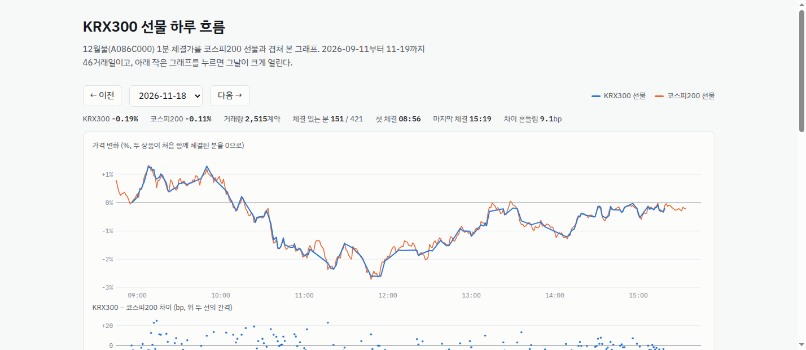

# 5주차 · 데이터 기반 전략 — KRX300 선물 장 시작 지정가

**제출: 2026/11/20(금) 23:59** · 팀 풀옵션(Team-03)

> 이 README 가 5주차 보고서입니다. KRX300 선물을 상품 구조 → 참여자 → 호가 → 방향 순으로 뜯어보고, 시험한 것 대부분을 기각한 끝에 남은 한 가지(장 시작 지정가)를 실행기로 만들었습니다. 두 사람이 따로 분석했고(이건준: 12월물 46일·호가 녹화·실행기 / 강민영: 연결 1분봉 1년치·시장 진단·교차검증), 6-6 의 판정은 1년치 교차검증을 기준으로 합니다.
> **실행 환경을 섞지 않습니다.** 6-1~6-6 은 **과거 봉 자료 백테스트**(Python, 주문 없음), 6-7 은 **호가 녹화 분석**(조회만), 6-8 은 **녹화 호가 재생**(체결은 가정, 주문 없음)입니다. **모의계좌 주문은 제출 주(11/14~20)에는 한 건도 내지 않았습니다.** 전략이 도는 시간이 08:45~09:00 뿐이라 11/23(월) 아침이 첫 실행이었고, 11/23~27 결과는 6-9 에 있습니다.

| 항목 | 내용 |
| --- | --- |
| 전략 | 08:45~09:00 에 KRX300 선물의 넓게 벌어진 호가 안쪽, **코스피200 선물로 환산한 적정가 ∓ d틱**에 지정가를 걸어 둠 |
| 대상 | KRX300 선물 2612 (`A086C000`), 적정가 계산은 코스피200 선물 2612 (`A016C000`), 헤지는 미니코스피 2612 (`A056C000`) |
| 무엇을 사고파나 | 장 시작 직후 적정가에서 40틱 안팎 떨어진 가격에 나오는 1계약짜리 체결을 받아 냄. 체결되면 미니코스피로 헤지하고 09:15 에 두 다리 정리 |
| 이번 주 결론 | 1년치(270거래일) 교차검증에서 **40틱 거리만 유효**(63건, 1회 평균 +14.3틱, t 2.7, 앞뒤 절반 모두 플러스). 30틱은 불확실(t 0.8), **20틱은 손실**(−7.1틱). 실제 체결은 아직 한 번도 확인하지 못함 |

## 한눈에

- KRX300 지수는 **코스피200 × 0.953 + 코스닥 위주 125종목 5%** 입니다. 코스피200과 일간 상관 0.9995, 차이는 하루 10bp 입니다.
- 선물은 하루 약 5,000계약이 돌지만 미결제는 400~1,000계약입니다. **거래의 98.8%가 그날 안에 상쇄**됩니다.
- 참여자는 외국인 51%, 증권·선물사 46%, 개인 2% 입니다. 증권사는 거래소 시장조성 계약 대상입니다.
- 장중 호가 스프레드는 **14틱(8.5bp)** 으로 코스피200 선물(2틱)의 7배이고, 호가는 5초 안에 코스피200을 따라갑니다.
- 과거 호가·체결 내역은 API 에 없어서 **REST 호가 녹화기와 웹소켓 녹화기를 직접 만들어** 자료를 쌓았습니다(4-1).
- 호가를 치는 쪽, 안쪽에 대는 쪽, 바깥에 대는 쪽, 방향을 거는 쪽을 차례로 시험했고 **장중에는 전부 손실**이었습니다.
- **08:45~09:00 에는 스프레드가 약 100틱**으로 벌어지고 그 안쪽에서 1계약씩 체결됩니다. 여기에 지정가를 거는 것이 남은 한 가지입니다.
- 이 전략을 1년치로 다시 돌리면 **적정가에서 40틱 떨어진 곳만** 통계적으로 남습니다. 체결은 4~5거래일에 한 번입니다.

## 폴더 구성

| 경로 | 내용 |
| --- | --- |
| [open_limit.py](open_limit.py) | **실행기** — 적정가 계산, 지정가 걸기·다시 걸기, 체결 시 헤지, 시간 종료 취소, 09:15 청산. 녹화 호가 재생용 브로커 포함 |
| [run_open_limit.py](run_open_limit.py) | **실행 스크립트** — NH 호가를 몇 초마다 조회해 실행기에 넘김. 기본은 주문 없는 예행연습, `--orders` 를 주면 **모의계좌** 주문(4주차 `NHPaperBroker`). 전일 비율 계산, 사전점검, 끝난 뒤 잔고 대조 포함 |
| [ws_rec.py](ws_rec.py) | **웹소켓 호가·체결 녹화기** — NH 실시간(KA 체결·KB 호가)을 받은 순서 그대로, 받은 시각(밀리초)과 함께 저장. 조회만 (4-1) |
| [test_open_limit.py](test_open_limit.py) | 시험 17개 (키·네트워크 불필요) |
| `analysis/` | 분석·백테스트 스크립트와 자료 내려받기 스크립트 (아래 2-2). 1년치 교차검증·시장 진단 쪽 코드와 결과(강민영)도 이 폴더에 올림 |
| `analysis/data/` | NH 1분봉·30초봉(KRX300·코스피200 선물), 일봉, 투자자별 매매 |
| `analysis/idx/` | 지수 구성 종목 비중표와 분해 스크립트 |
| `results/20261120/` | 11/20 호가 녹화 원본(`book_20261120.jsonl`, 5초 간격), 재생 기록(`replay_d20.jsonl`, `replay_d30.jsonl`), 웹소켓 녹화 표본(`ws_sample_20261120.jsonl`, 앞 400줄) |
| `screenshots/` | 날짜별 가격 그래프 캡처 |

---

## 1. 과제 요약

5주차 주제는 「데이터 기반 전략」입니다. 전략을 먼저 정하지 않고 **KRX300 선물이라는 상품에만 있는 특성**을 자료에서 찾은 뒤, 그 특성을 쓰는 전략만 남기는 순서로 진행했습니다.

- 대상 상품은 KRX300 선물입니다. 호가·참여자·장중 분석(6-1~6-5, 6-7)은 12월물이 근월물인 2026-09-11 ~ 11-19(46거래일), 장 시작 지정가의 판정(6-6)은 **연결 1분봉 2025-10-10 ~ 2026-11-18(270거래일)** 입니다.
- 만기 지난 월물은 월물 코드로는 조회되지 않고, 연결선물(`cidx_yn=1`)로 받아야 긴 기간이 나옵니다. 46일 분석은 이를 쓰지 않아 기간이 짧았습니다.
- 46일 구간의 코스피200 선물은 −27.7%, 연율 변동성 52% 였습니다. **급락 구간 한 번의 표본**이라는 점이 46일 기준 숫자 전체에 깔려 있습니다.

## 2. 실행 방법

### 2-1. 준비

NH 선물 Open API 앱(백엔드)이 떠 있어야 합니다. 시세 조회 스크립트는 앱의 로컬 API(`http://127.0.0.1:47100/api/domestic/...`)를 부릅니다. 키는 앱 설정 파일에만 두고 이 저장소에는 넣지 않습니다.

### 2-2. 재현 순서

```bash
cd week05/analysis
python3 krx_dl.py            # 1분봉·일봉 내려받기 (조회만)
python3 dl_30s.py            # 30초봉 내려받기 (분봉 간격 값 0)
python3 inv_dl.py            # 투자자별 매매
python3 analyze.py           # 6-1 유동성·시간대
python3 features.py          # 6-2 참여자·거래량 성격
python3 idx/parse.py && python3 idx/comp.py && python3 idx/px.py && python3 idx/decomp.py   # 6-1 지수 구성과 분해
python3 quote_strats.py      # 6-3 호가 치기·튄 체결
python3 mm_sim_30s.py        # 6-3 호가 대기 (30초 갱신)
python3 leadlag.py           # 6-4 선행 상품
python3 open_limit_bt.py     # 6-6 장 시작 지정가 (30초 갱신)
python3 open_limit_fast.py   # 6-6 같은 전략, 5초 갱신 근사

python3 book_rec.py          # 장중 호가 녹화 (조회만, 08:40~15:50)
mkdir -p book && python3 book_an.py ../results/20261120/book_20261120.jsonl   # 6-7 스프레드·지연·체결 위치
python3 book_mm.py && python3 book_outside.py                                  # 6-7 안쪽·바깥 호가

cd .. && python3 open_limit.py results/20261120/book_20261120.jsonl --ratio 4.35186 --d 20   # 6-8 재생
python3 -m pytest test_open_limit.py -q                                                     # 시험
python3 ws_rec.py --app-dir <앱 폴더> --until 15:50                                          # 웹소켓 호가·체결 녹화 (조회만)
python3 run_open_limit.py --app-dir <앱 폴더>                                                # 실시간 호가로 예행연습 (주문 없음)
python3 run_open_limit.py --app-dir <앱 폴더> --orders                                       # 모의계좌 주문 (08:45 전에 시작)
```

`leadlag.py` 의 ES·NQ 부분과 `idx/px.py` 는 각각 해외 1분봉과 야후 주가를 추가로 받습니다.

## 3. 전략

### 3-1. 무엇을 보고 만든 전략인가

11/20 에 5초 간격으로 녹화한 호가에서, 장 시작 구간은 장중과 전혀 다른 시장이었습니다.

| 시각 | KRX300 선물 스프레드 중앙 | 체결 계약 |
| --- | --- | --- |
| 08:45~08:59 | 97~101틱 | 1 |
| 09:00~09:04 | 65틱 | 77 |
| 09:05~09:09 | 20틱 | 33 |
| 09:10 이후 | 13~14틱 | — |

- 08:48:16 첫 체결 때 호가는 3245.2 / 3325.0 이었고 체결가는 3307.0(1계약)이었습니다. 코스피200으로 환산한 적정가 3311.9 보다 24틱 낮습니다.
- 이런 체결은 넓은 스프레드 **안쪽에 누군가 걸어 둔 지정가**가 체결된 것입니다. 시장가로는 살 수 없는 가격입니다.
- 과거 46일의 1분봉에서도 첫 체결이 적정가에서 중앙 13.5bp(약 23틱) 떨어져 찍혀 있었습니다.

### 3-2. 매매 규칙

```
적정가 F = (전일 15:00~15:19 의 KRX300 선물 / 코스피200 선물 가격 비율 중앙값) × 지금 코스피200 선물 호가 중간값
```

| 단계 | 시각 | 규칙 |
| --- | --- | --- |
| 준비 | 전일 장 마감 뒤 | 15:00~15:19 비율 중앙값 계산 |
| 주문 | 08:45:00 ~ 08:59:30 | KRX300 선물에 F − d틱 매수, F + d틱 매도 지정가를 1계약씩. **d = 40틱**(6-6). 목표가가 몇 틱 넘게 바뀌면 취소하고 다시 걺 |
| 헤지 | 체결 즉시 | 반대쪽 지정가 취소, 미니코스피 4계약 반대 방향 시장가. 하루에 한 번만 체결을 받음 |
| 철수 | 08:59:30 | 미체결 전부 취소. 09:00 현물 개장 뒤에는 걸어 두지 않음 |
| 청산 | 09:15:00 | 두 다리 시장가 정리 |

- 헤지 수량: KRX300 1계약(약 1.7억)에 미니코스피 4계약(약 1.6억), 헤지 비율 약 91%.
- 코스피200 선물 호가가 0.5pt 넘게 벌어지면 적정가를 믿지 않고 주문을 뺍니다.
- 내 목표가가 상대 호가를 넘어 바로 체결될 가격이면 그쪽은 내지 않습니다.

### 3-3. 미리 알고 있는 약점

- **전일 비율이 오늘도 맞는다는 가정.** 전일 비율이 다음 날 09:15~09:30 실제 비율에서 벗어나는 정도가 표준편차 14.6bp, 약 25틱입니다(1년치). 20틱 거리는 이 오차 안쪽이라 기회가 아니라 틀린 적정가에 걸리는 경우가 섞입니다.
- **꼬리 손실.** 40틱에서도 한 번에 −185틱(2026-07-03), −172틱(2026-09-08)인 날이 있었습니다. 1계약 약 −180만원입니다. 실행기에는 아직 손절 규칙이 없습니다.
- **상대가 왜 그 가격에 파는지 모릅니다.** 정보를 가진 쪽이라면 불리한 체결만 받게 됩니다.
- **체결이 며칠에 한 번이고 1계약 단위입니다.** 1년 동안 08:45~09:00 에 KRX300 체결이 있던 날은 271일 중 94일(합계 1,554계약)이고, 40틱 기준 체결은 4~5거래일에 한 번입니다.
- **09:00 이후까지 걸어 두면 손실입니다**(6-6).

## 4. 사용 API와 프로그램 구조

| API | 앱 로컬 경로 / 함수 | 용도 | 환경 |
| --- | --- | --- | --- |
| 국내 차트(분) | `/chart-minute` (`dcnt` 1, 0) | 1분봉·30초봉 | 조회만 |
| 국내 차트(일) | `/chart-daily`, `chart_daily` 원본 | 일봉, 일별 미결제(`occurs1_opint`) | 조회만 |
| 국내 현재가·호가 | `/price`, `/price-bid` | 호가 녹화, 스냅샷 | 조회만 |
| 투자자 매매동향 | `/trend-investor` | 외국인·증권 등 그룹별 매수·매도 | 조회만 |
| 품목 정보 | `/product-detail`, 종목 마스터 | 틱·승수·증거금·월물 코드 | 조회만 |
| 실시간 국내 시세체결 `KA` · 시세호가 `KB` (웹소켓) | `ws_rec.py` — `/trade/ws-stream`, 접속키 발급 → 세션 초기화 → 구독 | 체결 건별·호가 변경 전부 녹화 | 조회만 (모의·실전 둘 다 접속 확인) |
| 국내 신규·취소 주문, 주문내역, 잔고, 주문가능수량 | 4주차 `nh_pair.NHPaperBroker` (`run_open_limit.py --orders`) | 11/23 모의 실행에서 사용 | **모의만. 이번 주 주문 호출 없음** |

```
book_rec.py ── 5초마다 호가·현재가 → results/<날짜>/book_*.jsonl
                                         │
open_limit.py                            ▼
  OpenLimit (실행기) ◀── Quote ── quote_from_snap(녹화 한 줄)  /  run_open_limit.py 가 조회한 실시간 호가
     │ send · filled · cancel
     ▼
  ReplayBroker (녹화 호가로 체결 판정, 시험·재생)  /  nh_pair.NHPaperBroker (모의계좌, 11/23)
```

실행기는 주문을 직접 내지 않고 `broker.send / filled / cancel` 만 부릅니다. 4주차 `NHPaperBroker` 와 같은 모양이라 브로커만 바꿔 끼웁니다.

### 4-1. API 가 주지 않는 자료를 API 로 만들어 쓴 것

NH API 에는 과거 호가를 주는 조회도, 과거 체결 내역을 주는 조회도 없습니다. 이번 주 결론의 대부분은 **API 가 주는 값을 그대로 쓴 것이 아니라, 지금 값을 계속 받아 쌓아서 만든 자료**에서 나왔습니다.

| 만든 것 | 쓴 API | API 가 그대로는 주지 않는 것 | 이걸로 알게 된 것 |
| --- | --- | --- | --- |
| 호가 녹화 (`analysis/book_rec.py`) | 호가·현재가 조회를 5초마다 | 과거 호가 | 장중 스프레드 14틱, 장 시작 100틱, 호가가 5초 안에 코스피200을 따라감 (6-7) |
| **웹소켓 호가·체결 녹화 (`ws_rec.py`)** | 실시간 `KA`·`KB` | 호가가 바뀐 순서 전부, 체결 한 건씩 | 아래 |
| 30초봉 (`analysis/dl_30s.py`) | 분봉 조회의 간격 값 0 | 1분보다 짧은 봉 | 호가 대기 모의를 30초 갱신으로 (6-3) |
| 일별 미결제 | 일봉 조회 원본의 `occurs1_opint` | 미결제 추이 | 거래의 98.8% 가 당일 상쇄 (6-2) |
| 투자자별 일별 매매 (`analysis/inv_dl.py`) | 투자자 매매동향을 날짜마다 | 기간 추이 | 외국인 51%·증권 46%, 순매수는 거래량의 1.5% (6-2) |
| 전일 비율 (`run_open_limit.py`) | 15:00~15:19 분봉 두 종목 | 두 상품 사이의 적정가 | 장 시작 지정가의 기준 가격 (3-2) |

#### 웹소켓 녹화기

REST 녹화는 5초마다 한 장을 찍어 그 사이의 순서를 모릅니다. 6-7 의 분석에 계속 「5초 사이에 무슨 일이 있었는지는 모름」이라는 단서가 붙은 이유입니다. 그래서 서버가 밀어 주는 실시간 메시지를 그대로 받는 녹화기를 따로 만들었습니다.

- 접속: 웹소켓 접속키 발급(연결마다 새로) → `/trade/ws-stream` 연결 → 세션 초기화 → 종목마다 `KA`(체결)·`KB`(호가) 구독. 3종목 6개 구독이고 NH 의 전체 구독 상한은 20개입니다.
- 서버가 보내는 세션 유지 신호(`pingpong`)를 받은 그대로 되돌리고, 끊기면 1·2·5·10·30·60초 간격으로 다시 붙어 구독을 다시 겁니다. 끊김과 재접속도 한 줄로 적습니다.
- 메시지는 해석하지 않고 원문 그대로, **받은 시각(밀리초)** 과 함께 한 줄씩 저장합니다. 키·토큰·접속 주소는 화면에도 파일에도 남기지 않습니다.

11/20 14:46:04 ~ 14:49:10 (186초) 에 받은 것:

| 종목 | 호가(`KB`) 메시지 | 체결(`KA`) 메시지 |
| --- | --- | --- |
| KRX300 선물 | 571 (초당 약 3번) | 197 (그중 실제 체결 13건) |
| 코스피200 선물 | 1,119 | 854 |
| 미니코스피 | 1,277 | 1,177 |

| | REST 녹화 (5초) | 웹소켓 녹화 |
| --- | --- | --- |
| 호가 | 5초마다 5단계 | 바뀔 때마다 **10단계** |
| 단계별 주문 건수 | 없음 | 있음 (`ask_cnt_n`·`bid_cnt_n`) |
| 체결 | 누적 거래량 차이로 추정 | 한 건씩 가격·수량 (`tick_div` = 1) |
| 어느 쪽이 쳤는지 | 직전 호가와 비교해 추정 | 매수 체결 누적·매도 체결 누적이 따로 옴 (`cum_buy_exec_qty`·`cum_sel_exec_qty`) |
| 체결 순간의 최우선 호가 | 최대 5초 전 것 | 체결 메시지에 같이 실림 |

- 받은 KRX300 최우선 호가는 매수·매도 모두 「4계약, 주문 1건」이었습니다. 단계별 주문 건수로 한 참여자가 양쪽에 대고 있는 호가를 직접 가려낼 수 있습니다.
- 11/23 부터는 모의계좌 실행과 같은 시간(08:38~09:25)에 이 녹화가 함께 돕니다. 내 지정가가 걸려 있던 순간의 호가와 체결을 건별로 대조하기 위해서입니다. 용량이 커서(한 줄 약 2.5KB, 47분에 약 220MB) 저장소에는 올리지 않고 표본만 둡니다.
- **이 자료를 읽는 분석 코드는 아직 없습니다.** 지금은 수집기와 11/20 오후 한 시간의 녹화, 표본 400줄까지입니다.

## 5. 실행 환경

| 항목 | 백테스트 (6-1~6-6) | 호가 녹화 분석 (6-7) | 재생 (6-8) | 모의 실행 (6-9) |
| --- | --- | --- | --- | --- |
| 실행 | 로컬 Python | 로컬 Python | 로컬 Python | 11/23 예정 |
| 시세 | NH 1분봉·30초봉, 야후 | NH 호가·현재가 5초 녹화 (11/20) | 같은 녹화 파일 | NH 실시간 호가 |
| 체결 | 봉의 저가·고가가 내 가격을 뚫으면 체결로 가정 | 해당 없음 | 다음 기록에 거래가 있고 마지막 체결가가 내 가격에 닿으면 체결로 가정 | 모의 서버 체결 |
| 주문 | 없음 | 없음 | 없음 | 모의계좌 |

시세 조회는 jarvis-brain VM 에 띄운 앱의 로컬 API 로 했습니다. 투자자 매매동향은 앱이 실전 서버에서 받습니다.

---

## 6. 결과

### 6-1. 상품 — 코스피200과 무엇이 다른가

| 그룹 | 종목 수 | KRX300 비중 | 코스피200 비중 |
| --- | --- | --- | --- |
| 양쪽 공통 | 176 | 95.04% | 99.62% |
| KRX300에만 — 코스닥150 종목 | 91 | 4.11% | 0 |
| KRX300에만 — 그 외 | 34 | 0.84% | 0 |
| 코스피200에만 | 25 | 0 | 0.38% |

KODEX KRX300·KODEX 200 의 11/18 보유종목 기준입니다. 삼성전자 32.7%, SK하이닉스 22.6% 로 두 종목이 55% 입니다.

| 비교 방식 | 일간 수익률 차이 표준편차 | 지수 구성으로 설명되는 몫 |
| --- | --- | --- |
| 지수끼리 (구성 종목으로 합성) | 9.6bp | — |
| 선물끼리, 각자 종가 | 60bp | 12% |
| 선물끼리, 같은 분의 가격 | 15bp | 67% |

KRX300 선물의 마지막 체결은 15:19 전후이고 코스피200 선물 종가는 15:45 입니다. 종가끼리 비교한 60bp 는 그 26분 동안의 시장 움직임입니다.



### 6-2. 참여자 — 누가 왜 거래하나

| 항목 | 값 |
| --- | --- |
| 일 거래량 중앙 | 5,355계약 (명목 약 1.1조, 코스피200 선물의 4.4%) |
| 미결제 | 410~1,068계약 |
| 하루 미결제 변화 ÷ 거래량 (중앙) | 1.2% |
| 일 거래량과 코스피200 거래량의 상관 | −0.12 |

| 상품 | 외국인 | 증권·선물 | 개인 |
| --- | --- | --- | --- |
| KRX300 | 50.8% | 45.5% | 2.1% |
| 코스피200 | 73.3% | 9.6% | 12.9% |
| 미니 | 64.6% | 5.9% | 28.3% |

- 투자자 분류는 API 원자료이고 그룹별 매수·매도 합계만 있습니다. 누가 누구와 체결했는지는 자료에 없습니다.
- 외국인의 하루 순매수는 자기 거래량의 1.5%(중앙)입니다. 외국인 비중은 코스피200 일중 변동폭과 상관 +0.64 입니다.
- 거래소는 2025-12-29 에 2026년 파생상품 시장조성 계약을 맺었고 KRX300 선물이 대상에 들어 있습니다(출처).

### 6-3. 호가에서 버는 쪽 — 과거 봉 자료

| 시도 | 결과 |
| --- | --- |
| 늦은 호가 치기 (코스피200 대비 덜 따라온 쪽으로 다음 분 첫 체결가에 진입) | 신호 때 17~40bp 이던 괴리가 다음 체결에 0.2~0.6bp 만 남음 |
| 튄 체결 되돌림 | 다음 체결에서 54~56% 가 이미 되돌아옴. 편도 1틱 비용에서 마이너스 |
| 적정가 ∓5틱 호가 대기, 60초 갱신 | 체결당 −9.2틱, 불리한 체결 77% |
| 같은 방식, 30초 갱신 | 체결당 −6.3틱, 불리한 체결 78% |

### 6-4. 방향을 거는 쪽

| 시도 | 결과 |
| --- | --- |
| 먼저 움직이는 상품 | 국내에서는 코스피200 선물이 가장 빠름. 삼성전자·SK하이닉스 현물과 선물, 지수, 닛케이 모두 따라감 |
| ES·NQ 추종 | 1분 앞서는 경향은 있으나 승률 45~50%, 기간을 나누면 유의성 소멸 |
| 당일 방향 규칙 11가지 (KODEX 200, 2년) | t값 2 를 넘는 것 없음 |
| 첫 1시간 범위가 넓은 날 추종·역추종 | 1년·6개월은 역추종, 최근 3개월은 추종이 이김 |

첫 1시간(09~10시) 고저 범위는 그날 이후 움직임의 **크기**는 구분했습니다(순위상관 +0.30~+0.46). 방향은 알려 주지 않았습니다.

### 6-5. 방향 전략은 이 상품의 특성을 쓰지 않는다

방향 신호는 코스피200에서 나오고 KRX300 은 그것을 따라갑니다. 같은 전략을 KRX300 선물로 하면 스프레드 14틱(8.5bp)을 건너야 해서 코스피200 선물(1.3bp)보다 불리합니다. 그래서 방향 전략은 접고 호가 쪽 특성만 남겼습니다.

### 6-6. 장 시작 지정가 — 백테스트

#### (가) 1년치 교차검증 — 연결 1분봉 270거래일 (강민영) · 판정 기준

데이터는 NH API 의 KRX300·코스피200 연결 1분봉, 2025-10-10 ~ 2026-11-18(270거래일, 롤오버 날 제외)입니다. 규칙을 분봉으로 근사했습니다.

- 적정가 = 전일 15:00~15:19 KRX300/코스피200 종가 비율 중앙값 × 그 분 코스피200 종가 (호가 중간값 대신 체결가)
- 08:45~08:59 에 적정가 ± D틱 양쪽에 지정가, 하루 최대 1건(먼저 닿은 쪽)
- 체결: 분봉 저가(매수)·고가(매도)가 지정가를 1틱 이상 뚫어야 체결로 봄 (대기열 맨 뒤 가정)
- 헤지: 체결 분에 코스피200 β 0.98, 1틱 불리하게
- 청산 09:15: KRX300 은 09:15 종가에서 호가 절반 7틱 불리, 코스피200 1틱 불리
- 단위는 KRX300 틱(0.2pt = 1만원), 수수료 미포함

| 거리 | 체결 | 1회 평균 | t | 승률 | 앞 절반(~2026-05) / 뒤 절반 |
| --- | --- | --- | --- | --- | --- |
| 20틱 | 77건 | −7.1틱 | −1.55 | 51% | −5.9 / −8.1 |
| 30틱 | 70건 | +3.9틱 | 0.81 | 64% | +6.6 / +1.3 |
| **40틱** | 63건 | **+14.3틱** | **2.72** | 76% | +17.5 / +11.1 |

- 40틱은 앞뒤 절반 모두 플러스이고, 매수(31건 평균 +9.0틱)·매도(32건 +19.5틱) 양쪽 다 플러스입니다.
- 20틱은 1년치로 보면 손실입니다.
- 한 가지 확인이 남아 있습니다. 적정가에 「그 분 코스피200 종가」를 쓰면 체결보다 뒤의 값이 섞입니다. 실제 3초 갱신에 가까운 가정이지만, 그 분 시가로도 돌려 차이를 봐야 결과가 이 가정에 얼마나 기대는지 알 수 있습니다.

#### (나) 12월물 30초봉 43일 (이건준) · 보조

08:45~08:59 에만 주문, 청산은 09:15~09:19 시장가(스프레드 절반 7틱 불리하게), 헤지 비용 1.5틱 차감. 손익 단위는 틱입니다.

| 적정가에서 거리 | 30초 갱신 | 5초 갱신 근사 — 확실한 체결만 | 5초 갱신 근사 — 가능한 체결 전부 |
| --- | --- | --- | --- |
| 5틱 | 38건, −4.4 | 31건, −6.4 | 46건, −6.3 |
| 10틱 | 34건, 0.0 | 28건, −3.8 | 43건, −2.5 |
| 20틱 | 27건, +3.1 (t 0.3) | 19건, +12.1 (t 1.5) | 35건, +7.4 (t 1.2) |
| 30틱 | 20건, +12.3 (t 1.1) | 12건, +25.4 (t 2.5) | 28건, +14.0 (t 2.0) |
| 40틱 | 11건, +20.2 (t 1.9) | 8건, +37.0 (t 3.1) | 18건, +31.0 (t 3.4) |

- **이 표는 1년치보다 전 구간에서 10틱쯤 높게 나왔습니다.** 43일 표본이 유리하게 나온 것이고, 5초 갱신 근사(30초봉 안의 코스피200 고가·저가로 잡은 범위)는 과대였습니다. 멀리 걸수록 좋아진다는 모양만 두 검증에서 같습니다.
- 주문을 09:04 까지 걸어 두면 10틱 −12.9, 20틱 −6.6, 30틱 −3.0 으로 나빠집니다. 09:00 현물 개장 때 불리한 체결이 몰립니다.
- 20틱 거리 27건 중 손익이 가장 컸던 +125틱과 가장 나빴던 −104틱은 모두 밤사이 비율 변화에서 나왔습니다.

#### (다) 서로 따로 해서 같은 숫자가 나온 것

| 항목 | 이건준 | 강민영 |
| --- | --- | --- |
| 장중 호가 차이 | 14틱 (8.5bp), 11/20 5초 녹화 | 12틱 (약 7bp), 11/19 10초 녹화 |
| 외국인 / 증권 비중 | 51% / 46% | 48% / 47% (2026년) |
| 호가가 코스피200을 따라가는 속도 | 5초 안 | 10초 안 (중간가 상관 0.94) |
| 장중 시장가·지정가 전략 | 전부 기각 | 비용을 빼면 손해이거나 검증 불가 |

### 6-7. 11/20 호가 녹화 분석 (5초 간격, 09:05~13:41, 조회만)

| 항목 | KRX300 선물 | 코스피200 선물 |
| --- | --- | --- |
| 스프레드 중앙 | 14틱 (8.5bp) | 2틱 (1.3bp) |
| 최우선 호가 잔량 | 매수 4 / 매도 4계약 | — |
| 호가 중간값의 적정가 대비 괴리 (중앙) | 1.1bp | — |

- 코스피200 이 5초에 10bp 움직이면 KRX300 호가는 같은 5초에 7.9bp, 다음 5초까지 9.8bp 따라옵니다.
- 호가를 친 체결 263건에서 친 쪽은 적정가보다 평균 7틱 불리하게 샀지만, 그 5초 동안 코스피200 이 친 쪽에 유리하게 평균 7.8틱 움직였습니다(89%). 호가를 대던 쪽은 5~10초 뒤 기준 체결당 −1.7~−2.2틱입니다.

| 내 호가 위치 | 체결 | 결과 |
| --- | --- | --- |
| 적정가 ∓2틱 (스프레드 안쪽), 60초 뒤 평가 | 시간당 61.5건 | −5.0틱 |
| 적정가 ∓6틱 (안쪽) | 시간당 36.6건 | −4.1틱 |
| 상대 최우선 호가보다 5틱 바깥, 체결 즉시 상대 호가에 청산 | 75건 | −11.4틱, 승률 16% |
| 같은 방식에서 코스피200 이 거의 안 움직인 체결만 | 9건 | +0.3틱 |

장중에는 안쪽·바깥 어느 쪽에 서도 손실이었고, 바깥 호가의 체결 75건 중 56건은 코스피200 이 5bp 이상 불리하게 움직인 순간이었습니다. **녹화는 13:41 까지의 분석이고 하루치입니다.**

### 6-8. 11/20 장 시작 재생 (녹화 호가, 체결 가정, 주문 없음)

`open_limit.py` 를 11/20 녹화 파일에 그대로 돌렸습니다. 전일 비율 4.35186(11/19 는 개장이 1시간 늦어 16:00~16:19 로 계산).

| 거리 | 결과 |
| --- | --- |
| 10틱 | 08:48:16 매수 3309.4 체결 → 미니 760.92 매도 4계약 → 09:15:01 KRX300 3335.8 매도, 미니 766.8 매수 → **+144,000원** |
| 20틱 | 08:48:16 매수 3307.4 체결 → 같은 헤지·청산 → **+244,000원** (KRX300 +1,420,000 / 미니 −1,176,000) |
| 30틱 | 체결 없음 |
| 40틱 | 체결 없음 |

- **모의계좌 체결이 아닙니다.** 녹화한 호가에 「다음 기록에 거래가 있고 마지막 체결가가 내 가격에 닿으면 체결」이라는 규칙을 적용한 결과이고, 수수료는 넣지 않았습니다.
- 그 시간대 체결은 3307.0 에 1계약 하나였습니다. 다시 거는 기준을 5틱으로 바꾸면 내 호가가 조금 낮게 남아 20틱 거리도 체결되지 않습니다. 하루 결과가 1계약짜리 체결 하나에 달려 있습니다.
- **10틱·20틱은 1년치 검증에서 손실 구간입니다**(6-6 가). 이 날 플러스가 나온 것은 하루의 결과이고, 유효한 거리인 40틱은 이 날 체결이 없었습니다.
- 15분 동안 지정가 주문 횟수는 20틱 거리 56회, 30틱 거리 226회였습니다.

### 6-9. 모의계좌 실행 — 2026-11-23 ~ 11-27

> **NH 국내 모의계좌 주문** 기록입니다(앱 시뮬레이션 아님). 숫자는 `results/<날짜>/live_summary.json`·`results/live_runs.csv` 의 체결 기록에서 옮겼습니다. 승수 KRX300·미니코스피 모두 1pt = 5만 원(KRX300 1틱 0.2pt = 1만 원).

| 날짜 | d | 전일 비율 | 지정가(다시 걸기 포함) | 체결 | 헤지·청산 | 손익(원) | 비고 |
| --- | --- | --- | --- | --- | --- | --- | --- |
| 11-23 | 10틱 | 4.3513 | 37회 | KRX300 매도 1 @ 3148.6 (08:47) | 미니 매수 4 @ 725.44 → 청산 매도 4 @ 735.96. **KRX300 청산 주문 거부**로 −1계약 남음 | (−873.6만) | 미니 다리 +210.4만. KRX300 −1계약은 다음 날 09:40 3365.4 에 정리(−1,084만) — 헤지 없이 하루 넘긴 손실이라 괄호로 표시 |
| 11-24 | — | — | — | — | — | — | 11/23 잔여 포지션으로 STOP — 실행 안 함 |
| 11-25 | 10틱 | 4.3517 | 75회 | KRX300 매수 1 @ 3240.6 (09:00) | 미니 매도 4 @ 743.48 → 청산 매수 4 @ 735.54 / KRX300 은 **늦은 체결**로 3246.2 매도 | +186.8만 | KRX300 +28만 · 미니 +158.8만. 손익 대부분이 헤지 다리 |
| 11-26 | 40틱 | 4.3601 | 80회 | KRX300 매수 1 @ 3180.0 (09:02) | 미니 매도 4 @ 728.96 → 두 다리 청산 (3187.6 · 730.50) | +7.2만 | KRX300 +38만 · 미니 −30.8만. 설계대로 끝난 첫 거래 |
| 11-27 | 40틱 | 4.3620 | 60회 | 설계 안 체결 0 | — | −97만 | 「미접수」 주문 2건이 설계 밖에서 체결 — 09:00:59 매도 3182.4 → 3200.6 매수, 09:17:08 매수 3160.6 → 3159.4 매도, 둘 다 헤지 없이 즉시 청산 |

- **합계(4회 실행)**: 설계대로 끝난 거래는 11/26 한 건(+7.2만)뿐입니다. 11/25 는 늦은 체결, 11/23·27 은 모의 서버의 「미접수」 주문(취소가 5039 로 거부되다가 나중에 체결) 때문에 설계 밖 포지션이 생겼고, 11/23 을 포함하면 −776.6만 원입니다.
- **「미접수」 주문**: 주문번호는 받았는데 주문내역에서 거래소 접수시각이 비어 있고, 취소는 계속 5039 로 거부되다가 나중에 체결됩니다(11/23·25·26·27 매일 발생). 오류-문의 채널에 제보했고(11/26) 운영에서 「모의 서버 불안정으로 보이며 담당 부서 확인 중」이라고 답했습니다. 실행기는 취소가 거부된 주문을 실행이 끝난 뒤에도 지켜보다가, 체결되면 바로 정리합니다(11/27 09:17 건).
- **판단**: 4회로는 40틱 거리의 우위를 확인할 수 없습니다. 설계 밖 체결을 빼면 표본이 1건이라, 12/09 까지 계속 돌려 표본을 늘립니다.

- 11/23 부터의 모의계좌 실행 결과는 실행이 끝난 뒤(평일 09:26) 실행 서버가 이 저장소 main 에 `[자동]` 커밋으로 올립니다.
  - `results/<날짜>/live_events.jsonl` — 지정가·취소·체결·헤지·청산·잔고 대조를 한 줄씩
  - `results/<날짜>/live_book.jsonl` — 그 시간에 조회한 호가 (약 3초 간격)
  - `results/<날짜>/live_summary.json` — 그날 요약
  - `results/live_runs.csv` — 날짜별 한 줄 요약 (거리, 지정가 횟수, 체결, 손익, 남은 포지션)

## 7. 결론과 한계

- KRX300 선물에만 있는 특성은 **넓은 스프레드, 장 시작의 빈 호가, 실수요 부재, 코스피200과의 촘촘한 가격 관계**였습니다. 방향 전략은 이 중 아무것도 쓰지 않습니다.
- 장중 호가 싸움은 초 단위 이하에서 갈리고, 5초 자료와 REST 주문으로는 어느 쪽에 서도 손실이었습니다.
- 장 시작 15분은 받으려는 폭(40틱)이 몇 초 동안의 시세 움직임(1초 약 2틱, 5초 약 5틱)보다 훨씬 커서 속도가 덜 중요합니다. 그래서 이 구간만 전략으로 남겼습니다.
- 1년치로 다시 보면 남는 것은 40틱 거리 하나입니다. 빈도가 낮은(4~5거래일에 한 번) 대신 앞뒤 절반과 매수·매도 양쪽에서 모두 플러스였습니다.
- 한계
  - 호가·참여자·장중 분석은 46일이고 지수가 28% 빠진 시기입니다. 장 시작 지정가의 판정만 1년치입니다.
  - 장 시작 스프레드가 100틱이라는 것은 11/20 하루만 직접 봤습니다. 과거 구간은 체결가가 적정가에서 20~40틱 떨어져 찍힌다는 사실로 간접 확인했습니다.
  - 1년치도 63건이고, 거리 세 개를 훑은 뒤 고른 숫자라 실제 유의성은 t 2.72 보다 낮습니다. 1분봉 체결가 기준이라 같은 분 안의 순서는 모릅니다.
  - 40틱에서도 하루 −185틱까지 잃은 날이 있었고, 손절 규칙은 아직 없습니다. 09:05 전에는 스프레드가 65~100틱이라 그 전에 시장가로 손절하면 손절 자체가 50틱 안팎입니다.
  - 모의 서버가 스프레드 안쪽 지정가를 어떻게 체결시키는지 확인하지 못했습니다.

## 8. 오류·개선

### 8-1. API 에서 본 것

| 현상 | 내용 |
| --- | --- |
| 투자자 매매동향의 빈 날 | 2026-10-20 이후는 매일 값이 오지만, 10-19 이전은 **수·목요일만** 값이 있고 나머지 평일은 오류 없이 전부 0 으로 옴. KRX300·코스피200·미니·코스닥150 모두 같은 날짜가 빔. 거래가 있던 날(9/11 7,432계약 등)임 |
| 분봉 간격 값 0 | `dcnt=0` 을 넣으면 30초봉이 옴. 하루 거래량 합이 일봉과 일치함 |
| 체결 없는 분 | 봉이 아예 없음. KRX300 은 411분 중 중앙 192분만 봉이 있어 직접 격자를 만들어 채워야 함 |
| 개장이 늦은 날 | 11/19 는 봉 시각이 1시간 밀려 있음(09:45~16:45) |
| 실시간 `KB` 는 10단계 | REST 호가 조회는 앱 기준 5단계까지 썼는데, 웹소켓 호가는 10단계와 단계별 주문 건수가 함께 옴 |
| 실시간 `KA` 에 체결 아닌 메시지 | `tick_div` 가 0 인 메시지는 체결량 0 의 기타 갱신(현물지수 등). 186초 동안 KRX300 `KA` 197건 중 실제 체결은 13건 |
| 체결구분 `exec_div` | 값의 뜻이 명세에 없어 매수·매도로 바꾸지 않고 원문 그대로 저장 |
| 만기 지난 월물 | 월물 코드로는 분봉·일봉 조회 0건. 긴 기간은 연결선물(`cidx_yn=1`)로 받아야 함 |

### 8-2. 분석에서 틀렸다가 고친 것

- **같은 분 안의 시각 어긋남.** 「코스피200 대비 괴리가 다음 체결에 72~76% 되돌아온다」를 기회로 읽었으나, 두 상품의 마지막 체결 시각이 몇십 초 달라 생긴 숫자였습니다. 진입을 한 박자 늦춰 다시 재니 사라졌습니다.
- **신호 가격에 그대로 진입.** 첫 체결가 자체에 들어간 것으로 계산하면 승률 100% 가 나왔습니다. 그 가격은 남의 체결입니다.
- **비용 가정.** 호가 자료가 없을 때 KRX300 왕복 비용을 2틱으로 잡았는데, 녹화해 보니 스프레드가 14틱이었습니다. 6-4 의 KRX300 선물 기준 숫자는 그만큼 더 불리합니다.
- **자료 해상도.** 호가 대기 모의를 1분봉으로 돌린 뒤에야 30초봉이 있다는 것을 확인했습니다.
- **기간.** 46일로 낸 장 시작 지정가 결과는 1년치보다 전 구간에서 10틱쯤 높았고, 20틱을 플러스로 봤으나 1년치에서는 손실이었습니다. 연결선물로 긴 기간을 받을 수 있다는 것을 놓쳤습니다.

### 8-3. 다음에 할 것

- 11/23(월) 아침 모의계좌 첫 실행 결과로 6-9 를 채움. 모의계좌 주문·취소는 그때가 첫 호출이라, 주문 거부나 체결 조회 문제는 그 실행에서 드러남.
- 모의 서버의 지정가 체결 방식과 주문 횟수 제한 확인.
- 웹소켓 녹화 자료를 읽는 분석 코드 — 장 시작 안쪽 지정가를 누가 치는지, 시장조성자 호가가 코스피200 을 따라오는 데 걸리는 시간(밀리초), 1초 갱신일 때의 결과.
- 장 시작 호가를 며칠 더 녹화해 스프레드 100틱이 매일 반복되는지 확인.
- 꼬리 손실 규칙(체결 전 코스피200 이 크게 움직이면 주문 취소, 09:05 이후 건당 손절선)과 비율 오차 줄이기 — 6주차(주문·위험관리 응용)로 넘김.

## 9. 시험 (`test_open_limit.py`, 17개 통과)

| 시험 | 확인하는 것 |
| --- | --- |
| 가격 반올림 | 매수는 내림, 매도는 올림 (적정가에서 멀어지는 쪽) |
| 시작 전 주문 금지 | 08:45 전에는 주문을 내지 않음 |
| 양쪽 지정가 | 적정가 ∓ d틱에 매수·매도 1계약씩 |
| 다시 거는 기준 | 목표가가 2틱 넘게 바뀔 때만 취소 후 재주문 |
| 체결 시 헤지 | 미니코스피 4계약 반대 방향, 반대쪽 지정가 취소 |
| 거래량 조건 | 누적 거래량이 늘지 않았으면 체결로 보지 않음 |
| 시간 종료 | 08:59:30 에 미체결 전부 취소하고, 다음 조회에서 체결 여부를 한 번 더 확인 |
| 09:15 청산과 손익 | 두 다리 정리, 손익이 손계산과 일치 |
| 매도 체결 | 방향이 반대로 맞게 처리됨 |
| 코스피200 호가 이상 | 주문을 빼고 쉼 |
| 상대 호가와 겹침 | 바로 체결될 가격이면 그쪽은 내지 않음 |
| 헤지 거부 | 숨기지 않고 「한 다리만 보유」로 기록 |
| 하루 한 번 | 체결 뒤 새 지정가를 내지 않음 |
| 취소와 체결의 엇갈림 | 취소한 줄 알았던 주문이 체결돼도 놓치지 않고 수량만큼 헤지 |
| 철수 뒤 늦은 체결 | 08:59:30 취소 뒤 한 번 더 확인해, 늦게 체결된 것을 포지션으로 잡음 |
| 양쪽 체결 | 매수·매도가 모두 체결되면 헤지 없이 종료 |
| 헤지 미체결 | 시장가 헤지가 체결되지 않으면 손익을 확정하지 않고 「헤지 미완료」로 기록 |

## 출처

- [KRX 영문 상품 페이지 — KRX300 Futures](https://global.krx.co.kr/contents/GLB/02/0201/0201040211/GLB0201040211.jsp)
- [머니투데이 2026-09-09 — KRX 300 소수집중형지수 전환](https://www.mt.co.kr/stock/2026/09/09/2026090914245483089)
- [FUNETF — KODEX KRX300 구성종목](https://www.funetf.co.kr/product/etf/view/KR7292190006)
- [라이센스뉴스 — 2026년 주식·파생상품 시장조성 계약](https://www.lcnews.co.kr/news/articleView.html?idxno=120125)
