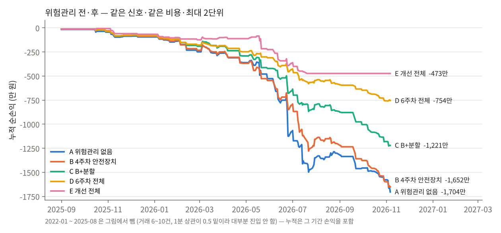
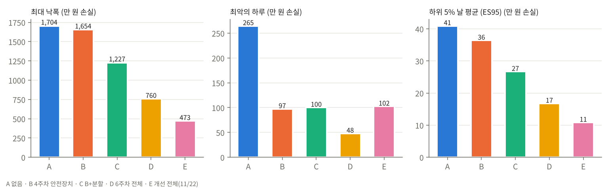
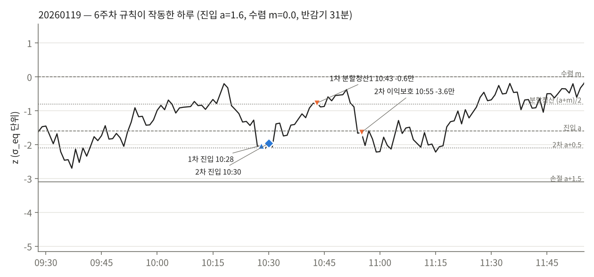

# 6주차 · 전략 + 위험관리 — 삼성전자–SK하이닉스 주식선물 페어에 손절·분할·한도·실시간 감시 붙이기

**제출: 2026-11-27(금) 23:59** · 팀 풀옵션(Team-03)

> 이 README 가 6주차 보고서입니다. 전략은 **4주차 것을 그대로** 쓰고(1절), 이번 주는 「얼마나 잃으면 나오나 · 얼마씩 나눠 들어가고 나오나 · 도는 동안 무엇을 지켜보나」를 정해 코드로 만들었습니다(3절).
> **실행 환경을 섞지 않습니다.** 4절·5-1 은 **과거 1분봉 백테스트**, 5-2 는 **과거 1분봉을 흘려 넣은 재생 시연**(서버 아님), 5-3 은 **NH 국내 모의계좌 실행**입니다. 결과가 마이너스여도 그대로 씁니다.

| 항목 | 내용 |
| --- | --- |
| 전략 | 4주차 6-4 「보정 OU · 시장가 · 추세필터」 — 삼성전자–SK하이닉스 주식선물 가격비 스프레드 평균회귀 |
| 이번 주에 붙인 것 | ① 손절(가격·금액·시간·이익보호) ② 분할 매수·분할 매도 ③ 보유·하루 손실·손절 횟수·누적 낙폭 한도 ④ 웹소켓 실시간 감시(틱 손절·미체결·거부·끊김·시세 멈춤) |
| 비교 | 같은 기간(2022-01-10 ~ 2026-11-06, 1,173일) · 같은 신호 · 같은 비용 · 같은 최대 2단위에서 위험관리 7단계 |
| 실행 | 주문은 모의(paper) 키, 시세는 실전(real) 키 — 4주차와 같음 |
| 작성 | 강민영 |

## 한눈에

**위험관리를 다 넣자 손실이 −1,704만 → −754만 원, 최대 낙폭 −1,704만 → −760만 원, 최악의 하루 −265만 → −48만 원으로 줄었습니다.** 하지만 여전히 마이너스입니다. 위험관리는 손실의 크기와 꼬리를 줄였을 뿐 비용(1틱)을 넘는 이익을 만들지 못했고, 이는 4주차 결론과 같습니다.

1. **손절 하나만 넣으면 오히려 나빠짐(4-2)** — z 손절만 넣은 A1 은 −2,012만 원으로 A 보다 308만 원 더 잃음. 이동평균이 포지션을 따라 움직여서 z 가 손절선에 늦게 닿기 때문(최악의 거래 −285만 원). **거래당 손실을 실제로 막은 건 금액 손절**(최악의 거래 −265만 → −91만 원)
2. **분할(4-3)** — 1차 1단위 → 더 벌어지면 2차 → 중간에서 절반 청산. 평균 보유가 2 → 1.57단위로 줄고 손실 −1,652만 → −1,221만 원. 1만 단위·분당 비용 전 손익은 313만 → 494만 원으로 가장 좋음
3. **한도(4-4)** — 누적 낙폭 −250만 원 「그날 중단」이 2026-05-11 처음 걸린 뒤 사실상 「하루 1단위」로 묶음 → 그 뒤 손실 −942만(C) → −517만 원(D). **이 규칙이 「이 전략을 멈춰라」를 자동으로 말한 것**
4. **실시간 감시(5-2)** — 같은 날 1분봉 손절은 09:29, 틱 손절은 09:25:15 에 나옴(4분 빠름). 끊김 20초·시세 멈춤 120초·주문 거부를 잡아 신규를 멈추고, 거부는 사람이 확인할 때까지 안 풀림
5. **값은 결과를 보기 전에 정함** — 민감도(4-5)에서 값을 하나씩 바꿔도 D 는 −707만 ~ −823만 원 안. 순서가 뒤집히는 값은 없음
6. **11/22 개선 네 가지(4-6)** — 고정 z 손절·비율 한도는 오히려 나빠졌고(−754만 → −1,016만 원), 재검증 재개·갭 필터가 거래를 줄여 −473만 원. 다만 **최악의 하루는 −48만 → −102만 원으로 커짐**. 개선이라기보다 「덜 거래해서 덜 잃음」

## 폴더 구성

| 경로 | 내용 |
| --- | --- |
| [rules6.py](rules6.py) | **위험관리 엔진** — 트랜치(분할 묶음)·손절·분할·한도·실시간 차단. 백테스트와 실행기가 같이 씀 |
| [monitor6.py](monitor6.py) | **실시간 감시** — `Watch`(판단, 네트워크 없음) + `NHStream`(NH 앱 웹소켓 KA·O1_K) |
| [runner6.py](runner6.py) | 장중 실행기 — 4주차 `pair_spread.Runner` + Engine6 + Watch. 1초 감시 루프 · 20초 판단 |
| [backtest6.py](backtest6.py) | 전·후 비교 백테스트 7단계 + 민감도 |
| [theory6.py](theory6.py) | 값의 근거 숫자 (OU 도달확률·수렴시간 분포·손절 짝비교) |
| [evidence6.py](evidence6.py) | 어림값 기준의 데이터 근거 · OU 모형 확률 vs 실제 빈도 (3-6) |
| [demo6.py](demo6.py) | 재생 시연 — 과거 하루를 틱으로 흘리고 장애를 끼워 넣음 (서버 아님) |
| [figs6.py](figs6.py) | 그림 |
| [test6.py](test6.py) | 시험 33개 (키·네트워크 불필요) |
| `v1_20261120/` | 11/22 수정 전 파일 보관 (README·rules6·runner6·monitor6·backtest6·test6·figs6·demo6) |
| `pair_core.py` · `risk_layer.py` · `ou_noise.py` · `pair_spread.py` · `nh_pair.py` | **4주차 파일 그대로** (고치지 않음) |
| `results/` | `compare.csv` · `compare_by_year.csv` · `sensitivity.csv` · `trades_<설정>.csv` · `risk_events_D.csv` · `risk_events_E.csv` · `theory6.json` · `demo_<날짜>/` · `figs/` |
| `run6_*.bat` | 윈도에서 두 번 눌러 실행 |

1분봉 원본(`pair_1m_full.csv`, 38MB)은 올리지 않습니다. `data/` 나 4주차 폴더 `results/` 에 있으면 찾아 씁니다.

---

## 1. 쓴 전략 요약 — 4주차 6-4 그대로

| 칸 | 내용 |
| --- | --- |
| 스프레드 | s = ln(삼성) − ln(하이닉스) (가격비, β = 1 — 4주차 3-11 에서 학습 구간 1위) |
| 숫자 | 매일 장 전, 전날까지 2일 1분 스프레드로 **OU + 호가 튐 분리** 추정(4주차 6-4) → 비용을 넣은 분당 기대이익 최대인 진입선 a · 청산선 m (Bertram 2010). 창 = 반감기×5, 최대 보유 = 반감기×3 |
| 진입·청산 | z ≤ −a 면 삼성 매수·하이닉스 매도, z ≥ +a 면 반대 / z 가 m 안으로 돌아오면 청산 |
| 필터 | 추세 반대 진입 금지 · 1분 상관 < 0.5 면 진입 안 함 · 09:15 전 · 14:50 뒤 · 15:15 강제 청산 |
| 1단위 | 하이닉스 1계약 + 금액을 맞춘 삼성(2026-11-06 종가로 6계약). 1단위 명목 약 2,270만 원(두 다리 합; 이 기간 약 130만~5,900만 원) |
| 비용 가정 | 다리마다 체결마다 1틱 + 수수료 편도 0.003%(**NH 실제 수수료율은 모름 — 가정**) |
| 4주차 결과 | 비용 전 손익은 플러스(검증 +90만 원)였지만 비용의 1/4 이라 순손익 마이너스 |

이 설정을 고른 이유: 4주차 17가지 중 **비용 전 손익이 학습·검증 둘 다 플러스였던 유일한 설정**입니다. 신호에 약한 엣지라도 있어야 「위험관리가 그 엣지를 얼마나 지키나」를 볼 수 있습니다.

이 기간 중앙값: 반감기 33.6분 · 진입선 a 1.7σ · 청산선 m 0 · 최대 보유 101분.

## 2. 실행 방법

| 순서 | 할 일 | 명령 |
| --- | --- | --- |
| 1 | 시험 | `python test6.py` → 「33/33 통과」 |
| 2 | 전·후 비교 (처음엔 OU 계획 계산에 약 7분, 그다음은 `cache/` 에서 2분) | `python backtest6.py` |
| 3 | 근거 숫자 | `python theory6.py` |
| 4 | 재생 시연 | `python demo6.py --date 20251110` · `python demo6.py --date 20260212 --reject-nth 2` |
| 장중 | 모의계좌 실행 (5-3) | `python runner6.py --app-dir <앱 폴더> --paper-order` → 15:30 자동 종료, `results/<날짜>/` |

- 웹소켓은 NH 앱(nh-futures-open-api)의 `backend.realtime.link.Connection` 을 그대로 씁니다. 따로 깔 것은 없습니다.
- 모의 주문이 막히면 `--sim`. 웹소켓이 안 붙으면 `--no-stream`(④ 꺼짐 — 5-3 표에 표시).
- 거부·미체결·레그 실패·한 다리 노출·낙폭 중단으로 멈추면 HTS 에서 잔고를 확인한 뒤 `--ack` 를 붙여 다시 켭니다. 이 중지는 `results/risk_state6.json` 에 저장돼 **날이 바뀌어도 유지**됩니다.
- 실행기 기본 규칙은 **11/20 규칙(설정 D)** 입니다 — 백테스트에서 꼬리 손실이 더 작았기 때문입니다(4-6). 11/22 개선 규칙(설정 E)으로 돌리려면 `--rules e`. 11/22 에 고친 실행기 결함과 한 다리 노출·감시 끊김 대응은 어느 쪽에도 적용됩니다. D 는 낙폭 중단 다음 날 1단위로 자동 재개하고, E 는 `--ack` 전까지 재개하지 않습니다.

## 3. 위험관리 규칙과 값을 정한 이유

**값은 결과를 보기 전에 정했고, 결과를 본 뒤 바꾸지 않았습니다.** 근거는 ① 4주차에서 이미 쓰던 값 ② OU 확률과정에서 계산한 확률 ③ 계좌 규모 가정 셋입니다(`theory6.py` → `results/theory6.json`). 4-5 민감도는 「이 근처에서 결론이 뒤집히나」 확인용입니다.

### 3-1. 손절선

| 규칙 | 값 | 이유 |
| --- | --- | --- |
| 가격 손절 | \|z\| ≥ a + 1.5σ | 표준화 OU 에서 a 에서 출발해 m 보다 a+1.5 에 먼저 닿을 확률은 5.1% (a+1.0 은 17.5%, a+2.0 은 1.1%). **실제로는 A1 172건 중 31건(18%)이 이 선에 닿았습니다** — 모형의 약 3.5배, 5~6번에 한 번 꼴. 그래서 「닿으면 OU 가 깨졌다는 신호」로 볼 수는 없고, **모형이 꼬리를 작게 본다**고 읽는 게 맞습니다(11/24 정정). 값 자체는 4주차와 같고, 민감도(4-5)에서 1.0 은 나빴고 2.0 은 비슷했습니다 |
| 금액 손절 | 평가손실 ≥ 단위당 **30만 원** | 4주차 리스크 레이어의 거래당 꼬리 예산(ES97.5). 지금 1단위 명목(약 2,270만 원)의 1.3%. z 손절과 달리 **이동평균이 따라와도 손실 금액을 직접 묶음** (4-2 에서 이게 핵심으로 드러남) |
| 시간 손절 | 보유 ≥ 반감기 × 3 | OU 몬테카를로(2만 번)에서 a → m 수렴 시간은 중앙 1.55·평균 1.98 반감기, 3 반감기 넘게 안 돌아올 확률 19%. **실제로는 A 154건 중 57건(37%)** 이 3 반감기를 넘겼습니다(모형의 약 2배, 11/24 정정). 이 57건은 승률 8.8%·평균 −35.6만 원(넘기지 않은 거래는 +3.4만 원) — 근거는 모형 확률이 아니라 이 실제 손익 차이 |
| 상관 붕괴 | 1분 상관 < 0.2 | 4주차 그대로 — 두 다리가 따로 놀면 페어가 아님 |
| 이익 보호 | 분할 청산 뒤 \|z\| 가 다시 a 까지 벌어지면 남은 것 청산 | 절반을 익절한 뒤 남은 절반이 원래 진입 자리로 돌아가면 「되돌림이 끝났다」고 봄 |
| 틱 손절 | 위 가격·금액 손절을 **체결 틱마다** 다시 계산 | 1분봉 판단은 봉이 끝나야 알 수 있음. 웹소켓 틱으로 봉 중간에 넘으면 바로 청산 (5-2 에서 4분 빨랐음) |

### 3-2. 분할 매수·분할 매도

| 규칙 | 값 | 이유 |
| --- | --- | --- |
| 1차 진입 | z = a 에서 **1단위** | 4주차는 한 번에 다 들어감. 2단위를 한 번에 넣으면 가장 덜 벌어진 자리에서 전부 들어감 |
| 2차 진입 | \|z\| ≥ **a + 0.5** 에서 1단위 더, 보유 시간이 최대 보유의 절반 안일 때만 | OU 에서 a 에서 a+0.5 에 m 보다 먼저 닿을 확률 46%. **실제로는 C 177건 중 101건(57%)** 이 2차까지 들어갔습니다(11/24 정정). 손절선(a+1.5)까지 1.0σ 남겨 2차 단위의 최대 손실을 1차의 2/3 로 묶음. 오래 안 돌아오는 포지션에는 안 보탬(시간 손절과 같은 논리) |
| 1차 청산 | z 가 (a + m)/2 (중간선)에 오면 **먼저 들어간 단위만** | 수렴 시간이 반감기 1.5배 넘게 걸릴 확률이 모형상 52% — 절반은 중간에서 확정해 「다 왔다가 다시 벌어지는」 위험을 줄임. 다른 세 확률처럼 실제는 모형보다 클 가능성이 높지만 따로 재지 않음 |
| 나머지 청산 | z = m (원래 수렴선) | 4주차 그대로 |

### 3-3. 보유·손실 한도

| 규칙 | 값 | 이유 |
| --- | --- | --- |
| 최대 보유 | **2단위** (하이닉스 2 · 삼성 약 12계약) | 명목 약 4,500만 원(2026-11-06 기준). 증거금률 15% 가정(모름)이면 약 700만 원. 실행기는 진입 전 `주문가능수량` API 로 두 다리가 다 들어가는 단위만 냅니다(11/22 추가 — 11/20 판에는 빠져 있었음) |
| 하루 손실 한도 | 실현손실 **−60만 원** → 그날 신규 금지 | 금액 손절 두 번(30만 × 2). 4주차와 같은 값 |
| 하루 손절 횟수 | 손절 **2번** → 그날 신규 금지 | 처음엔 「손절 확률이 5%인 사건이 하루 두 번이면 그날 추정이 틀린 것」으로 정했으나, **실제 손절 비율은 거래당 41.8% 라 이 근거는 틀렸습니다**(11/24 정정). 데이터 근거는 3-6 — 오히려 1회를 가리킴 |
| 누적 낙폭 | 고점 대비 **−150만** → 최대 1단위(2차 금지) · **−250만** → 그날 중단, 다음 날부터 1단위 · −100만 위로 회복하면 원래대로 | 4주차 리스크 레이어 값 그대로. −250만 원은 금액 손절 8번 남짓. 실행기는 누적손익·낙폭 상태를 `results/risk_state6.json` 에 저장해 날을 넘겨 이어 갑니다(11/22 수정) |

### 3-4. 실시간 모니터링 (`monitor6.py`)

NH 앱의 웹소켓으로 **국내_시세체결(KA)** 두 종목과 **국내_주문/체결(O1_K)** 을 받습니다. 시세는 실전 키, 주문 알림은 모의 키 연결입니다.

| 보는 것 | 값 | 하는 일 | 이유 |
| --- | --- | --- | --- |
| 연결 상태 | LIVE 아닌 채 **20초** | 신규 중지 → 다시 붙으면 해제 + REST 로 1분봉·잔고 즉시 다시 받기 | 실시간은 끊긴 동안 값을 메워 주지 않음(앱 문서). 20초 = REST 루프 한 바퀴 |
| 시세 멈춤 | 장중 한 다리라도 체결 틱 **120초** 없음 | 신규 중지 → 틱 오면 해제 | 연결은 살아 있는데 값만 멈추는 경우. 두 종목 모두 보통 분마다 여러 번 체결됨 — 2분이면 비정상 |
| 주문 거부·자동취소 | 처리구분 9·8 | 신규 중지, **사람이 확인할 때까지** (`--ack`) | 증거금·가격 제한 같은 원인은 다시 내도 또 거부됨 |
| 미체결 | 접수 뒤 **10초** 경보 · **30초** 신규 중지(사람 확인) | | 시장가가 30초 넘게 안 차면 한 다리만 남았을 수 있음. 4주차 체결 확인(6초 + 재주문 1회)보다 넉넉히 |
| 틱 손절 | 3-1 가격·금액 손절을 틱마다 | 그 자리에서 청산 (봉 끝 안 기다림) | |

**청산은 어떤 이상에서도 막지 않습니다.** 막는 것은 신규 진입뿐이고, 감시가 끊겨도 4주차 REST 루프(20초)·5분 잔고 대조는 그대로 돕니다.

### 3-5. 11/22 개선 규칙 (설정 E, `rules6.improved()`)

11/20 판(설정 D)을 점검하며 찾은 빈 곳을 메운 규칙입니다. **값은 백테스트를 돌리기 전에 정했고**, 결과(4-6)가 좋지 않은 것도 그대로 둡니다.

| 규칙 | 값 | 이유 |
| --- | --- | --- |
| 고정 z 손절 | z₀ = (s − 진입 시점 평균) / σ_eq 가 a + 1.5 밖 — 이동 z 와 둘 중 먼저 닿는 쪽. 2차 진입선(a + 0.5)도 z₀ 로 | 4-2: 이동평균이 포지션을 따라와 이동 z 는 손절선에 늦게 닿음 |
| 비율 한도 | 금액 손절 1.3% · 하루 손실 2.6% · 낙폭 6.6% / 11% / 회복 4.4% (진입 명목, 두 다리 합 대비) | 1단위 명목이 기간 중 약 130만 ~ 5,900만 원으로 변함. 비율은 D 의 원 단위 값을 2026-11-06 명목(약 2,270만 원)에서 환산 |
| 재검증 재개 | 낙폭 중단 뒤 자동 재개 없음. 백테스트: 주문 없이 1단위 가상 매매를 이어가다 최근 20건 순손익 합 > 0 이면 1단위로 재개(고점을 그 시점으로 다시 잡음). 실행기: 사람이 `--ack` 로 풀 때까지 | 4-4: 「다음 날 1단위 재개 → 손실 → 다시 중단」 반복 |
| 그날 쉬기 | 밤사이 스프레드 갭이 2σ_eq 초과 · 주식선물 만기일(둘째 목요일) | OU 추정이 전날까지 2일 데이터라 밤사이 크게 뛴 날에 약함. 실적 발표일 목록은 정확한 과거 날짜가 없어 넣지 않음 |

실행기에만 있는 것(백테스트로 잴 수 없음):

| 상황 | 단계 |
| --- | --- |
| 청산이 한 다리만 체결됨 | 0 ~ 20초: 다음 루프에 재시도 → 20초 경과 또는 남은 다리 평가손실이 금액 손절의 절반: 쉬지 않고 재시도 → 60초: 신규 전면 중지(사람 확인) |
| 시세 웹소켓 끊김 | 20초: 신규 중지 → 60초: REST 조회 간격 20초 → 5초 → 180초: 2단위면 2차 트랜치를 청산해 1단위로 |
| 틱 손절 지연 | 고치지 않고 잼 — 로그 `틱손절실행` 의 「감지후_주문까지초」, `틱손절완료` 의 「청산소요초」 |

20초·60초·180초·「절반」은 어림값입니다. 5초 간격 조회가 NH 속도 제한(EGW036)에 걸리는지는 서버에서 확인하지 못했습니다.

### 3-6. 어림값으로 정했던 기준의 데이터 근거 (11/23 확인, 11/24 검토 반영 · `evidence6.py` → `results/evidence6.json`)

값은 바꾸지 않았고, 정한 뒤 데이터로 맞는지 확인만 했습니다. 시세·거래량은 2025-10 ~ 2026-11, 09:15 ~ 15:15 기준입니다. 1단위 = 삼성 6계약 + 하이닉스 1계약(명목 약 2,258만 원, 2026-11-06 종가).

| 기준 | 값 | 데이터로 본 근거 | 판정 |
| --- | --- | --- | --- |
| 하루 손절 횟수 | 2회 | **설정 C(하루 손절 한도 없음), 전 기간, 포지션 단위**에서 셈. 손절은 엔진의 하루 손절 횟수와 같은 정의(가격·금액·시간·상관 붕괴·**이익 보호 포함**). 그날 손절이 0번일 때 들어간 거래는 평균 −6.2만 원(140건), **1번 난 뒤에 들어간 거래는 평균 −11.7만 원(32건)**, 2번 난 뒤는 +4.5만 원(5건, 너무 적음). 이익 보호를 빼고 세면 1번 뒤 −11.7만 원(24건). D 에서는 −5.1만(132건) / −7.2만 원(11건) — D 는 손절 2번이면 그날 멈추므로 2번 뒤 거래가 없음. 거래당 손절 비율 41.8% | **데이터는 1회를 가리킴.** 정의를 바꾸든 설정을 바꾸든 「손절 1번 뒤 거래가 더 나쁨」은 같음. 민감도(4-5)도 1회가 −707만 원으로 2회(−754만 원)보다 나음. 미리 정한 2회를 유지하되, 다음 주 후보는 1회 |
| 최대 보유 | 2단위 | 분할하려면 최소 2단위. 2단위 = 삼성 12 · 하이닉스 2계약. 1분봉 거래량 중앙값은 삼성 3,751 · 하이닉스 736계약, 하위 10% 분도 168 · 106계약 → 주문이 한산한 분 거래량의 약 2 ~ 7% | 유동성으로는 여유 있음. 증거금(15% 가정이면 약 680만 원)은 실행기가 주문가능수량 API로 매번 확인 |
| 연결 끊김 → 신규 중지 | 20초 | 실행기 REST 판단 주기(20초) 한 바퀴. 이보다 짧으면 끊긴 걸 알아도 판단 기회가 없음 | 설계상 값 |
| 연결 끊김 → REST 5초 | 60초 | NH 앱의 재연결 대기는 0·1·2·5·10·30초(합 48초) 뒤 60초로 늘어남. 60초를 넘겼다면 자동 재연결 사다리를 한 번 다 돈 것 | 앱 동작에 맞춘 값 |
| 연결 끊김 → 1단위로 축소 | 180초 | 스프레드의 3분 변화는 99%가 1.34σ 안, 99.9%가 2.33σ 안. 진입선에서 손절선까지는 1.5σ 라 **3분 동안 못 봐도 손절선을 건너뛸 확률은 1% 미만**. 그 이상 못 보면 보유를 줄임 | 데이터로 뒷받침됨 |
| 시세 멈춤 | 120초 | **11/24 정정:** 처음엔 「거래량 0인 1분봉이 없다」고 썼는데, NH 분봉은 체결이 없는 분은 봉이 아예 오지 않아 이렇게 세면 항상 0 이 나옵니다. 다시 **빠진 분**을 셌습니다: 266일 · 95,000봉 중 666분(0.7%)이 빠졌고, 연속으로 빠진 길이는 1분 341번 · 2분 27번 · 4분·6분 1번씩 · 29분 9번. 파일은 두 다리 inner join 이라 빠진 분 = 「적어도 한 다리에 체결이 없던 분」이고 어느 다리인지는 모름. 29분 연속 9번은 원인을 모름(수집 문제일 수 있음) | **2분 이상 무체결은 266일 중 38번 — 약 7일에 한 번은 120초 기준이 걸릴 수 있음.** 자동 해제되는 중지라 그대로 두되, 「연결 문제로 봄」은 틀린 말이었음 — 장이 실제로 조용했을 수 있음. 다리별로 보려면 분봉을 다리마다 따로 받아야 함 |
| 미체결 경보 / 중지 | 10초 / 30초 | 두 다리 주문은 6초 체결 확인 → 취소 → 1초 → 재주문 6초로 최대 약 13초. 10초는 첫 확인이 실패한 시점, 30초는 그 전체 주기의 2배를 넘김 | 실행기 동작에 맞춘 값 |
| 한 다리 노출 → 쉬지 않고 재시도 | 20초 또는 평가손실 **단위당 15만 원** | 한 다리만 남았을 때 그 다리의 손실 99%값 — 1단위: 1분 6.4만 ~ 7.0만, 3분 10.4만 ~ 12.2만 원. **2단위: 1분 12.9만 ~ 14.0만, 3분 20.8만 ~ 24.4만 원.** 11/24 정정: 코드가 단위와 상관없이 15만 원 고정이라 2단위에서는 1분 정상 변동만으로 걸릴 수 있었음 → **닫는 트랜치의 단위 수만큼 곱하도록 고침**(1단위 15만 · 2단위 30만). 두 경우 모두 3분 99%값보다 큼 | 고친 뒤 데이터로 뒷받침됨 |
| 한 다리 노출 → 신규 전면 중지 | 60초 | 60초 동안 노출된 손실은 99% 확률로 1단위 7만 · 2단위 14만 원 안 — 금액 손절(단위당 30만 원)의 1/4 이하에서 사람이 개입하게 함 | 데이터로 뒷받침됨 |

**정리 (11/24):** 감시·노출 기준은 데이터와 NH 앱 동작으로 대체로 설명되지만, 검토에서 세 군데가 틀린 것으로 드러났습니다. ① 하루 손절 2회는 데이터가 1회를 가리킴 ② 시세 멈춤의 근거(거래량 0인 봉)는 셀 수 없는 것을 센 것이었고, 다시 세 보니 2분 무체결은 약 7일에 한 번 ③ 한 다리 노출 15만 원은 1단위 기준이었는데 코드가 단위를 반영하지 않았음 — ③은 코드를 고쳤습니다. 하루 손절 횟수는 값을 정한 뒤에 확인한 것이라 이번 주 모의 실행에서는 바꾸지 않습니다.

**OU 모형 확률과 실제 빈도 (11/24 추가).** 3-1·3-2 의 확률은 모두 모형값이고, 실제 거래에서 센 비율은 그보다 큽니다.

| 사건 | 모형 | 실제 | 실제를 센 곳 |
| --- | --- | --- | --- |
| 수렴선보다 가격 손절선(a+1.5)에 먼저 닿음 | 5.1% | 18% (31/172) | A1 |
| 반감기 3배 넘게 보유 | 19% | 37% (57/154) | A |
| 2차 진입선(a+0.5)에 닿음 | 46% | 57% (101/177) | C |

모형은 꼬리를 작게 봅니다. 이유로 볼 만한 것: z 를 이동평균 기준으로 재서 추세에서 평균이 따라옴(4-2), 반감기·σ_eq 를 2일치로만 추정해 오차가 큼, 실제 스프레드 분포가 정규보다 꼬리가 두꺼움. 어느 것이 얼마나 기여하는지는 나눠 재지 않았습니다. **기준 값을 정할 때 모형 확률을 그대로 믿으면 손절·시간 초과가 생각보다 2 ~ 3.5배 자주 납니다.**

## 4. 위험관리 넣기 전·후 비교 — 같은 기간 · 같은 조건

2022-01-10 ~ 2026-11-06 (1,173일). 신호·비용·체결 가정(다음 분 시가 + 1틱)은 모두 같고 `rules6.Rules6` 값만 다릅니다. **최대 2단위로 맞춤** — 4주차는 1단위였으므로 손익 크기가 약 2배입니다.

### 4-1. 결과

| 설정 | 거래 | 비용 전(원) | 비용(원) | **순손익(원)** | **최대 낙폭(원)** | **최악의 하루(원)** | 일간 ES95(원) | 최악의 거래(원) | 평균 단위 |
| --- | --- | --- | --- | --- | --- | --- | --- | --- | --- |
| A 위험관리 없음 | 154 | +2,782,000 | 19,822,785 | −17,040,786 | −17,040,786 | −2,646,977 | −409,245 | −2,646,977 | 2.00 |
| A1 A + 가격 손절 | 172 | +2,457,000 | 22,574,838 | −20,117,838 | −20,117,838 | −2,846,244 | −431,773 | −2,846,244 | 2.00 |
| A2 A + 시간 손절 | 168 | +4,995,000 | 21,275,693 | −16,280,694 | −16,302,926 | −3,113,950 | −390,680 | −1,834,455 | 2.00 |
| A3 A + 금액 손절 | 161 | +2,767,000 | 21,152,117 | −18,385,118 | −18,385,118 | −2,553,618 | −432,369 | −906,417 | 2.00 |
| B 4주차 안전장치 (A1+A2+A3+상관+하루 한도) | 171 | +5,460,000 | 21,977,241 | −16,517,242 | −16,539,474 | −974,033 | −363,997 | −906,417 | 2.00 |
| C B + 분할 | 177 | +5,918,000 | 18,128,862 | −12,210,861 | −12,266,586 | −1,002,508 | −266,627 | −836,137 | 1.57 |
| **D 6주차 전체** (C + 손절 횟수 + 낙폭) | 143 | +1,615,000 | 9,155,599 | **−7,540,598** | **−7,600,066** | **−479,688** | **−167,600** | **−453,208** | 1.15 |

일간 ES95 = 하위 5% 날의 평균 손익. 연도별은 `results/compare_by_year.csv` — **거래 대부분이 2025-10 이후**입니다(2022~2025-08 은 1분 상관이 0.5 밑이라 설정마다 8~10건뿐).





### 4-2. 손절 — 하나씩 넣어 보면

- **가격 손절만(A1)은 더 나빴습니다(−308만 원).** 같은 시각에 들어간 A 거래와 짝을 지어 보면 손절 21건 중 57%는 그대로 들고 갔으면 덜 잃었습니다. 더 큰 문제는 최악의 거래(2026-06-24, −285만 원)입니다. 이 거래는 09:25 에 들어가 13:36 에야 손절됐습니다. z 는 「직전 W분 평균」에서 잰 거리라서 **스프레드가 한쪽으로 계속 가면 평균도 따라와 z 가 손절선에 잘 안 닿습니다.** z 손절은 「OU 가 깨졌다」는 신호로는 맞지만, 손실 금액의 상한은 아닙니다.
- **금액 손절(A3)은 같은 거래를 09:33 에 −91만 원으로 끊었습니다.** 최악의 거래가 −265만 → −91만 원. 거래당 손실을 실제로 묶은 것은 이 규칙입니다.
- **시간 손절(A2)은 혼자서도 손실을 줄였습니다(−76만 원).** 3 반감기를 넘긴 거래는 승률 8.8% 였기 때문입니다. 다만 최악의 하루는 오히려 커졌습니다(−311만 원). 시간에 걸려 나온 뒤 같은 날 또 들어가서 다시 잃었기 때문이고, 이것은 하루 한도(B)가 막습니다.
- 넷을 합친 **B 는 최악의 하루를 −265만 → −97만 원으로 1/3 로** 줄였습니다. 누적 손실은 거의 그대로입니다(−1,704만 → −1,652만 원).

### 4-3. 분할 — B → C

- 거래 수는 비슷한데(171 → 177) 평균 보유가 2 → 1.57단위로 줄었고, **순손익 −1,652만 → −1,221만 원**(+431만 원).
- 분할 청산 1차가 68번 났습니다. 2차까지 들어간 포지션의 절반은 중간에서 확정됐습니다.
- 노출(단위×분) 1만당 비용 전 손익: B 313만 → **C 494만 원으로 일곱 설정 중 가장 좋습니다.** 2차가 더 벌어진 자리에서 들어가니 같은 노출로 더 벌었습니다. 하지만 1틱 비용을 넘을 만큼은 아닙니다.
- 이익 보호선은 11번 났고, 그림 3 처럼 나온 뒤 다시 수렴한 경우도 있었습니다(규칙의 비용).

### 4-4. 한도 — C → D

- 누적 낙폭 −250만 원 「그날 중단」이 **2026-05-11 처음 걸렸습니다**(그날 가격 손절 → 시간 손절, 고점 대비 −285만 원). 그 뒤로는 손실이 회복되지 않아, 매일 「1단위로 재개 → 한 번 잃으면 다시 중단」이 반복됐습니다.
- 2026-05-11 전후로 나누면 C 는 −280만 / −942만 원, **D 는 −237만 / −517만 원**입니다. D 가 덜 잃은 것은 대부분 이 뒤쪽에서 **덜 거래해서**입니다.
- 이것을 「낙폭 한도가 이익을 냈다」로 읽으면 안 됩니다. **실제 데스크라면 2026-05-11 에 이 전략을 멈추고 다시 검증했어야 한다는 뜻**이고, 규칙이 그 결정을 자동으로 내린 것입니다.
- **하루 손실 한도 −60만 원은 D 에서 한 번도 안 걸렸습니다**(최악의 하루 −48만 원). 그 전에 손절 횟수(8번)·낙폭 규칙이 먼저 막았습니다. 남겨 둔 이유: 다른 두 규칙이 못 잡는 「손절 없이 수렴 청산으로 조금씩 계속 잃는 날」의 마지막 안전장치입니다.

### 4-5. 민감도 — D 에서 값 하나씩만 바꿈 (고르는 데 안 씀)

| 바꾼 값 | 값 | 순손익(원) | 최대 낙폭(원) | 최악의 하루(원) |
| --- | --- | --- | --- | --- |
| (기준 D) | | −7,540,598 | −7,600,066 | −479,688 |
| 가격 손절 거리 | 1.0 / 2.0 | −8,231,749 / −7,355,515 | −8,291,217 / −7,414,983 | −423,200 / −453,208 |
| 2차 진입 거리 | 0.3 / 1.0 | −7,494,542 / −7,441,315 | −7,554,010 / −7,500,783 | −453,208 / −479,688 |
| 금액 손절 | 20만 / 50만 | −7,400,643 / −7,475,615 | −7,460,111 / −7,535,083 | −429,678 / −603,462 |
| 하루 손실 한도 | 40만 / 100만 | −7,540,598 / −7,540,598 | 같음 | 같음 (한 번도 안 걸림) |
| 하루 손절 횟수 | 1 / 3 | −7,072,763 / −7,567,814 | −7,132,231 / −7,627,282 | −453,208 / −479,688 |

전부 −707만 ~ −823만 원 안이고, 어느 값에서도 D 가 C 보다 나빠지거나 플러스가 되지 않습니다. 가격 손절을 1.0 으로 좁히면 나빠지는 것(4-2 와 같은 이유)만 뚜렷합니다.

### 4-6. 11/22 개선 — D 에 하나씩 쌓음

| 설정 | 거래 | 비용 전(원) | **순손익(원)** | **최대 낙폭(원)** | **최악의 하루(원)** | 일간 ES95(원) | 최악의 거래(원) |
| --- | --- | --- | --- | --- | --- | --- | --- |
| D 6주차 전체 (11/20) | 143 | +1,615,000 | −7,540,598 | −7,600,066 | −479,688 | −167,600 | −453,208 |
| E1 D + 고정 z 손절 | 145 | +875,000 | −8,271,181 | −8,330,649 | −453,208 | −168,865 | −453,208 |
| E2 E1 + 비율 한도 | 152 | −568,000 | −10,163,224 | −10,222,692 | −1,456,964 | −201,143 | −773,500 |
| E3 E2 + 재검증 재개 | 91 | −244,000 | −5,314,068 | −5,314,068 | −523,487 | −102,180 | −464,037 |
| **E 개선 전체** (E3 + 갭·만기 쉬기) | 69 | −451,000 | **−4,733,550** | **−4,733,550** | **−1,024,790** | −108,232 | −1,024,790 |

- **고정 z 손절은 손익을 73만 원 나쁘게 했습니다.** 가격 손절이 25건 → 66건(이동 z 14 + 고정 z 52)으로 늘었고 수렴 청산은 73 → 63건으로 줄었습니다. 4-2 의 문제(추세에서 z 손절이 늦음)는 맞지만, **D 에서는 이미 금액 손절이 그 손실을 막고 있었기** 때문에 고정 z 는 돌아올 거래를 먼저 끊는 쪽으로 더 많이 작용했습니다. 「z 손절을 고정 기준으로 바꾸면 나아진다」는 11/20 판의 예상은 이 데이터에서 틀렸습니다.
- **비율 한도는 꼬리를 키웠습니다**(최악의 하루 −45만 → −146만 원). 비율을 가격이 낮은 2026-11 명목에서 환산했는데, 거래가 몰린 2026년 중반은 명목이 약 4,000만 ~ 5,900만 원이라 같은 1.3% 가 원으로 52만 ~ 77만 원이 됩니다. 「명목 대비」로 일관되게 만든 대신 그 시기엔 D 보다 훨씬 느슨했습니다. 비율로 걸려면 값을 더 작게 잡아야 했습니다.
- **재검증 재개가 손실을 가장 많이 줄였습니다**(−1,016만 → −531만 원). 거래가 152 → 91건으로 줄어서입니다. 중단 중 가상 매매 97건의 순손익은 −797만 원으로, 규칙이 그만큼을 실제로 잃지 않게 했습니다.
- **갭 필터는 「드문 날 거르기」가 아니었습니다.** 2σ_eq 를 넘는 밤사이 갭은 거래 가능한 1,111일 중 409일(37%), 2025-10 이후로는 259일 중 145일(56%)입니다. σ_eq 는 장중 1분 스프레드의 크기라 밤사이 갭과 비교하기엔 너무 작습니다. 손실이 줄어든 것(−531만 → −473만 원)은 날의 절반을 쉬었기 때문이고, 기준을 1.5 로 좁히면 −368만, 3.0 으로 넓히면 −581만 원 — 쉬는 날 수에 비례할 뿐입니다.
- **E 는 2026-07-20 에 중단된 뒤 끝까지 재개되지 않았습니다**(그 뒤 가상 매매 28건, −97만 원). 4-4 와 같은 답입니다 — 이 전략은 멈추는 게 맞았습니다.
- **종합:** 누적 손실은 D 보다 281만 원 줄었지만 대부분 덜 거래한 결과이고, **최악의 하루·최악의 거래는 D 의 두 배가 넘습니다**입니다. 꼬리 손실을 묶는 데는 D 의 원 단위 금액 손절이 더 잘 작동했습니다.

민감도(`results/sensitivity.csv` 의 `E:` 줄): 금액 손절 비율 0.8% / 2.0% 는 −504만 / −473만 원, 낙폭 중단 7% / 15% 는 −481만 / −463만 원, 가상 매매 10건 / 30건은 −590만 / −473만 원. 최악의 하루는 금액 손절 비율을 0.8% 로 줄여도 −91만 원입니다.

## 5. 작동 기록

### 5-1. 백테스트 로그 — D 에서 규칙이 작동한 횟수 (`results/risk_events_D.csv`)

| 규칙 | 횟수 | | 청산 사유 | 횟수 |
| --- | --- | --- | --- | --- |
| 진입(1차) | 143 | | 수렴 | 73 |
| 분할 매수(2차) | 21 | | 시간 손절 | 36 |
| 분할 청산(1차) | 15 | | 가격 손절 | 25 |
| 분할 제한(낙폭 상태라 2차 막음) | 63 | | 장마감 | 9 |
| 하루 손절 횟수 → 그날 중지 | 8 | | 금액 손절 | 4 |
| 낙폭 한도 (상태 바뀜·신호 무시, 같은 날 같은 이유는 한 번만 셈) | 160 | | 이익 보호 | 2 |

**한 날의 기록 — 2025-11-10** (분할 매수 → 가격 손절 → 다시 분할 → 분할 청산 → 시간 손절 → 손절 2회로 그날 중지)

```
2025-11-10 09:24  진입      1차 1단위 (삼성 6 · 하이닉스 1)  z −2.14
2025-11-10 09:25  분할매수  2차 1단위                        z −2.68   보유 2단위
2025-11-10 09:29  손절      가격손절 2단위  −133,427원       z −3.38
2025-11-10 10:21  진입      1차 1단위                        z −2.11
2025-11-10 10:30  분할매수  2차 1단위                        z −2.28   보유 2단위
2025-11-10 11:40  분할청산  1차만 1단위  −72,725원           z −0.84   남은 1단위
2025-11-10 11:53  손절      시간손절 1단위  −90,725원         z −1.45   일손익 −296,877원
2025-11-10 11:53  하루손절횟수  손절 2회 — 그날 신규 진입 중지
```

**낙폭 한도가 처음 걸린 날 — 2026-05-11**

```
2026-05-11 11:33  손절      가격손절 1단위  −102,340원
2026-05-11 14:08  손절      시간손절 1단위  −377,348원       일손익 −479,688원
2026-05-11 14:08  하루손절횟수  손절 2회 — 그날 신규 진입 중지
2026-05-11 14:08  낙폭한도  고점 대비 −2,847,193원 — 그날 중단
2026-05-12 09:00  낙폭한도  중단 다음 날 → 최대 1단위로 재개
```



2026-01-19 — 1차 10:28 · 2차 10:30 → 중간선에서 1차만 청산(10:43) → 다시 진입선까지 벌어져 이익 보호(10:55). 이날은 그 뒤 12:00 쯤 수렴했으므로 이익 보호가 손해였던 경우입니다.

### 5-2. 재생 시연 — 실시간 감시가 이 순서로 반응함 (서버 아님)

`demo6.py` 는 과거 하루의 1분봉을 15초 간격 틱 4개(시가 → 불리한 쪽 극값 → 반대 극값 → 종가)로 쪼개 `Watch` 와 `Engine6` 에 흘리고, 장애를 일부러 끼워 넣습니다. **NH 서버에서 받은 기록이 아닙니다.** 규칙과 감시의 반응 순서를 키 없이 재현해 보이는 용도입니다. 전체 기록은 `results/demo_<날짜>/log.jsonl`.

**2025-11-10 — 틱 손절이 1분봉 손절보다 4분 빠름 · 끊김 · 시세 멈춤**

```
09:24:00  규칙작동  진입 1차 z −2.14
09:25:00  규칙작동  분할매수 2차 z −2.68  보유 2단위
09:25:15  틱손절    틱 가격손절  z −3.29 (손절선 3.2)          ← 백테스트(1분봉)는 09:29 에 −133,427원
09:25:15  규칙작동  손절 가격손절 2단위 −129,426원
11:58:00  실시간연결  reconnecting (재생: 서버가 연결을 닫음)
11:58:30  이상감지  연결끊김 — 신규 중지 (자동 해제)
11:58:45  실시간연결  live → 이상해소 → 다시채움(REST 로 1분봉·잔고 즉시)
12:14:45  이상감지  시세정지 — 하이닉스 체결 틱 120초 넘게 없음 → 신규 중지
12:15:30  이상해소  시세정지 → 신규 재개
```

**2026-02-12 — 주문 거부는 사람이 확인할 때까지 안 풀림**

```
09:27:00  규칙작동  진입 1차 z +1.64
09:31:00  주문알림  2차 주문 rejected (재생: 증거금 부족 가정)
09:31:00  이상감지  주문거부 — 신규 중지 (자동해제=False)
09:31:00  규칙작동  분할제한 — 2차 진입 자리 z +2.48 막음
09:34:30  틱손절    틱 가격손절 z 3.22 (손절선 3.1) → 1차 청산 −111,051원   ← 청산은 막히지 않음
11:54:00  규칙작동  진입 신호 z +2.98 무시 — 주문거부
12:09:45  이상해소  연결끊김 (자동)   … 그래도 주문거부가 남아 신규 중지 유지
15:19:00  종료  남은 이상 [주문거부]
```

### 5-3. 모의계좌 실행 — 2026-11-23 ~ 11-27

> 명령: `python runner6.py --app-dir <앱 폴더> --paper-order` (규칙 D 기본, `--rules e` 로 11/22 개선 규칙). **체결 내역에 있는 것만 체결로 씁니다.** 기록은 `results/<날짜>/log.jsonl`(규칙작동·주문알림·이상감지)·`trades.csv`(트랜치마다)·`risk_events.csv`. 아직 실행 전인 칸은 비워 둡니다.

| 날짜 | 환경 | 실시간 감시 | 진입(1차/2차) | 분할 청산 | 손절(종류) | 틱 손절 | 이상 감지(종류) | 순손익(원) | 비고 |
| --- | --- | --- | --- | --- | --- | --- | --- | --- | --- |
| 11-23 | 미실행 | | | | | | | | 아래 사유 |
| 11-24 | 미실행 | | | | | | | | 아래 사유 |
| 11-25 | 미실행 | | | | | | | | 아래 사유 |
| 11-26 | 미실행 | | | | | | | | 아래 사유 |
| 11-27 | 미실행 | | | | | | | | 아래 사유 |

**5-3 미실행** — 같은 국내 모의계좌·키를 5주차 장 시작 실행(08:38~09:26, 12/09까지)과 2주차 S4가 쓰고 있어 동시에 켜면 토큰 충돌과 잔고 섞임이 생김. 6주차 실행기는 NH 서버에서 아직 안 돌렸고, 작동 근거는 백테스트(5-1)와 재생 시연(5-2)뿐.

스크린샷: `screenshots/` — ① 실행기 콘솔의 `규칙작동`·`틱손절`·`이상감지` 줄 ② HTS 주문·체결 내역(트랜치마다 두 다리) ③ 잔고 대조

## 6. 결론과 한계

**결론.** 위험관리는 이 전략의 손실을 절반 아래로, 최악의 하루를 1/5 로 줄였습니다. 그런데 그 이유를 나눠 보면 ① 금액 손절이 거래당 손실을 묶었고 ② 분할이 같은 노출로 비용 전 손익을 높였고 ③ 누적 낙폭 한도가 2026-05 이후 거래를 줄였습니다. ③은 「이 전략을 멈춰라」라는 신호이고, 4주차 결론(1틱 비용을 못 넘음)과 같은 답입니다. 이번 주에서 가장 쓸모 있는 발견은 **이동평균 기준 z 손절은 추세에서 손실 상한이 되지 못한다**는 점입니다. 평균회귀 전략의 손절은 금액(또는 진입 시점 평균에 고정한 z)으로 걸어야 합니다.

**한계.**
- 체결은 1분봉 가정입니다(다음 분 시가 + 1틱). 틱 손절의 효과는 백테스트에 안 들어 있고, 재생 시연(5-2)도 1분봉을 쪼갠 가짜 틱입니다. 실제 효과는 5-3 모의 실행으로만 잴 수 있습니다.
- 2차 진입·분할 청산은 1단위씩이라 삼성 6~8계약을 한 번에 시장가로 냅니다. 1분봉으론 호가 잔량을 몰라 낙관적일 수 있습니다.
- 수수료율 0.003%·증거금률 15%는 모르는 값입니다. 비용의 대부분은 틱이라 결론은 같습니다.
- 거래가 2025-10 이후에 몰려 있어(약 94%) 사실상 1년치 결과입니다.
- 금액 손절·한도가 원 단위 고정이라 가격 수준이 바뀌면 의미가 달라집니다(1단위 명목이 이 기간 약 130만~5,900만 원). 다음엔 명목 대비 비율로 거는 편이 맞습니다.
- 일곱 설정은 미리 정해 한 번씩만 돌렸지만, 같은 데이터를 4주차에도 봤습니다. 새 데이터(11-23 이후 모의 실행)에서 같은 모양이 나오는지가 진짜 검증입니다.

**11/22 에 고친 실행기 결함 (시험은 통과, NH 서버에서는 아직 확인 못 함).**
- 진입 전 `주문가능수량` API 로 증거금을 확인합니다(11/20 판에는 빠져 있었음).
- 누적손익·낙폭 상태와 「사람 확인」 중지를 `results/risk_state6.json` 에 저장해 날을 넘겨 유지합니다(11/20 판은 다음 날 초기화).
- 실행기가 스스로 취소한 주문은 미체결 감시에서 뺍니다(11/20 판은 30초 뒤 「미체결」 중지가 잘못 걸릴 수 있었음).

| 다음에 할 것 | 이유 |
| --- | --- |
| 비율 한도의 값을 다시 정하기 (기간 전체 명목 분포 기준) | 4-6 — 2026-11 명목에서 환산한 1.3% 는 2026년 중반엔 너무 느슨했음 |
| 갭 필터의 척도를 밤사이 갭 자체의 분포(예: 지난 60일 갭의 상위 5%)로 | 4-6 — 장중 σ_eq 의 2배는 날의 절반을 거름 |
| 모의 실행 틱 기록으로 틱 손절 vs 1분봉 손절 손익 차이 재기 | 5-2 의 4분이 실제로 얼마인지 |
| 고정 z 손절을 켠 것과 끈 것을 모의 실행에서 나란히 기록 | 4-6 — 백테스트에서는 73만 원 나빴지만 145건 차이라 우연일 수 있음 |

## 7. 시험 (`test6.py`, 33개 통과)

| 묶음 | 시험 |
| --- | --- |
| 엔진 (12) | 분할 진입 → 중간선 1차 청산 → 이익 보호 · 한 번에 수렴하면 둘 다 청산 · 가격 손절과 손절선 밖 진입 금지 · 위험관리 없음은 z −5 에도 안 나옴 · 금액 손절(삼성 −3,000원 × 10계약 × 10 = −30만) · 시간 손절(59분 안 나옴, 60분 나옴) · 2차는 최대 보유 절반 안에서만 · 하루 손실 한도와 다음 날 해제 · 하루 손절 2회 · 낙폭 half → stop → 다음 날 half → 회복 · 실시간 차단은 신규만 막고 청산은 안 막음 · 상태 저장·복구 |
| 감시 (6) | 끊김 19초 무반응 · 21초 차단 · 다시 붙으면 해제+다시채움 · 한 다리 시세 멈춤 · 거부는 틱이 와도 안 풀리고 `ack` 로만 · 미체결 10초 경보·30초 차단, 체결 알림 오면 안 막음 · 틱 가격 손절은 한 번만 · 틱 금액 손절 −29만 안 나옴/−30만 나옴 |
| 개선 규칙 (9) | 이동 z −1.0 이어도 고정 z −3.1 이면 손절(끄면 안 나옴) · 2차 진입선도 고정 z · 비율 금액 손절(명목 1,200만 × 1.3% = 15.6만: −15만 안 나옴/−16만 나옴) · 낙폭 중단 → 가상 매매 2건 합 플러스 → 1단위 재개, 가상 손익은 누적에 안 들어감 · manual 은 다음 날도 중단, `resume` 으로만 · 만기일(2026-11-12)·갭 2.5σ 쉬기 · 스스로 취소한 주문은 미체결 아님 · 끊긴 시간 재기 · 틱 고정 z 손절 |
| 실행기 (6) | 종이 체결로 1차·2차 두 다리씩 → 계좌 순수량 = 실행기 계산(삼성 20 · 하이닉스 −2) → 1차만 분할 청산 → (10, −1) · 증거금: 2단위 요청에 1단위만 가능하면 1단위, 0단위면 주문 안 냄 · 누적손익·낙폭 중단·레그 실패 중지가 다음 날 폴더에서도 유지, 끊김 중지는 안 넘어감, `--ack` 로 풀림 · 한 다리 노출 1 → 2 → 3단계 · 한 다리 기준이 단위 수만큼 커짐(2단위 −20만 안 걸림 / −32만 걸림) · 감시 끊김 61초 REST 5초 / 181초 2차만 청산 |

## 출처

- Bertram, W. K. (2010). Analytic solutions for optimal statistical arbitrage trading. *Physica A*, 389(11). — OU 진입·청산선 (4주차 3-3)
- OU 첫 도달 확률의 척도함수 표현: Karlin & Taylor (1981), *A Second Course in Stochastic Processes*, 15장
- NH선물 Open API 앱 `backend/realtime` — 실시간 이름(KA·O1_K), 처리구분 코드(8 자동취소·9 거부), 끊긴 동안 값이 메워지지 않음
